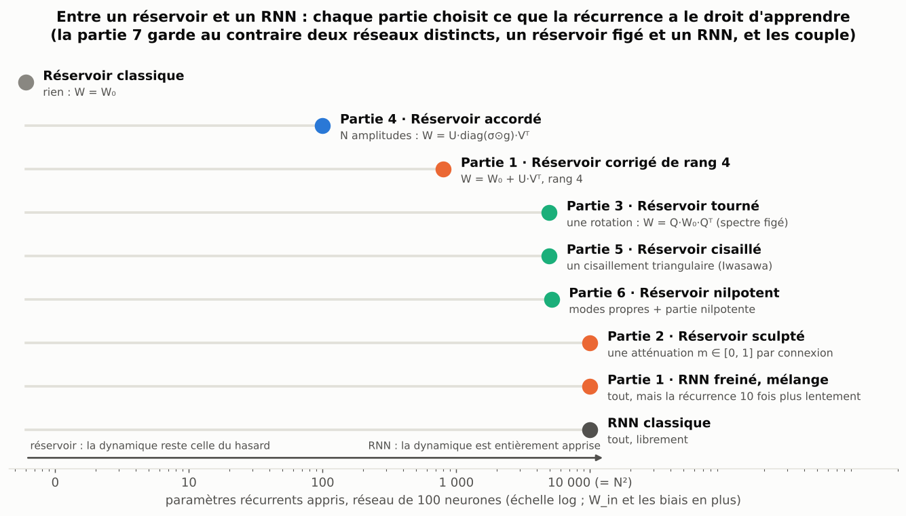
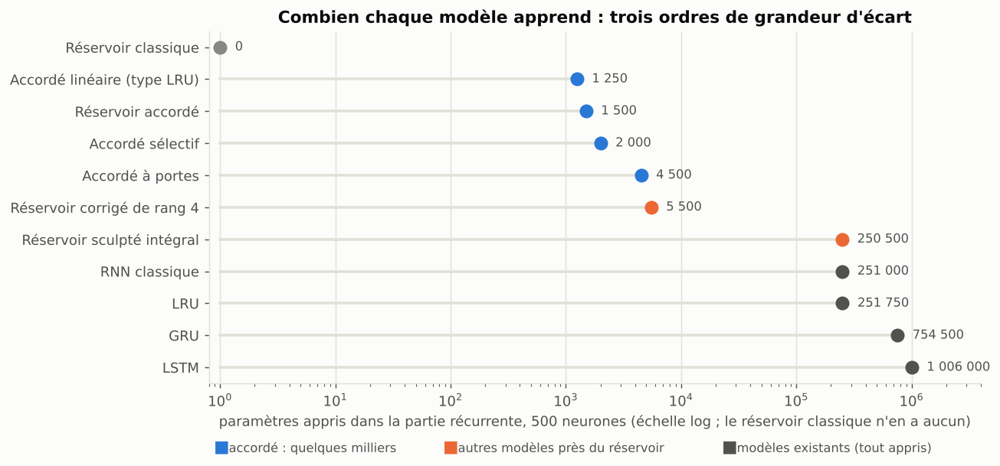

# partially-frozen-rnn

*Entre un réservoir et un RNN : partir d'une récurrence aléatoire figée, et n'apprendre qu'une pièce choisie.*

[](.github/workflows/tests.yml)

Un **réservoir** (Echo State Network) tire sa matrice récurrente au hasard et n'apprend que sa lecture. Un **RNN** apprend
tout. Ce dépôt étudie ce qu'il y a entre les deux. Chaque partie fixe ce que la récurrence a le droit d'apprendre (une
vitesse, une atténuation par connexion, une rotation, une amplitude par direction, un cisaillement, une partie nilpotente),
mesure ce que ça vaut avec des graines appariées, dit sur quelles tâches ça marche, et relie le résultat à la théorie et à la
littérature.



## En bref

> **En une phrase : la facilité d'apprentissage bat la géométrie de la cible, même quand la solution exacte est dans la
> famille.** Là où le réservoir cisaillé en bande gagne, le même nombre de coefficients appris au hasard fait aussi bien
> (partie 5.5) ; aucun choix de directions, même dicté par le gradient, ne bat le hasard à dimension égale (partie 9.5) ; et
> quand une structure est plantée dans la tâche, l'élève qui contient exactement la solution ne gagne nettement dans aucun
> cas : ce sont des bandes de quelques centaines de coefficients qui gagnent (partie 9.7, à 100 neurones).

- **Rester entre les deux bat le RNN qui apprend tout** sur des séries synthétiques, à presque toutes les tailles de 100 à
  2 000 neurones, mais chaque famille a ses tâches.

  

- **Mélanger, c'est freiner** (partie 1) : avec Adam, `(1−α)·W₀ + α·ΔW` revient à apprendre α fois plus lentement. La règle
  qui en sort, entrées libres et récurrence 10 fois plus lente, est très proche de la prescription μP.
- **Le réservoir sculpté** (partie 2), qui n'apprend qu'une atténuation entre 0 et 1 par connexion, est le meilleur modèle de
  l'étude sur la mémoire, à toutes les tailles ; c'est la borne qui compte.
- **Le réservoir tourné** (partie 3) garde le spectre et n'apprend que l'orientation : utile en prédiction chaotique, inutile
  pour la mémoire.
- **Le réservoir accordé** (partie 4) n'apprend qu'une amplitude par direction singulière : avec 1 500 paramètres à 500
  neurones, il fait mieux que le GRU sur Mackey-Glass (1,8 fois) et que le LRU sur NARMA10 (1,7 fois) avec le même budget de
  recherche. **Mais sur ces séries, le gain vient surtout des biais et des entrées** : bien réglé, un réservoir dont seuls les
  biais et `W_in` apprennent égale l'accordé sauf sur NARMA10, et les amplitudes nuisent sur Lorenz et Hénon. Sur les systèmes
  réels, au contraire, les amplitudes sont indispensables. Le LRU bien réglé gagne sur la mémoire.
- **Les réservoirs cisaillé et nilpotent** (parties 5 et 6) apprennent un facteur de la décomposition d'Iwasawa ou de
  Jordan-Chevalley. Pleins, ils sur-apprennent. **En bande** (quelques milliers de paramètres), le cisaillé bat l'accordé sur les
  cinq tâches synthétiques avec un seul réglage, tient sur des séries régénérées, fait mieux que le GRU sur Silverbox et, avec
  le même budget de recherche, que le GRU sur Mackey-Glass et le LRU sur NARMA10. **Mais des contrôles montrent que ce n'est pas
  le cisaillement** : le même nombre de coefficients appris au hasard, même directement dans `W₀`, fait aussi bien. Le GRU garde
  Lorenz et Hénon.
- **Coupler un réservoir figé et un RNN** (partie 7) : un relais aléatoire dans la transition bat le GRU sur Hénon, mais un
  relais entièrement appris fait aussi bien ; c'est la profondeur qui compte.
- **Au-delà du synthétique** (partie 8) : mieux que le GRU sur un système physique réel (Silverbox) avec 127 fois
  moins de paramètres, nette défaite sur un autre (Wiener-Hammerstein), aucun gain en classification. Les mécanismes en jeu sont, pour
  l'essentiel, déjà connus (μP, supermasks, adaptation par valeurs singulières, plasticité intrinsèque, LottaLoRA, nnRNN) ;
  ce qui reste propre à ce travail est étroit.
- **La tâche peut-elle choisir sa structure ?** (partie 9) : non, pas à partir du gradient. Projeté sur l'espace tangent
  de chaque structure, il ne dit pas laquelle apprendre mieux que leur taille, ni au départ ni en cours d'entraînement ; il
  ne désigne pas non plus de sous-espace, y compris par une décomposition de Lie apprise sur la tâche (PCA du tangent `M⁻¹G`).
  Même sur des tâches où une structure est plantée et atteignable, ni le gradient ni l'entraînement ne la retrouvent : à
  budget égal, ce sont les bandes qui gagnent. Deux indices prometteurs ont été vérifiés sur des graines neuves, et
  sont tombés. La facilité d'apprentissage bat la géométrie de la cible, même
  quand la solution exacte est dans la famille.

## Le rapport

| | Partie | Ce que la récurrence apprend | Schéma |
|---|---|---|---|
| 0 | [Introduction](rapport/0_introduction.md) | la question, les notations, le protocole | [principe](results/figures/schema_principe.png) |
| 1 | [Mélanger, c'est freiner](rapport/1_melanger.md) | tout, lentement ; retouché, corrigé de rang r | [schéma](results/figures/schema_partie1_freine.png) |
| 2 | [Le réservoir sculpté](rapport/2_sculpte.md) | une atténuation entre 0 et 1 par connexion | [schéma](results/figures/schema_sculpte.png) |
| 3 | [Le réservoir tourné](rapport/3_tourne.md) | une rotation, spectre figé | [schéma](results/figures/schema_tourne.png) |
| 4 | [Le réservoir accordé](rapport/4_accorde.md) | une amplitude par direction ; qui apprend quoi ; portes, linéaire, taille, plusieurs tâches, budget égal | [schéma](results/figures/schema_accorde.png) |
| 5 | [Le réservoir cisaillé](rapport/5_cisaille.md) | un cisaillement triangulaire (Iwasawa) | [schéma](results/figures/schema_cisaille.png) |
| 6 | [Le réservoir nilpotent](rapport/6_nilpotent.md) | modes propres et partie nilpotente (Jordan-Chevalley) | [schéma](results/figures/schema_nilpotent.png) |
| 7 | [Coupler un réservoir et un RNN](rapport/7_couplage.md) | deux réseaux distincts : duos, relais, readout carré | [schéma](results/figures/schema_couplage.png) |
| 8 | [Synthèse](rapport/8_synthese.md) | toutes les familles, modèles existants, données non synthétiques, position par rapport à l'existant | [figure](results/figures/recherche_equitable.png) |
| 9 | [La tâche peut-elle choisir sa structure ?](rapport/9_structure.md) | le gradient dit-il quelle structure ou quel sous-espace apprendre ? même quand la structure est plantée dans la tâche ? | [figure](results/figures/enseignants.png) |
| | [Annexe : mesures en attente et pistes](rapport/annexe_pistes.md) · [Références](rapport/references.md) · [Reproduire](rapport/reproduire.md) · [Fausses pistes](fausses_pistes/README.md) | | |

Chaque partie sur un réservoir commence par son schéma et par « ce qu'il faut retenir », et se termine par le même bilan :
où ça marche, les limites, le lien avec la théorie.



## Reproduire

```bash
pip install -e ".[dev]"     # numpy, scipy, matplotlib, pytest ; ".[dev,gpu]" pour PyTorch
pytest                      # quelques minutes
python experiments/38_schemas.py            # tous les schémas pédagogiques, en quelques secondes
python experiments/42_figures_rapport.py    # les figures de synthèse, à partir des résultats enregistrés
```

Les calculs à 500 neurones et plus tournent sur GPU ; les mesures encore en attente sont dans
[`notebooks/colab_gpu.ipynb`](notebooks/colab_gpu.ipynb). La liste des scripts, partie par partie, est dans
[rapport/reproduire.md](rapport/reproduire.md).

## Organisation du dépôt

```
partially-frozen-rnn/
├── README.md            # cette page
├── rapport/             # le rapport, un fichier par partie
├── src/hfrnn/           # le code : réservoirs, modèles (numpy et PyTorch), tâches
├── experiments/         # un script par expérience, cités dans le rapport
├── notebooks/           # le carnet Colab des mesures en attente
├── results/             # figures (dont les schémas) et données
├── tests/               # vérifications (gradients, numpy = PyTorch, chaque modèle)
└── fausses_pistes/      # essais abandonnés, et pourquoi
```
