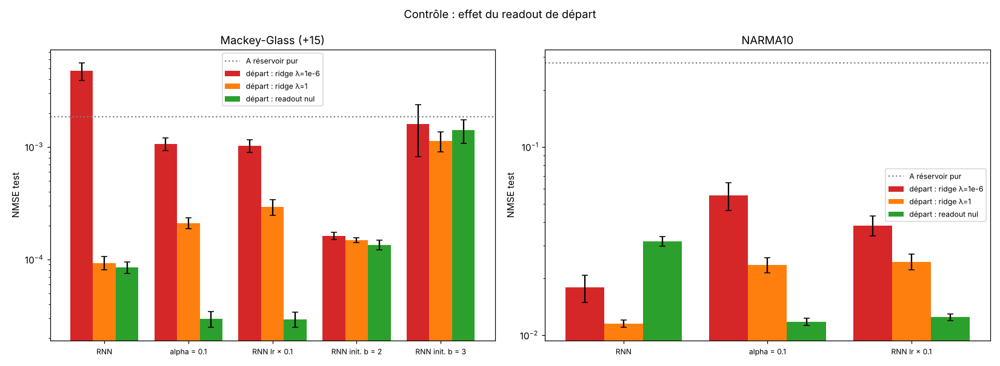
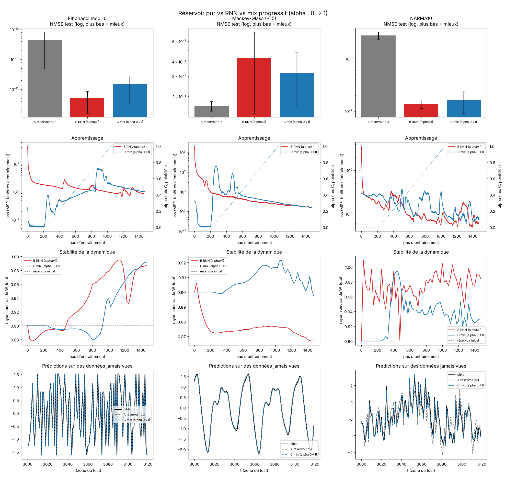
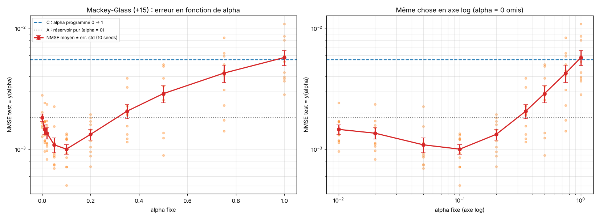
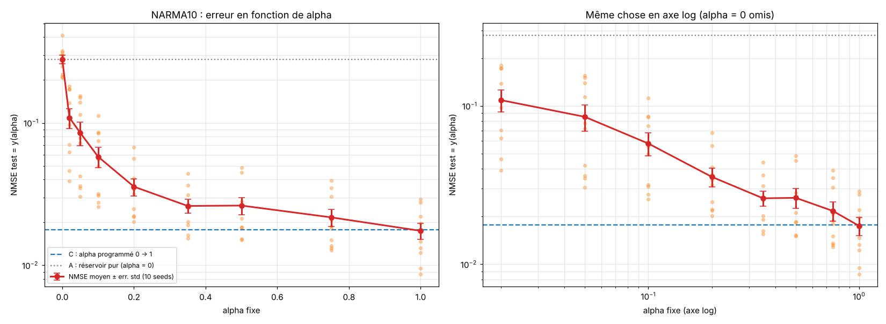
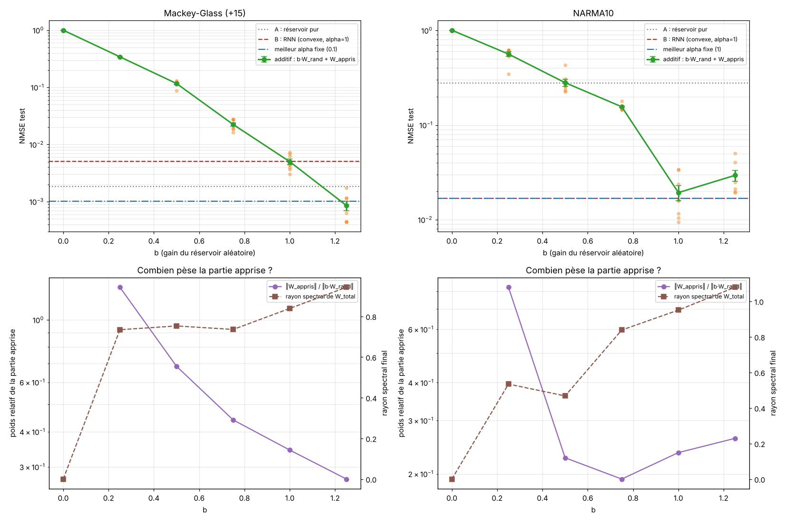
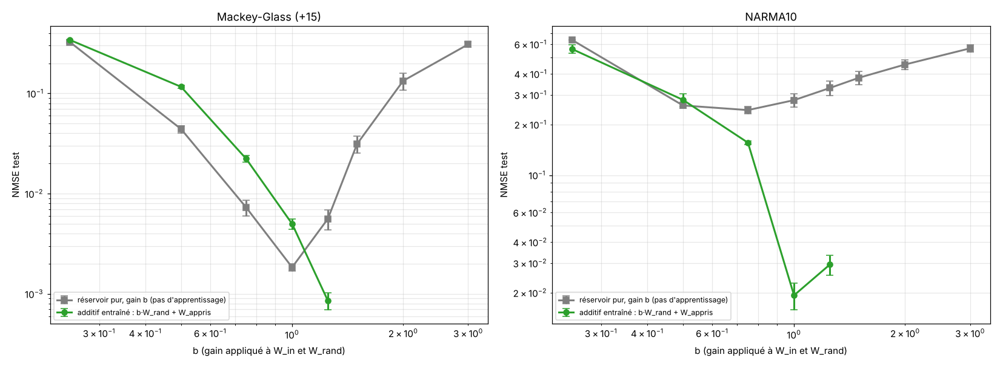
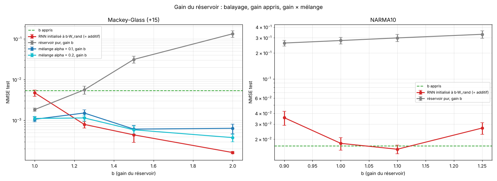
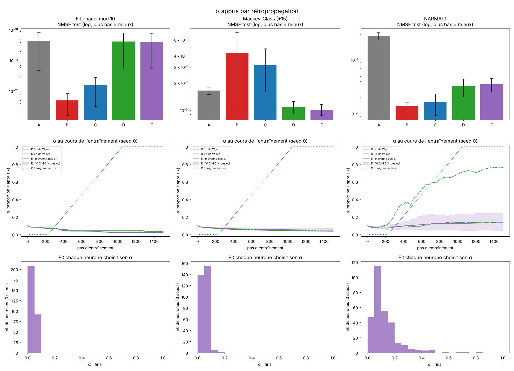
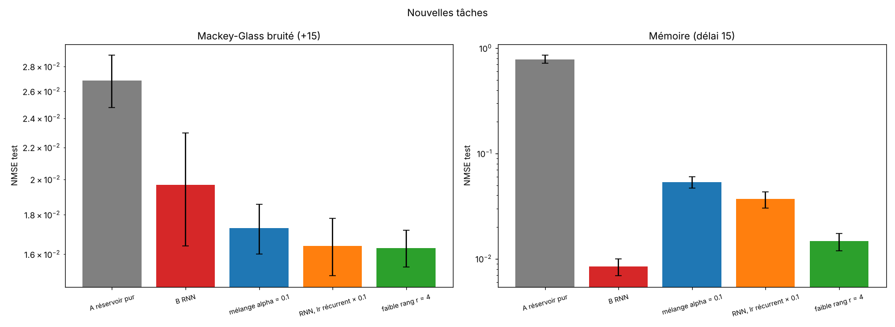

# Fausses pistes

Ce dossier garde les essais qui ont mené à des conclusions trompeuses, avec la raison.
Rien ici n'est utilisé par les résultats du [README principal](../README.md).

## 1. Readout de départ ajusté par ridge

Dans les premiers essais, le readout de départ était ajusté par régression ridge (λ = 1e-6) sur les états du
réservoir, avant l'entraînement. Sur Mackey-Glass, ses poids étaient énormes (norme ≈ 400). Le moindre changement
des poids récurrents faisait alors exploser les prédictions : la loss d'entraînement du RNN passait de 0.01 à plus
de 100 dans les premiers pas.

Conséquences trompeuses :

- le RNN paraissait **moins bon que le réservoir classique** sur Mackey-Glass (0.0047 contre 0.0018) ;
- un petit α ou un « grand gain » du réservoir paraissaient très efficaces, surtout parce qu'ils évitaient
  cette explosion (avec un gain b = 2, le readout de départ est 100 fois plus petit).

Avec un readout de départ nul, le RNN fait 0.00008 sur Mackey-Glass, 20 fois mieux que le réservoir.

## 2. Le modèle « additif » `b·W₀ + ΔW`

Avec `ΔW` nul au départ, ce modèle suit **exactement la même trajectoire** qu'un RNN classique initialisé à
`b·W₀` (même point de départ, même gradient). Ce n'est donc pas un nouveau modèle, juste un RNN avec un autre
gain initial. Ses bons scores pour b > 1 venaient du problème n° 1. Avec le bon protocole, un gain initial de 1.5
ou 2 n'aide plus.

## 3. Gain du réservoir appris

Apprendre `b` par gradient faisait s'effondrer le modèle (`b_in` → 0.02). Le gradient de `b` est une somme sur
toutes les connexions : il dominait la norme globale du gradient, et le clipping écrasait alors les mises à jour de
tous les autres paramètres. Une fois `b` sorti du clipping, il reste ≈ 1 et le modèle se comporte comme un RNN.

## 4. Mélange programmé et mélange réglé (premier protocole)

Une rampe α : 0 → 1 pendant l'entraînement ne fait pas mieux qu'un RNN. Avec le premier protocole (problème n° 1),
le mélange réglé (α appris) paraissait médiocre et semblait toujours dériver vers le bas ; avec le bon protocole, c'est l'un des
meilleurs modèles (voir README principal).

## 5. Mackey-Glass avec bruit d'entrée

Aucun écart significatif entre les modèles entraînés (5 seeds). Tâche abandonnée.

