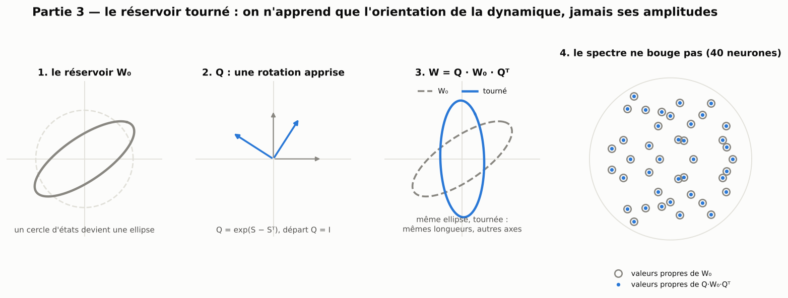
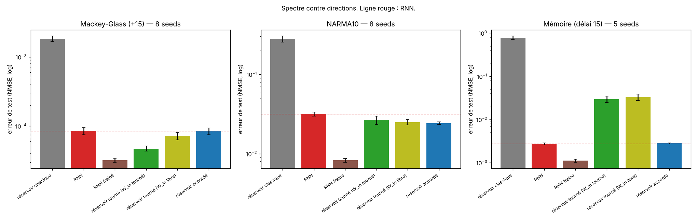

[Sommaire](../README.md#le-rapport) · [← Partie 2](2_sculpte.md) · [Partie 4 →](4_accorde.md)

# Partie 3 — Le réservoir tourné : n'apprendre que l'orientation



> **Ce qu'il faut retenir**
>
> - On garde exactement le spectre du réservoir (valeurs propres et valeurs singulières) et on n'apprend qu'une rotation `W = Q·W₀·Qᵀ`.
> - Ça aide les tâches de prédiction chaotique (Mackey-Glass, et surtout Hénon) mais **échoue sur la mémoire** (10 fois moins bien que le RNN) et sur MNIST : sans pouvoir changer ses amplitudes, le réseau ne peut pas allonger sa mémoire.
> - C'est la moitié « directions » d'une question dont la partie 4 étudie la moitié « amplitudes ».

La qualité d'un réservoir vient-elle de son **spectre** (les valeurs propres et singulières, qui fixent la stabilité et
l'amplification) ou de ses **directions** (l'orientation de la dynamique dans l'espace des neurones) ? Pour le savoir, on
fige l'un et on apprend l'autre. Le réservoir tourné fige le spectre :

```
W = Q · W₀ · Qᵀ,     Q = exp(S − Sᵀ) orthogonale,  départ Q = I
```

`Q·W₀·Qᵀ` a exactement les mêmes valeurs propres et les mêmes valeurs singulières que `W₀`. Deux variantes : les entrées
tournent avec la récurrence (`W_in ← Q·W_in`), ou restent libres.

## 3.1 À 100 neurones : un gain en prédiction, un échec en mémoire

Écart apparié au RNN (learning rate standard), 8 graines (5 pour la mémoire) :

| | Mackey-Glass | NARMA10 | Mémoire |
|---|---|---|---|
| RNN | 0.000085 | 0.0316 | 0.0027 |
| Partie 1 : RNN freiné | 0.000032 | 0.0082 | 0.0011 |
| **Réservoir tourné** (entrées tournées avec `Q`) | **0.000047** (−0,24 ± 0,05) | 0.0266 (−0,09 ± 0,06) | 0.0297 (**+1,01** ± 0,08) |
| Réservoir tourné (entrées libres) | 0.000072 (−0,07 ± 0,08) | 0.0250 (−0,10 ± 0,05) | 0.0329 (+1,06 ± 0,08) |
| Partie 4 : réservoir accordé (amplitudes seules) | 0.000084 (0,00 ± 0,09) | 0.0242 (−0,11 ± 0,04) | **0.0028** (+0,02 ± 0,03) |



- **Mémoire** : garder le spectre et n'apprendre que l'orientation échoue (11 fois moins bien que le RNN), alors qu'apprendre
  seulement les amplitudes (accordé) égale le RNN. Pour se souvenir, il faut changer l'amplification.
- **Mackey-Glass** : c'est l'inverse. Réorienter la dynamique bat le RNN de 1,8 fois ; changer seulement les amplitudes
  n'apporte rien.
- **NARMA10** : les deux font un peu mieux que le RNN, sans différence entre eux.

## 3.2 Sur les systèmes chaotiques faits de produits

Sur cinq tâches à 100 neurones (3 graines, PyTorch), facteur d'erreur par rapport au réservoir accordé (×2 = deux fois
moins d'erreur) et au RNN :

| Réservoir tourné | Mackey-Glass | NARMA10 | Mémoire | Lorenz | Hénon |
|---|---|---|---|---|---|
| contre le réservoir accordé | ×1,3 | ×1,0 | **÷9,3** | ×1,7 | **×2,8** |
| contre le RNN | ×1,8 | ×1,2 | ÷10 | ÷2,7 | **×4,4** |

Sur Hénon (une application quadratique), réorienter la dynamique paie nettement : c'est le meilleur des modèles non
couplés à 100 neurones sur cette tâche. Sur Lorenz, il reste derrière le RNN.

## 3.3 Vu de l'intérieur : la mémoire la plus courte

La capacité mémoire (Jaeger, 2002 ; partie 4.3 pour le détail de la mesure) : à 100 neurones, entraîné sur la tâche de
mémoire, le réservoir tourné garde la mémoire la plus courte de tous les modèles (19,5, contre 22,5 pour le RNN et 31 pour
l'accordé) et presque aucune capacité non linéaire (0,6). Entraîné sur Mackey-Glass, il a au contraire la plus longue
mémoire des modèles entraînés (11,2, presque celle du réservoir de départ, 12,1) : il ne la sacrifie pas pour calculer. Sans pouvoir changer son spectre, il ne peut pas allonger sa mémoire : c'est son échec du tableau 3.1, vu
de l'intérieur.

## 3.4 Plus grand, et sur des données non synthétiques

- **500 neurones** (3 graines, Mackey-Glass et NARMA10) : il bat le meilleur RNN (6,6 et 2,4 fois), mais c'est le moins bon
  des modèles contraints à cette taille.
- **MNIST ligne par ligne** (256 neurones) : 11,65 % d'erreur, contre 4,4 % pour le RNN et 5,1 % pour l'accordé. Réorienter
  la dynamique sans changer ses amplitudes ne suffit pas à construire des représentations.
- **Quelques rotations seulement.** Ajouter 32 rotations apprises entre paires de directions à un réservoir accordé
  (partie 4.4) ne change rien (écarts de 0,03 au plus) : un peu d'orientation à très faible coût n'aide pas.

## 3.5 Bilan de la partie 3

**Où ça marche.** La prédiction de systèmes chaotiques : Mackey-Glass (1,8 fois mieux que le RNN à 100 neurones) et
surtout Hénon (4,4 fois mieux que le RNN, 2,8 fois mieux que l'accordé).

**Les limites.**
- Échec sur la mémoire (10 fois moins bien que le RNN) et sur MNIST.
- La rotation coûte une exponentielle de matrice à chaque pas d'apprentissage (O(N³)), ce qui limite la taille testable ;
  elle apprend N(N−1)/2 paramètres, sans être plus économe qu'un RNN.
- Pas de mesure sur les systèmes physiques réels.

**Le lien avec la théorie.**
- *Pourquoi la mémoire ne peut pas venir d'une rotation.* Si les entrées tournent avec la récurrence, un réseau **linéaire**
  `x ← Q·W₀·Qᵀ·x + Q·W_in·u` est exactement le réseau `W₀` vu dans une autre base (`x' = Qᵀ·x`) : un readout linéaire
  retrouve les mêmes informations. La rotation ne change donc rien à ce qu'un régime presque linéaire peut retenir ; elle
  n'agit que par la non-linéarité, appliquée coordonnée par coordonnée, qui n'est pas invariante par rotation. La mémoire
  linéaire, elle, est fixée par le spectre et l'alignement des entrées (Jaeger, 2002 ; Ganguli et al., 2008). C'est cohérent
  avec l'échec sur la mémoire et le gain sur des tâches où la non-linéarité est le cœur du problème (Hénon).
- *RNN orthogonaux et unitaires.* Paramétrer une rotation par l'exponentielle d'une matrice antisymétrique est la méthode
  des RNN orthogonaux ([Lezcano-Casado et Martínez-Rubio, 2019](https://arxiv.org/abs/1901.08428) ; Mhammedi et al., 2017 ;
  RNN unitaires, [Arjovsky et al., 2016](https://arxiv.org/abs/1511.06464)). Ici, la rotation n'est pas la récurrence
  elle-même : elle sert de changement de base autour d'un réservoir dont le spectre est figé. La dissociation « spectre pour
  la mémoire, orientation pour la prédiction », mesurée en figeant l'un ou l'autre sur un même réservoir, ne semble pas
  avoir été testée telle quelle.

---

[Sommaire](../README.md#le-rapport) · [← Partie 2](2_sculpte.md) · [Partie 4 →](4_accorde.md)
