[Sommaire](../README.md#le-rapport) · [← Partie 3](3_tourne.md) · [Partie 5 →](5_cisaille.md)

# Partie 4 — Le réservoir accordé : n'apprendre qu'une amplitude par direction

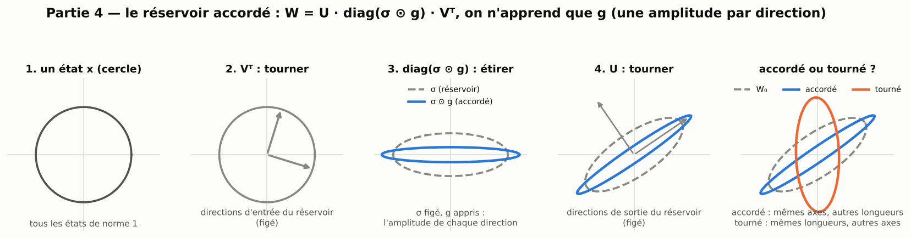

> **Ce qu'il faut retenir**
>
> - On garde les directions singulières aléatoires du réservoir (`W₀ = U·diag(σ)·Vᵀ`) et on n'apprend que l'amplitude de chacune : `W = U·diag(σ ⊙ g)·Vᵀ`, avec `W_in` et les biais. À 500 neurones, 1 500 paramètres appris suffisent pour battre largement le RNN, et faire mieux que le GRU et le LRU sur Mackey-Glass et NARMA10 dans une recherche équitable.
> - **Sur les séries synthétiques, le gain vient surtout des biais et des entrées, pas des amplitudes.** Les amplitudes g seules valent à peine le réservoir classique ; un réservoir dont seuls les biais et `W_in` apprennent fait l'essentiel du travail, et, avec le même budget de recherche, égale l'accordé sur Mackey-Glass et la mémoire. g n'est nettement utile que sur NARMA10 (2 fois), et **nuit** sur Lorenz et Hénon.
> - **Sur les systèmes physiques réels, c'est l'inverse** : sans g, l'erreur est 1,7 à 3 fois plus grande sur Silverbox et Wiener-Hammerstein. Les amplitudes y font l'essentiel de l'avantage de l'accordé.
> - Les extensions (portes, récurrence linéaire, réglages par tâche, correction de rang r) donnent des gains ciblés ; la plus nette est l'accordé linéaire, qui égale le LRU complet avec 200 fois moins de paramètres.

Une matrice tourne, étire, puis tourne encore : c'est sa décomposition en valeurs singulières. Le réservoir accordé garde
les deux rotations du hasard et n'apprend que l'étirement de chaque direction. C'est la moitié « amplitudes » de la question
de la partie 3, qui figeait au contraire les amplitudes pour n'apprendre que les directions.

```
x(t+1) = tanh( W_in·u(t) + U·diag(σ ⊙ g)·Vᵀ·x(t) + b )        appris : g (N valeurs), W_in, b
```

## 4.1 Le modèle, et ce qu'il vaut

**À 100 neurones**, il ne fait qu'égaler le RNN (tableau 3.1 : écarts 0,00, −0,11, +0,02). **À 500 neurones**, il devient
le meilleur modèle de l'étude sur Mackey-Glass et l'un des deux meilleurs sur NARMA10 (3 graines, contre le meilleur de
quatre learning rates du RNN) :

| N = 500 | Mackey-Glass | × moins d'erreur que le RNN | NARMA10 | × moins d'erreur que le RNN |
|---|---|---|---|---|
| Réservoir classique | 1.3e-5 | 0,1 | 0.241 | 0,4 |
| Meilleur RNN | 1.1e-6 | référence | 0.0945 | référence |
| Partie 1 : RNN freiné | 1.9e-7 | 6,1 | 0.0315 | 3,0 |
| Partie 1 : réservoir corrigé de rang 4 | 8.4e-8 | 13 | **0.0101** | **9,3** |
| Partie 2 : réservoir sculpté intégral | 8.7e-8 | 13 | 0.0173 | 5,3 |
| Partie 3 : réservoir tourné | 1.7e-7 | 6,6 | 0.0383 | 2,4 |
| **Réservoir accordé** | **7.5e-8** | **15** | 0.0102 | 9,1 |

Il n'apprend que 500 amplitudes sur les directions de `W₀` (plus `W_in` et `b`, 1 500 paramètres en tout), contre 250 000
poids récurrents pour le RNN. À protocole identique (500 neurones, 1 500 pas), ses variantes forment à elles seules le front
erreur/paramètres sur les trois tâches principales ; la seule exception est le sculpté intégral sur la mémoire.

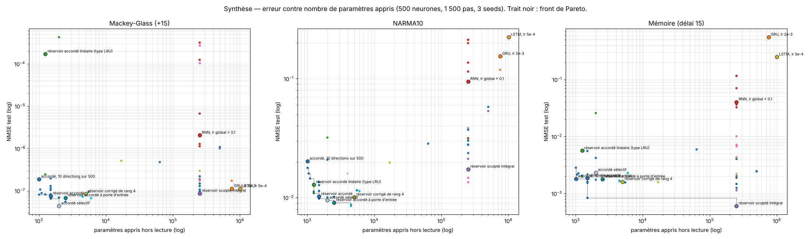

Face aux GRU, LSTM et LRU, avec le même budget de recherche pour tous (partie 8.2), il fait 1,8 fois mieux que le meilleur
modèle existant sur Mackey-Glass et 1,7 fois sur NARMA10, mais le LRU bien réglé le bat sur la mémoire (6 fois).

## 4.2 D'où vient le gain ?

C'est la question centrale de cette partie, et la réponse corrige la lecture naïve du modèle.

**Qui apprend quoi.** Dans l'accordé, trois choses apprennent : les amplitudes `g`, les biais `b` et les entrées `W_in`.
On les active une par une, puis par paires, à 200 neurones (3 graines). Les trois lignes « sans g » gardent exactement la
récurrence du réservoir (`W = W₀`).

| Ce qui est appris (paramètres) | Mackey-Glass | NARMA10 | Mémoire | Lorenz | Hénon |
|---|---|---|---|---|---|
| *rien : réservoir classique (0)* | 1.6e-4 | 0.26 | 0.52 | 1.5e-3 | 0.59 |
| g seules (200) | 9.6e-5 | 0.22 | 0.105 | 9.3e-4 | 0.77 |
| biais seuls, sans g (200) | 2.2e-5 | 0.167 | 0.518 | 4.2e-4 | 0.535 |
| W_in seules, sans g (200) | 7.4e-5 | 0.178 | 0.0061 | 1.7e-4 | 0.056 |
| **biais + W_in, sans g (400)** | 5.4e-6 | 0.048 | 0.0068 | **2.7e-5** | **0.027** |
| g + biais (400) | 6.7e-6 | 0.038 | 0.110 | 2.6e-4 | 0.79 |
| g + W_in (400) | 4.1e-5 | 0.21 | **0.0013** | 3.2e-3 | 0.086 |
| **g + biais + W_in : l'accordé (600)** | **3.6e-6** | **0.0156** | 0.0018 | 2.4e-4 | 0.057 |

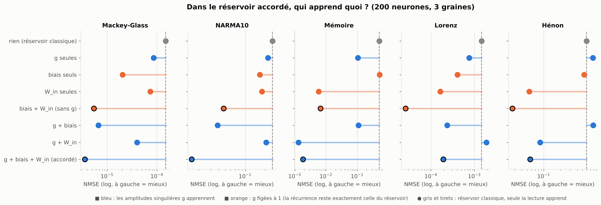

- **Les amplitudes g seules ne valent presque rien.** Elles ne font pas mieux que le réservoir classique sur NARMA10 (0,22
  contre 0,26) et font **pire** sur Hénon (0,77 contre 0,59) ; le gain est de 1,6 fois sur Mackey-Glass et Lorenz, 5 fois
  sur la mémoire.
- **Biais et entrées, sans g, font l'essentiel.** Avec la récurrence strictement aléatoire, apprendre les biais et `W_in`
  divise l'erreur par 30 sur Mackey-Glass, 5 sur NARMA10, 75 sur la mémoire, 55 sur Lorenz et 22 sur Hénon.
- **Lequel des deux compte dépend de la tâche** : le biais sur Mackey-Glass, NARMA10 et Lorenz ; les entrées sur la
  mémoire (80 fois) et Hénon (9 fois).
- **Ce que g ajoute change de signe selon la tâche.** Par rapport à « biais + W_in », g aide sur NARMA10 (3 fois), la mémoire
  (3,7 fois) et un peu Mackey-Glass (1,5 fois), mais **nuit** sur Lorenz (9 fois) et Hénon (2 fois) : sur ces deux tâches,
  le modèle sans g, avec 400 paramètres, fait mieux que l'accordé complet à 500 neurones.

**Avec le même budget de recherche.** Le tableau ci-dessus garde les réglages par défaut. À 500 neurones, avec la recherche
équitable de la partie 8.2 (12 essais sur validation, 5 graines), le réservoir à biais et entrées appris (1 000 paramètres)
fait **aussi bien que l'accordé sur Mackey-Glass** (6,4e-8 contre 7,0e-8, écart −0,04 ± 0,04) **et sur la mémoire** (7,5e-4
contre 6,5e-4, +0,06 ± 0,03), mais **2 fois moins bien sur NARMA10** (0,0156 contre 0,0080, +0,29 ± 0,04). Une fois chaque
modèle bien réglé, l'apport propre des amplitudes se réduit donc à NARMA10.

**Sur les systèmes physiques réels, en revanche, g compte.** Sur les trois systèmes de la partie 8.3 (500 neurones,
3 graines), le réservoir à biais et entrées appris fait nettement moins bien que l'accordé :

| RMSE de test | Silverbox, multisinus | Silverbox, flèche avec extrapolation | Silverbox, flèche sans extrapolation | Wiener-Hammerstein | Cascaded Tanks |
|---|---|---|---|---|---|
| Réservoir accordé (1 500 par.) | 4,25 mV | 9,93 mV | 4,03 mV | 11,8 mV | 1,69 V |
| Biais et entrées appris, sans g (1 000 par.) | 13,3 mV (×3,1) | 17,2 mV (×1,7) | 11,2 mV (×2,8) | 22,6 mV (×1,9) | 3,03 V (×1,8) |

Sur ces données, ce sont les amplitudes qui permettent à l'accordé d'égaler le GRU sur Silverbox ; un réservoir dont seuls les
biais et les entrées apprennent n'y suffit pas.

**Le même constat, vu par l'accordé tronqué.** On n'accorde que r directions sur 500 (r = 2, 10, 50), choisies parmi les
plus grandes valeurs singulières, les plus petites, ou au hasard ; `W_in`, les biais et le readout apprennent toujours.
Avec r = 2 plus petites directions (σ ≈ 0, donc une récurrence presque inchangée), on retrouve déjà **un tiers du gain de
l'accordé complet sur Mackey-Glass, 40 % sur NARMA10 et 100 % sur la mémoire**. Quelles directions accorder ne compte
presque pas : à r = 2 et 10, les plus grandes valent le hasard, et les plus petites ne sont que 1,2 fois moins bonnes.

| Directions accordées (500 neurones, 3 graines) | Mackey-Glass | NARMA10 | Mémoire |
|---|---|---|---|
| *Réservoir classique* | 1.3e-5 | 0.241 | 0.221 |
| *Meilleur RNN (251 000 paramètres)* | 1.1e-6 | 0.0945 | 0.0363 |
| **Accordé complet (500 directions)** | **7.5e-8** | **0.0102** | **0.00186** |
| r = 2 : plus grandes / plus petites / hasard | 1.9e-7 / 2.3e-7 / 2.1e-7 | 0.022 / 0.027 / 0.026 | 0.0019 / 0.0019 / 0.0019 |
| r = 10 : plus grandes / plus petites / hasard | 1.9e-7 / 2.3e-7 / 2.0e-7 | 0.020 / 0.027 / 0.024 | 0.0018 / 0.0019 / 0.0017 |
| r = 50 : plus grandes / plus petites / hasard | 1.1e-7 / 2.3e-7 / 1.9e-7 | 0.016 / 0.026 / 0.017 | 0.0021 / 0.0019 / 0.0016 |

Les plus petites directions sont un peu moins bonnes que les plus grandes (1,2 fois à r ≤ 10, 1,6 à 2,1 fois à r = 50, rien
sur la mémoire) ; les plus grandes ne battent pas le hasard à r = 2 et 10. À r = 10, les plus grandes redonnent les contrôles du
spectre ci-dessous (×0,40, ×0,50, ×1,03 contre ×0,41, ×0,50, ×1,04) : les deux expériences concordent.

**Les contrôles du spectre** (500 neurones, 3 graines ; facteur d'erreur par rapport à l'accordé, au-dessus de 1 = mieux) :

| | Mackey-Glass | NARMA10 | Mémoire |
|---|---|---|---|
| Directions de Fourier au lieu d'aléatoires | ×0,40 | ×0,95 | ×0,96 |
| *Réservoir de Fourier, non entraîné* | *×0,001* | *×0,05* | *×0,006* |
| Spectre de départ plat (toutes les σ égales) | ×0,95 | ×1,00 | **×1,21** |
| Spectre de départ étalé | ×0,39 | ×0,78 | ×0,34 |
| 100 / 50 / 10 directions accordées sur 500 | ×0,84 / ×0,70 / ×0,41 | ×0,71 / ×0,64 / ×0,50 | ×0,82 / ×0,87 / ×1,04 |
| Meilleur RNN | ×0,07 | ×0,11 | ×0,05 |

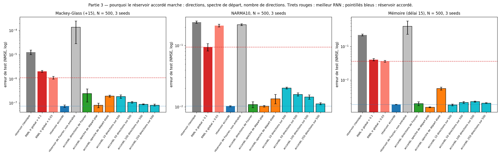

Les directions aléatoires ne sont pas indispensables (des directions de Fourier font aussi bien sur NARMA10 et la mémoire),
et le spectre de départ n'aide pas : un départ neutre (réservoir orthogonal mis à l'échelle) est même le meilleur sur la
mémoire. Lus avec le tableau « qui apprend quoi », ces contrôles disent la même chose : ce qui reste quand on retire
presque tout l'accordage de la récurrence, c'est un réservoir dont les biais et les entrées apprennent.

## 4.3 Ce que l'entraînement fait à la dynamique : la capacité mémoire

On fait passer un signal aléatoire u(t) dans le réseau entraîné et on demande à une lecture linéaire de retrouver u(t − k) :
la capacité au délai k vaut C_k = 1 − NMSE, et leur somme MC = Σ C_k est au plus N (Jaeger, 2002). On mesure aussi une
capacité non linéaire de degré 2 (Dambre et al., 2012) : retrouver des carrés et des produits d'entrées passées. 100 neurones,
3 graines, chaque modèle entraîné sur chacune des trois tâches.

| 100 neurones | entraîné sur Mackey-Glass : mémoire / non-linéaire | sur NARMA10 | sur la mémoire |
|---|---|---|---|
| Réservoir classique (non entraîné) | 12,1 / 0,0 | 12,1 / 0,0 | 12,1 / 0,0 |
| RNN | 5,9 / 4,3 | 12,9 / 26,7 | 22,5 / 6,4 |
| Partie 1 : RNN freiné | 9,0 / 21,0 | 14,0 / 45,1 | 26,4 / 8,3 |
| Partie 1 : réservoir corrigé de rang 4 | 8,3 / 18,0 | 14,8 / 43,1 | 28,3 / 5,3 |
| Partie 2 : réservoir sculpté intégral | 7,8 / 18,0 | 13,7 / **48,3** | 24,4 / 14,5 |
| Partie 3 : réservoir tourné | 11,2 / 21,0 | 13,8 / 21,6 | 19,5 / 0,6 |
| **Réservoir accordé** | 9,1 / 20,6 | 14,9 / 41,4 | **31,1** / 4,7 |

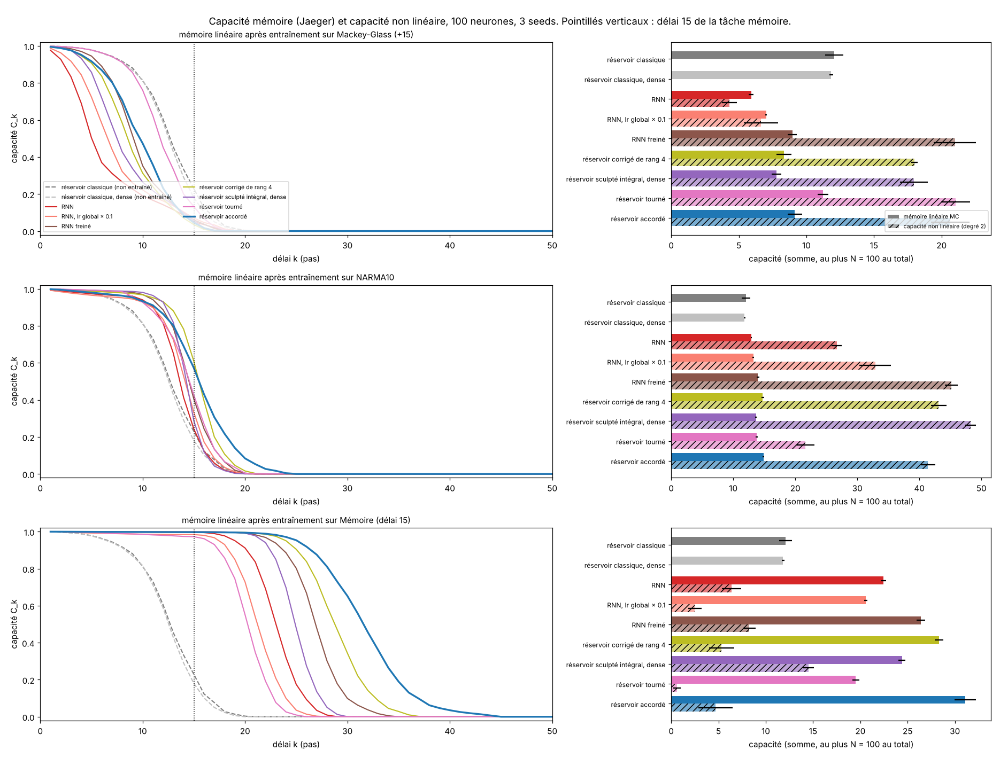

L'entraînement façonne la dynamique selon la tâche : entraîné sur la mémoire, chaque modèle allonge sa mémoire ; sur
NARMA10, il garde la même mémoire mais gagne beaucoup de capacité non linéaire ; sur Mackey-Glass, il sacrifie de la mémoire
pour du calcul. L'accordé obtient la plus longue mémoire de tous (31, contre 22 pour le RNN qui apprend ses 10 000 poids),
le tourné la plus courte (19,5).

## 4.4 Treize variantes, et les combinaisons

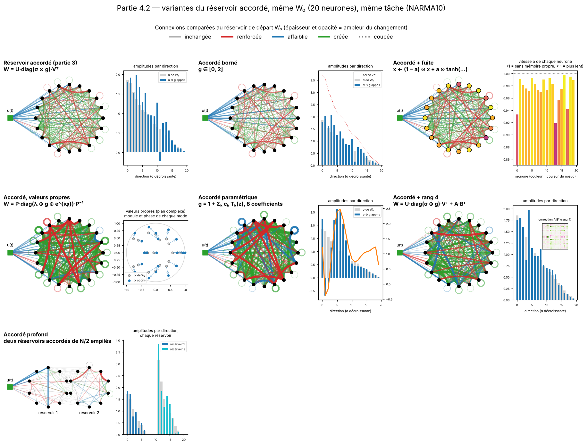

À 500 neurones (3 graines), NMSE et écart apparié au réservoir accordé (négatif = mieux ; en gras : mieux au-delà du bruit) :

| Variante | Ce qui change | Paramètres | Mackey-Glass | NARMA10 | Mémoire |
|---|---|---|---|---|---|
| **Réservoir accordé** | — | 1 500 | 7.4e-8 | 0.010 | 0.0019 |
| Accordé borné | `g ∈ [0, 2]` | 1 500 | +0,15 | +0,04 | −0,02 |
| Accordé + fuite | une vitesse apprise par neurone | 2 000 | −0,04 | −0,01 | −0,03 |
| Accordé, valeurs propres | module et phase de chaque mode propre | 2 000 | −0,03 | +0,31 | +0,35 |
| Accordé paramétrique | `g` = fonction lisse de 8 coefficients | 1 008 | +0,04 | +0,24 | +0,18 |
| Accordé + rang 4 | `+ A·Bᵀ` | 5 500 | +0,09 | +0,05 | **−0,08** |
| Accordé profond | deux accordés de N/2 empilés | 63 750 | +0,80 | +0,44 | +0,50 |
| **Accordé sélectif** | `g(t) = g + G·u(t)` | 2 000 | **−0,23** | −0,03 | +0,10 |
| Accordé + gains par neurone | `diag(d_L)·U·diag(σ⊙g)·Vᵀ·diag(d_R)` | 2 500 | **−0,13** | −0,01 | −0,02 |
| Accordé + pénalité | `λ·moyenne((g − 1)²)` | 1 500 | 0,00 | 0,00 | 0,00 |
| Accordé + 32 rotations | rotations entre paires de directions | 1 532 | −0,03 | +0,01 | −0,01 |
| *Contrôle : lr des amplitudes × 0,3 / × 3* | | 1 500 | +0,24 / −0,07 | +0,10 / +0,05 | **−0,07** / +0,01 |

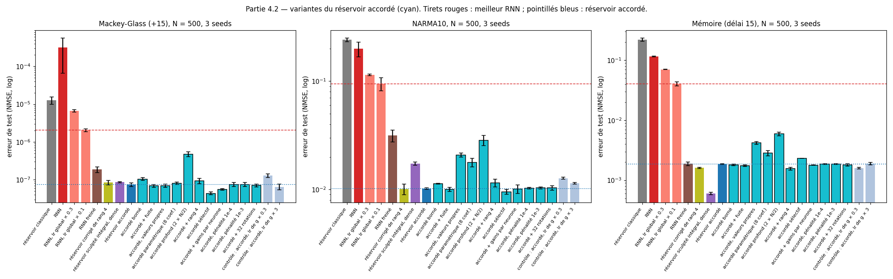

- **Aucune variante n'est un progrès net partout** ; l'accordé simple reste à moins de 1,7 fois de sa meilleure variante sur
  chaque tâche.
- **Deux gains réels mais ciblés** : l'accordé sélectif sur Mackey-Glass (1,7 fois), les gains par neurone sur Mackey-Glass
  (1,35 fois). L'accordé sélectif gagnait aussi sur NARMA10 à 200 neurones (1,5 fois), plus à 500.
- **Ce qui dessert** : accorder les valeurs propres au lieu des valeurs singulières (le même résultat revient en partie 6),
  réduire le profil à 8 coefficients, empiler deux demi-réservoirs.
- **Combiner les leviers des parties 1 et 2** (accordé + sculpté + freiné, à 100 et 500 neurones) n'apporte rien : aucune
  combinaison ne bat le meilleur modèle seul de chaque tâche, et ajouter le freinage dégrade toujours. Le seul gain notable
  vient du masque sur les entrées (accordé intégral : 2,2 fois mieux sur la mémoire à 500 neurones), ce qui annonçait déjà
  le rôle des entrées vu en 4.2.

## 4.5 Des portes accordées

Le GRU et le LSTM ajoutent des **portes**, au prix de trois ou quatre matrices N×N apprises. On refait ce chemin à partir de
l'accordé : on garde les portes, mais chaque matrice récurrente devient une matrice accordée, avec les directions aléatoires
figées du réservoir et un profil d'amplitudes par matrice.

| Modèle | Cellule | Paramètres (hors readout) |
|---|---|---|
| **Réservoir accordé à portes** | type GRU (`z`, `r`, `h̃`), avec `W, W_z, W_r` accordées | 9 N (contre 3 N² pour un GRU) |
| Réservoir accordé à portes légères | portes neurone par neurone | 9 N |
| Réservoir accordé à portes, type LSTM | portes `f, i, o` accordées | 12 N |
| **Réservoir accordé à porte d'entrée** | une seule porte, qui ne dépend que de l'entrée (comme minGRU) | 5 N |

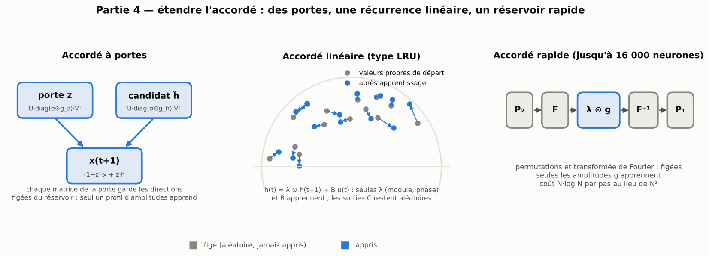

Toutes partent presque exactement du réservoir accordé (portes presque ouvertes au départ).

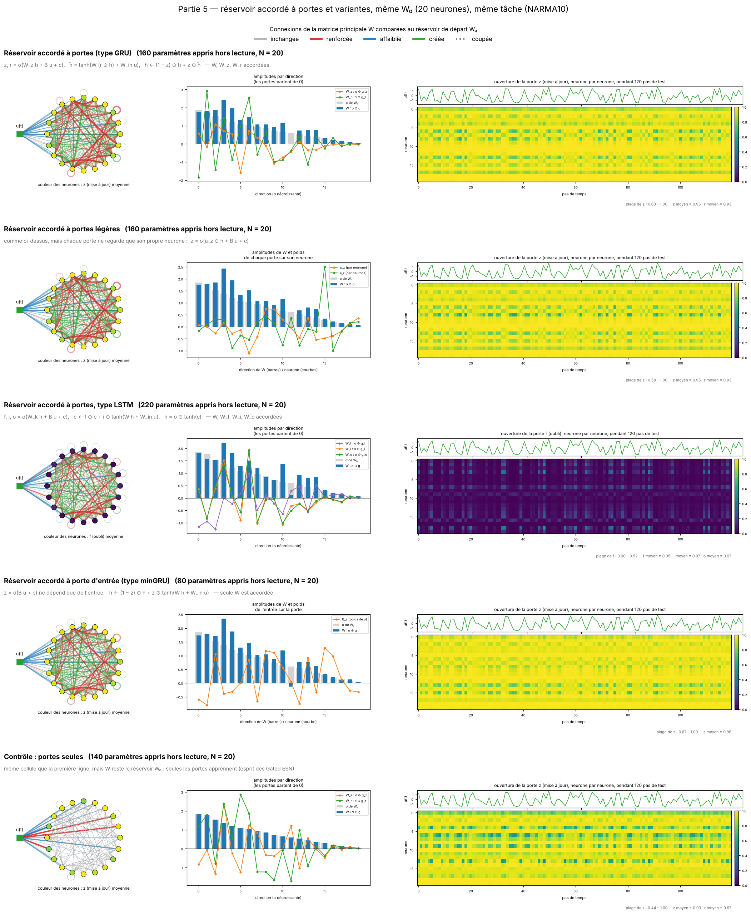

Les portes restent proches de leur départ mais bougent avec l'entrée : la porte de mise à jour reste en moyenne à 0,95,
et se ferme jusqu'à 0,6 sur quelques neurones, au rythme de u(t). Le LSTM accordé garde sa porte d'oubli presque fermée.

**À 500 neurones, 1 500 pas, 3 graines** (facteur d'erreur en moins par rapport à l'accordé) :

| N = 500 | Paramètres | Mackey-Glass | NARMA10 | Mémoire |
|---|---|---|---|---|
| Réservoir accordé (référence) | 1 500 | 7.5e-8 | 0.0102 | 0.00186 |
| Accordé sélectif | 2 000 | **×1,70** | ×1,07 | ×0,79 |
| **Réservoir accordé à portes** | 4 500 | ×1,02 | **×1,20** | **×1,15** |
| Réservoir accordé à porte d'entrée | 2 500 | ×1,10 | ×1,12 | ×1,05 |
| Réservoir accordé à portes, type LSTM | 6 000 | ×1,12 | ×0,89 | ×0,81 |
| Contrôle : portes seules (W = W₀ figée) | 4 000 | ×0,38 | ×0,65 | ×0,89 |

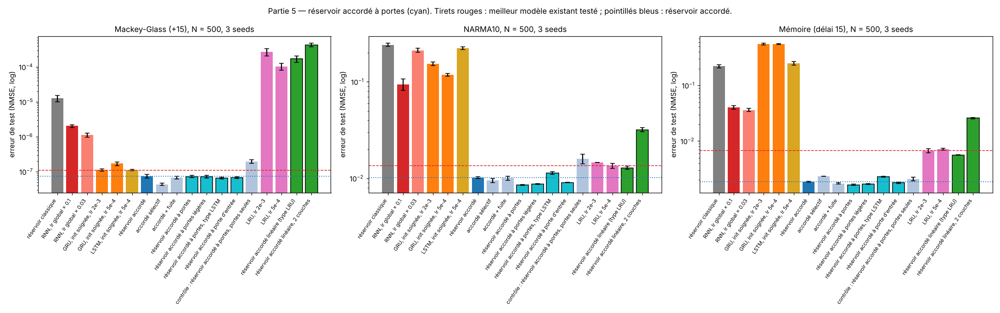

- Les portes améliorent l'accordé, mais peu (1,2 fois au mieux), et moins à 500 qu'à 200 neurones.
- **Entraîner seulement les portes ne suffit pas** : avec la matrice principale figée, le modèle fait 1,1 à 2,6 fois moins
  bien que l'accordé sans portes. C'est la différence avec les *Gated Echo State Networks*, où n'entraîner que les portes
  est efficace.
- **À 4 000 pas, face aux meilleurs modèles existants** (3 graines) : l'accordé sélectif fait 1,6 fois mieux que le GRU
  bien initialisé sur Mackey-Glass ; sur NARMA10 et la mémoire, les variantes à portes font au plus 12 % mieux que l'accordé
  simple. Sur douze tâches synthétiques (partie 8.3), les portes ne comptent que sur Hénon (1,8 fois) et le système de
  Wiener-Hammerstein (1,2 fois), et nuisent sur la mémoire à 30 pas.

## 4.6 L'accordé linéaire : le LRU complet avec 200 fois moins de paramètres

Le LRU (Orvieto et al., 2023) retire la non-linéarité de la récurrence : `h(t) = λ ⊙ h(t−1) + γ ⊙ B·u(t)`, puis
`GELU(Re(C·h) + D·u)`, et apprend λ, B, C et D (environ N² paramètres). L'**accordé linéaire** garde C et D tirés au hasard
et figés ; seules les valeurs propres λ, la normalisation γ et les entrées B apprennent.

| N = 500, 1 500 pas | Paramètres | Mackey-Glass | NARMA10 | Mémoire |
|---|---|---|---|---|
| LRU complet (meilleur de deux lr) | 251 750 | **1.0e-4** | 0.0135 | 0.0067 |
| **Réservoir accordé linéaire** | **1 250** | 1.7e-4 | **0.0129** | **0.0056** |
| Accordé linéaire, 2 couches | 2 000 | 4.3e-4 | 0.032 | 0.026 |
| *Réservoir accordé (non linéaire)* | 1 500 | *7.5e-8* | *0.0102* | *0.0019* |

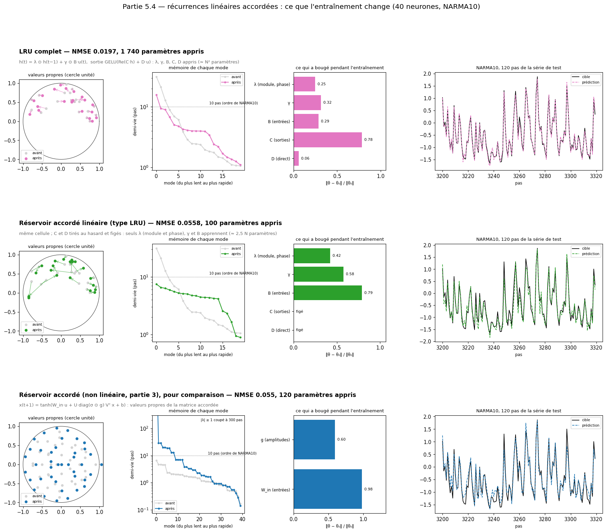

- **Il égale le LRU complet** avec 200 fois moins de paramètres (égalité sur NARMA10, 1,2 fois mieux sur la mémoire, 1,7 fois
  moins bien sur Mackey-Glass) : apprendre les matrices d'entrée et de sortie du LRU n'apporte presque rien sur ces tâches.
- Le LRU complet bouge surtout ses sorties C ; l'accordé linéaire, qui ne peut pas les toucher, déplace ses valeurs propres
  et **égalise la mémoire des modes** autour de l'horizon utile de la tâche.
- **Mais une récurrence linéaire est très en dessous d'un accordé non linéaire** sur ces séquences courtes (2 000 fois plus
  d'erreur sur Mackey-Glass), et une seconde couche aggrave tout.
- **Sur des séquences longues** (MNIST pixel par pixel, 784 pas, 128 neurones, 3 époques), le LRU gagne (28,3 % d'erreur),
  l'accordé linéaire est à 6 points avec 52 fois moins de paramètres (34,7 %), l'accordé non linéaire bat le GRU et le RNN
  (46,7 % contre 59,3 et 64,9 %). Sur l'archive UEA, l'accordé linéaire égale encore le LRU (83,0 % contre 83,4 % de
  précision moyenne, 11 fois moins de paramètres).

## 4.7 La taille : de 100 à 16 000 neurones

De 100 à 2 000 neurones (3 graines), contre le meilleur RNN, le rang 4 et le sculpté intégral :

| Accordé (meilleur des quatre modèles en gras) | N = 100 | 200 | 500 | 1 000 | 2 000 |
|---|---|---|---|---|---|
| Mackey-Glass | 8.8e-5 | **3.6e-6** | **7.4e-8** | 3.4e-8 | 3.4e-8 |
| NARMA10 | 0.023 | 0.016 | 0.0102 | **0.0105** | **0.017** |
| Mémoire | 0.0029 | 0.0018 | 0.0019 | 0.0020 | 0.0044 |

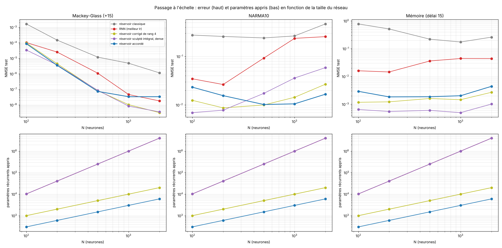

- **Chaque modèle a sa zone de taille.** Sur Mackey-Glass, l'accordé plafonne dès 1 000 neurones (3,4e-8), alors que le
  rang 4 et le sculpté continuent jusqu'à 3e-9 ; N amplitudes suffisent jusqu'à environ 500 neurones, pas au-delà. Sur
  NARMA10, c'est l'inverse : l'accordé devient le meilleur en grandissant, parce qu'il sur-apprend moins que les autres.
  Sur la mémoire, le sculpté est premier à toutes les tailles.
- **Le réservoir accordé rapide** remplace les directions aléatoires par des directions de Fourier (`W = P₁·F⁻¹·diag(λ ⊙ g)·F·P₂`),
  applicables en N·log N. Seize mille neurones s'entraînent en 2 min 30 avec 40 000 paramètres appris (un RNN de cette
  taille en aurait 256 millions), mais grossir n'améliore pas l'erreur sur ces tâches, limitées par leurs 3 000 points
  d'entraînement.

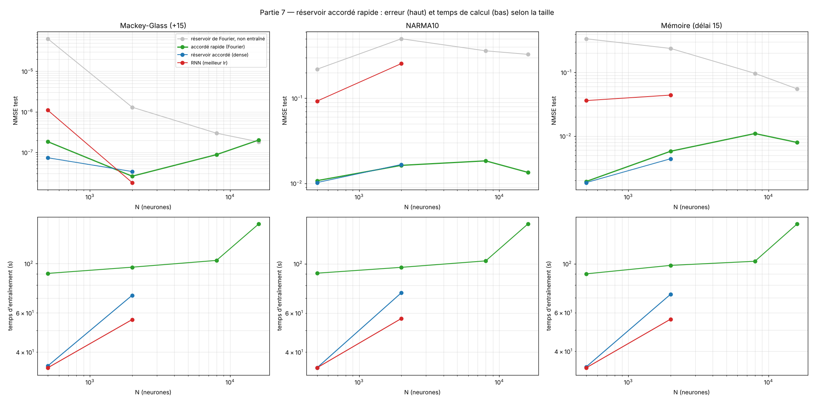

## 4.8 Un réservoir, plusieurs tâches

Le réservoir ne change jamais : on peut donc garder **un seul `W₀` pour plusieurs tâches**, et ne ranger, pour chaque tâche,
que ce qui a été appris. Changer de tâche revient à changer de réglage, comme une station sur un même poste de radio.

| 500 neurones, NMSE de test | Ce qu'on stocke | Mackey-Glass | NARMA10 | Mémoire |
|---|---|---|---|---|
| **Accordé, un réglage par tâche** (`W₀` commun) | **2 001 nombres par tâche** | **7.4e-8** | **0.0104** | **0.0019** |
| Accordé, entrées partagées et figées | 1 501 nombres par tâche | 1.9e-7 | 0.023 | 0.056 |
| *Meilleur RNN, une copie par tâche* | *251 501* | *1.1e-6* | *0.093* | *0.036* |
| RNN appris l'un après l'autre (à la fin) | un seul modèle | 0.91 | 1.11 | 0.55 |
| Accordé, un seul réglage appris l'un après l'autre | un seul modèle | 8.9 | 0.82 | 0.0027 |

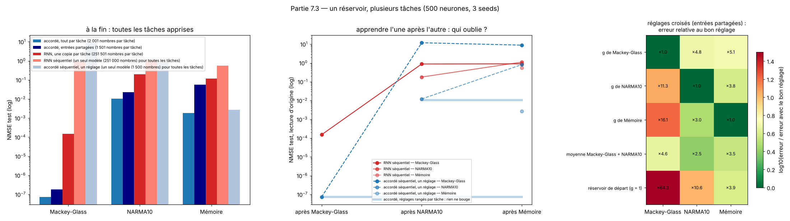

- Un réservoir commun et un réglage rangé par tâche battent un RNN par tâche (15, 9 et 19 fois), pour 125 fois moins à
  stocker, et rien n'est oublié. À 100 neurones, ils l'égalent pour 25 fois moins à stocker.
- **Partager les entrées coûte cher** (jusqu'à 30 fois sur la mémoire) : une tâche a besoin de ses propres poids d'entrée,
  ce qui rejoint 4.2.
- Apprendre les tâches l'une après l'autre dans un seul modèle provoque un **oubli catastrophique**, pour le RNN comme pour
  l'accordé : avoir peu de paramètres ne protège pas de l'oubli, ranger les réglages à part, oui.

## 4.9 À budget de paramètres égal : la correction de rang r

Comparer un GRU de 750 000 paramètres à un accordé de 1 500 ne dit rien sans la courbe complète. On donne à l'accordé plus
de liberté (une correction `U·Vᵀ` de rang r, de 1 500 à 257 500 paramètres à 500 neurones) et on fait varier le nombre
d'unités du GRU et du LRU (de 20 à 500).

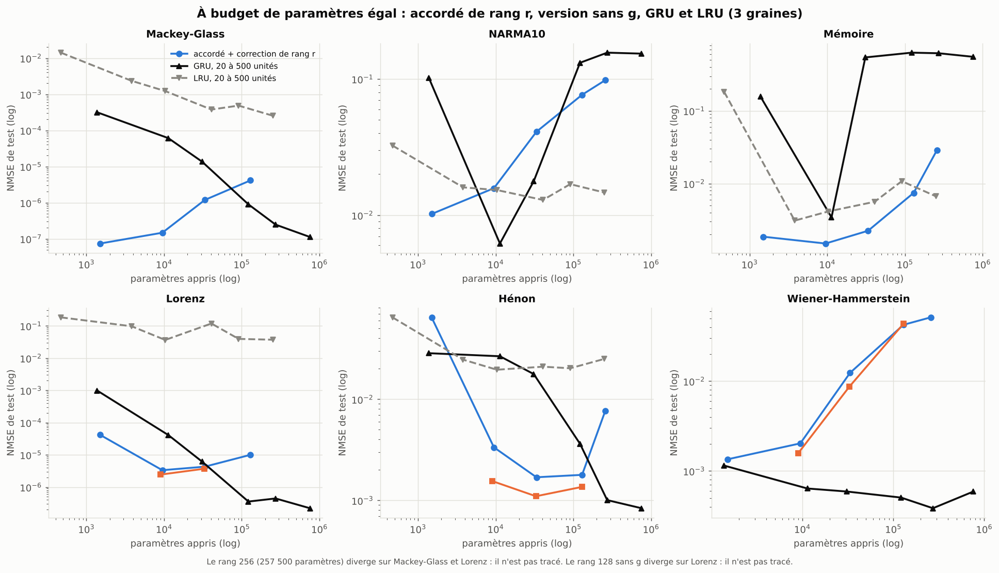

| Budget | Modèle (paramètres) | Mackey-Glass | NARMA10 | Mémoire | Lorenz | Hénon |
|---|---|---|---|---|---|---|
| ≈ 1,4 k | accordé, rang 0 (1 500) | **7.5e-8** | **0.0102** | **0.0019** | **4.3e-5** | 0.065 |
| | GRU 20 unités (1 380) | 3.3e-4 | 0.103 | 0.163 | 1.2e-3 | **0.032** |
| ≈ 10 k | accordé, rang 8 (9 500) | **1.5e-7** | 0.0158 | **0.0015** | **3.6e-6** | **0.0034** |
| | GRU 60 unités (11 340) | 6.4e-5 | **0.0063** | 0.0045 | 4.3e-5 | 0.028 |
| ≈ 32 k | accordé, rang 32 (33 500) | **1.3e-6** | 0.041 | **0.0023** | 4.4e-6 | **0.0017** |
| | GRU 100 unités (30 900) | 1.4e-5 | **0.019** | 0.545 | 6.5e-6 | 0.021 |
| ≈ 125 k | accordé, rang 128 (129 500) | 4.3e-6 | 0.077 | **0.0075** | 1.5e-5 | **0.0022** |
| | GRU 200 unités (121 800) | **9.3e-7** | 0.132 | 0.631 | **3.7e-7** | 0.0037 |
| ≈ 260 k | accordé, rang 256 (257 500) | instable | 0.099 | **0.029** | instable | 0.016 |
| | GRU 300 unités (272 700) | **2.5e-7** | 0.156 | 0.62 | **4.9e-7** | **0.0011** |

- **Sur Lorenz et Hénon, l'accordé de rang r bat le GRU jusqu'à environ 100 000 paramètres** (jusqu'à 12 fois : Lorenz à
  10 000 paramètres, Hénon à 30 000) ; au-delà, le GRU reprend l'avantage. Ailleurs, la correction de rang dégrade : sur Mackey-Glass et NARMA10,
  à tout rang ; sur la mémoire, à partir de r = 32. Le rang 256 est instable (learning rate unique).
- **Le GRU n'est mauvais sur NARMA10 et la mémoire qu'à certaines tailles.** Un GRU de 60 unités bat l'accordé sur NARMA10
  (0,0063 contre 0,0102) et s'en approche sur la mémoire ; à 20, 100 ou 500 unités, il échoue. Le GRU a donc une zone
  étroite de taille où il réussit ces tâches, que la recherche équitable (partie 8.2), qui tire la taille au hasard, n'a pas
  retrouvée.
- **Et sans g ?** Puisque g nuit sur Lorenz et Hénon (4.2), on retire les amplitudes et on garde biais, `W_in` et la
  correction de rang r (3 graines) :

  | Sans g, rang r (paramètres) | Lorenz | Hénon | Wiener-Hammerstein |
  |---|---|---|---|
  | rang 8 (9 000) | **2,6e-6** (×1,4 contre l'accordé de rang 8 ; **×17 contre le GRU de 60 unités**) | **0,0017** (×2,2 ; **×17**) | 0,0016 (×1,3 ; GRU ×2,5 devant) |
  | rang 32 (33 000) | 4,4e-6 (égal ; ×1,7 contre le GRU de 100 unités, dans le bruit) | **0,0011** (×1,5 ; **×16**) | 0,0087 (×1,4 ; GRU ×15 devant) |
  | rang 128 (129 000) | diverge sur une graine | 0,0017 (×1,3 ; ×2,7 contre le GRU de 200 unités) | 0,043 (égal ; GRU ×85 devant) |

  Sur les deux systèmes chaotiques, retirer g aide un peu (1,3 à 2,2 fois), et le modèle bat le GRU de budget comparable de
  16 à 17 fois jusqu'à 33 000 paramètres ; sur Hénon, 0,0011 avec 33 000 paramètres égale le GRU de 300 unités (0,0010,
  272 700 paramètres). Sur Wiener-Hammerstein, le GRU gagne dès 10 000 paramètres et la correction de rang sur-apprend
  (30 fois plus d'erreur au rang 128 qu'au rang 0).

## 4.10 Bilan de la partie 4

**Où ça marche.**
- Mackey-Glass et NARMA10 à 500 neurones : avec 1 500 paramètres, mieux que le GRU et le LRU réglés avec le même budget de
  recherche (1,8 et 1,7 fois), et loin devant le RNN.
- Le système physique Silverbox : à égalité avec le GRU, avec 500 fois moins de paramètres, et plus stable d'une graine à
  l'autre ; l'amplificateur de puissance simulé et l'égalisation de canal (partie 8.3), surtout quand les données sont rares.
- Les réglages rangés par tâche sur un réservoir commun ; l'accordé linéaire, qui égale le LRU complet.
- Lorenz et Hénon **à budget égal** : avec une correction de rang r et sans les amplitudes, 16 à 17 fois mieux que le GRU de
  même taille jusqu'à 33 000 paramètres.

**Les limites.**
- **Le nom ment en partie, sur les séries synthétiques** : l'essentiel du gain y vient des biais et des entrées, que l'on
  apprend dans un réservoir dont la récurrence ne change pas ; bien réglé, ce réservoir égale l'accordé sauf sur NARMA10, et
  g nuit sur Lorenz et Hénon. Sur les systèmes physiques réels, au contraire, les amplitudes sont indispensables (1,7 à
  3 fois moins d'erreur avec elles).
- La mémoire : le LRU bien réglé fait 6 fois mieux (partie 8.2). Lorenz, Hénon et le système de Wiener-Hammerstein : le GRU
  de grande taille domine (77 à 190 fois sur les deux systèmes chaotiques contre l'accordé simple, 3 fois sur le système
  réel de Wiener-Hammerstein, où le GRU gagne aussi à budget égal).
- Aucun gain en classification (MNIST, UEA). Le modèle plafonne sur Mackey-Glass au-delà de 1 000 neurones.

**Le lien avec la théorie.**
- *Adaptation par valeurs singulières.* Figer des matrices aléatoires et n'apprendre que des vecteurs d'échelle est le principe
  de [VeRA](https://arxiv.org/abs/2310.11454) ; n'apprendre que les valeurs singulières d'un poids pré-entraîné est celui de
  SVFit ([arXiv:2409.05926](https://arxiv.org/abs/2409.05926)), [SVFT](https://neurips.cc/virtual/2024/poster/93272),
  [SVDiff](https://arxiv.org/abs/2303.11305) et Transformer² ([arXiv:2501.06252](https://arxiv.org/abs/2501.06252)). Paramétrer
  un RNN par sa décomposition `U·Σ·Vᵀ` est connu ([Zhang, Lei et Dhillon, 2018](https://arxiv.org/abs/1803.09327)), avec `U` et
  `V` appris. L'accordé applique ce mécanisme à la récurrence d'un réservoir aléatoire : le transfert est nouveau, pas le
  mécanisme.
- *Plasticité intrinsèque.* Adapter un gain et un biais par neurone d'un réservoir est connu depuis
  [Steil (2007)](https://www.esann.org/sites/default/files/proceedings/legacy/es2007-98.pdf) et Schrauwen et al. (2008), avec
  une règle locale non supervisée. Le résultat de 4.2 (les biais portent une grande part du gain) place l'accordé tout près de
  cette lignée ; la différence est le critère (supervisé, par gradient) et l'apprentissage des entrées.
- *Pourquoi les biais comptent.* Pour un `tanh`, le biais déplace le point de fonctionnement de chaque neurone : il fixe sa
  pente locale, donc l'amplification effective de la dynamique linéarisée (`diag(1 − x²)·W`), et brise la symétrie impaire
  des états d'un réservoir sans biais. Apprendre les biais revient donc à accorder la dynamique **par neurone** plutôt que par
  direction singulière ; c'est une lecture, pas une démonstration.
- *Pourquoi g allonge la mémoire.* La capacité mémoire d'un réseau presque linéaire dépend de la façon dont `W` amplifie et
  fait décroître chaque direction : augmenter les valeurs singulières de quelques directions les rend plus lentes, d'où une
  mémoire plus longue (31 contre 22 pour le RNN). Sur Lorenz et Hénon, où il faut surtout des produits de variables, cette
  liberté ne sert pas et ajoute du sur-apprentissage.
- *Portes et récurrences linéaires.* Les Gated ESN ([Di Sarli, Gallicchio et Micheli, 2022](https://zenodo.org/record/7040474))
  n'entraînent que les portes ; minGRU ([Feng et al., 2024](https://arxiv.org/abs/2410.01201)) a inspiré la porte d'entrée ; un
  ESN linéaire diagonalisé aux valeurs propres échantillonnées ([arXiv:2602.19802](https://arxiv.org/abs/2602.19802)) a la
  structure de l'accordé linéaire, sans en entraîner les valeurs propres. Les adaptateurs par tâche sur un réservoir commun
  reprennent l'esprit de LoRA et SVDiff. La correction de rang r sur une base aléatoire figée est le principe de LottaLoRA
  (partie 8.4).

---

[Sommaire](../README.md#le-rapport) · [← Partie 3](3_tourne.md) · [Partie 5 →](5_cisaille.md)
