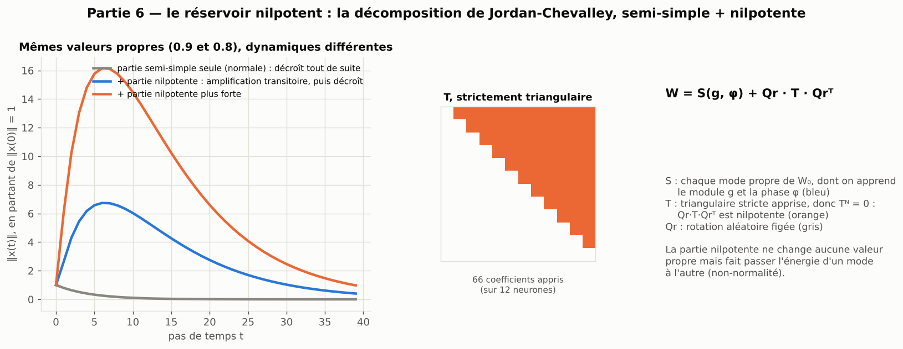

[Sommaire](../README.md#le-rapport) · [← Partie 5](5_cisaille.md) · [Partie 7 →](7_couplage.md)

# Partie 6 — Le réservoir nilpotent : modes propres et partie nilpotente (Jordan-Chevalley)

> **Ce qu'il faut retenir**
>
> - On sépare le réservoir en une partie semi-simple (ses modes propres, dont on apprend le module et la phase) et une partie nilpotente apprise, qui ne change aucune valeur propre mais crée de l'amplification transitoire.
> - Accorder seulement les modes propres est **moins bon** qu'accorder les valeurs singulières (2,2 à 2,6 fois sur la mémoire). Ajouter la partie nilpotente gagne beaucoup en synthétique (Mackey-Glass ×2, Lorenz ×4,3) mais perd sur Hénon.
> - À 500 neurones, la version complète (125 000 paramètres) s'effondre sur quatre tâches sur cinq et **dégrade les cinq tests de systèmes réels**. La version en bande garde un gain sur Lorenz (3,3 fois) mais perd sur Hénon (4,6 fois) : elle reste nettement en dessous du cisaillé en bande (partie 5).

La décomposition de Jordan-Chevalley écrit toute matrice comme la somme d'une partie **semi-simple** `S` (diagonalisable) et
d'une partie **nilpotente** `N` (`Nᵏ = 0`), qui commutent. La partie nilpotente ne change aucune valeur propre, mais elle fait
passer l'énergie d'un mode à l'autre : un signal est amplifié quelques pas avant de s'éteindre.

| Modèle | Écriture | Ce qu'on apprend | Paramètres à 100 neurones |
|---|---|---|---|
| Accordé sur les valeurs propres (partie semi-simple) | `W = Re(P·diag(λ ⊙ g·e^{iφ})·P⁻¹) + N₀` | module `g` et phase `φ` de chaque mode | 400 |
| **Réservoir nilpotent** | idem `+ Qr·T·Qrᵀ` | les modes et `T`, strictement triangulaire | 5 350 |

Une matrice aléatoire dense est presque sûrement diagonalisable : sa partie nilpotente `N₀` est nulle. Un réservoir creux à
10 % a en revanche des blocs de Jordan ; `N₀ = W₀ − S₀` est alors calculée et gardée figée. La partie apprise `Qr·T·Qrᵀ`
(`Qr` orthogonale aléatoire figée) est nilpotente, mais sa commutation avec la partie semi-simple, exigée par le théorème,
**n'est pas imposée** : c'est un modèle inspiré de la décomposition, pas la décomposition exacte.

## 6.1 Résultats à 100 neurones

Cinq tâches, 3 graines, facteur d'erreur par rapport à l'accordé (×2 = deux fois moins d'erreur) :

| Modèle | Paramètres | Mackey-Glass | NARMA10 | Mémoire | Lorenz | Hénon |
|---|---|---|---|---|---|---|
| Réservoir accordé (valeurs singulières), NMSE | 300 | 9.0e-5 | 0.023 | 0.0029 | 6.3e-4 | 0.042 |
| Accordé sur les valeurs propres | 400 | ×1,1 | ÷1,3 | **÷2,6** | ÷1,8 | ×1,0 |
| **Réservoir nilpotent** | 5 350 | **×2,0** | ÷1,0 | **×1,3** | **×4,3** | **÷2,2** |
| *Partie 5 : réservoir cisaillé* | 5 150 | ×1,2 | **×1,2** | **×1,2** | **×4,2** | **×2,0** |
| *RNN* | 10 200 | ×1,1 | **÷1,4** | ×1,0 | **×4,7** | ÷1,6 |

- **Les modes propres sont un moins bon levier que les valeurs singulières** : à budget voisin, ils perdent 2,6 fois sur la
  mémoire. Le même écart se retrouve à 500 neurones (2,2 fois sur la mémoire, 2 fois sur NARMA10 ; partie 4.4).
- **La partie nilpotente gagne beaucoup en synthétique** : 2 fois sur Mackey-Glass (plus que le cisaillé), 4,3 fois sur Lorenz,
  presque autant que le RNN. Mais elle **perd sur Hénon** (2,2 fois), où le cisaillé gagne.

## 6.2 À 500 neurones, plein et en bande

Cinq tâches, 3 graines ; facteur d'erreur par rapport à l'accordé (1 500 paramètres) :

| Modèle (paramètres) | Mackey-Glass | NARMA10 | Mémoire | Lorenz | Hénon |
|---|---|---|---|---|---|
| Réservoir nilpotent plein (126 750) | **÷118** | **÷11** | **÷47** | **×4,1** | **÷4,7** |
| Réservoir nilpotent en bande, k = 3 (3 494) | égal | **÷1,4** | **÷1,3** | **×3,3** | **÷4,6** |
| *Partie 5 : cisaillé en bande, k = 3 (2 494)* | ÷1,2 | **×1,6** | **×1,5** | **×6,2** | **×1,5** |

Comme le cisaillé, la version pleine s'effondre à cette taille, sauf sur Lorenz. La bande évite l'effondrement mais ne gagne
que sur Lorenz ; sur Hénon, la partie nilpotente perd autant en bande qu'en plein. À structure égale (une bande de trois
sur-diagonales), le cisaillement fait mieux que la partie nilpotente sur les cinq tâches.

## 6.3 Sur des systèmes physiques réels

À 500 neurones (3 graines), la partie nilpotente coûte environ 125 000 paramètres. Sur les trois systèmes réels de la partie
8.3, écart apparié en log10 du RMSE par rapport à l'accordé (+0,30 = deux fois plus d'erreur) :

| | Silverbox, multisinus | Silverbox, flèche avec extrapolation | Silverbox, flèche sans extrapolation | Wiener-Hammerstein | Cascaded Tanks |
|---|---|---|---|---|---|
| Réservoir accordé (1 500 paramètres), RMSE | 4,3 mV | 9,9 mV | 4,0 mV | 11,8 mV | 1,69 V |
| Réservoir nilpotent (126 750), écart | +0,36 | +0,19 | +0,38 | +0,21 | +2,24 (diverge) |

La partie nilpotente **dégrade les cinq tests** (1,5 à 2,4 fois plus d'erreur, divergence sur Cascaded Tanks, qui n'a que 1 024 points
d'entraînement). Le sur-apprentissage est l'explication la plus plausible, cohérente avec l'effondrement en synthétique à la même taille.
La version en bande n'a pas été mesurée sur ces systèmes, faute de gain synthétique hors de Lorenz.

## 6.4 Bilan de la partie 6

**Où ça marche.** Mackey-Glass (2 fois mieux que l'accordé) et Lorenz (4,3 fois) à 100 neurones ; Lorenz seulement à 500
neurones (3,3 fois en bande).

**Les limites.**
- Perte sur Hénon (2,2 fois à 100 neurones, 4,6 fois à 500), alors que le cisaillé y gagne.
- Effondrement de la version pleine à 500 neurones, en synthétique comme sur les systèmes réels.
- En bande, toujours moins bon que le cisaillé en bande de même taille.
- La commutation exigée par le théorème n'est pas imposée ; 100 neurones et 3 graines pour la partie synthétique.

**Le lien avec la théorie.**
- *Valeurs propres contre valeurs singulières.* Les valeurs propres règlent le comportement **asymptotique** (stabilité, temps
  de décroissance à long terme) ; les valeurs singulières règlent l'amplification **à chaque pas**. Pour une mémoire de 15 pas,
  c'est l'amplification à court terme qui compte, ce qui est cohérent avec l'avantage des valeurs singulières (partie 4) sur
  les modes propres. Pour une matrice non normale, les deux peuvent être très différents, et c'est exactement ce que la partie
  nilpotente exploite.
- *Amplification transitoire.* Avec `W = S + N`, `Wᵗ = Σₖ C(t, k)·Sᵗ⁻ᵏ·Nᵏ` quand `S` et `N` commutent : les termes en `N`
  ajoutent des puissances de t devant les modes (le comportement d'un bloc de Jordan), d'où une croissance polynomiale avant la
  décroissance exponentielle. C'est la mémoire transitoire des réseaux non normaux (Ganguli et al., 2008).
- *Travaux voisins.* Le nnRNN ([Kerg et al., 2019](https://arxiv.org/abs/1905.12080)) apprend une partie triangulaire dans la
  forme de Schur réelle `Q·(Λ + T)·Qᵀ`, la version numériquement stable de cette idée ; le réservoir nilpotent en est une
  variante appliquée à un réservoir, avec `Q` et le spectre figés. Ce n'est pas une idée nouvelle.

---

[Sommaire](../README.md#le-rapport) · [← Partie 5](5_cisaille.md) · [Partie 7 →](7_couplage.md)
