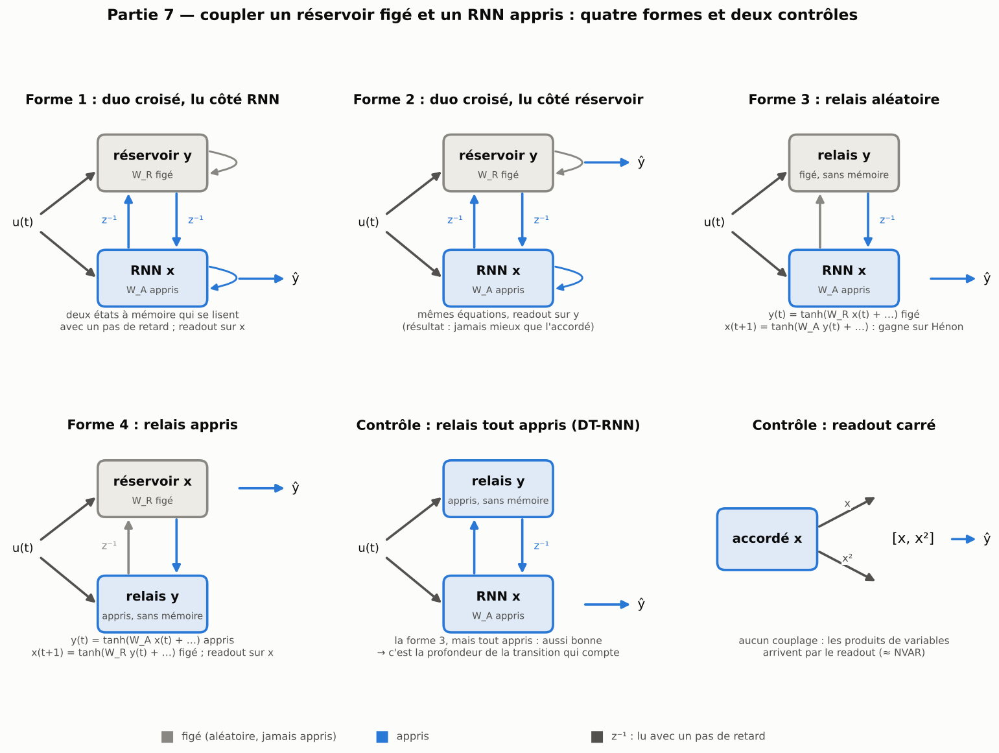

[Sommaire](../README.md#le-rapport) · [← Partie 6](6_nilpotent.md) · [Partie 8 →](8_synthese.md)

# Partie 7 — Coupler un réservoir figé et un RNN appris

> **Ce qu'il faut retenir**
>
> - Les **duos croisés** (un réservoir et un RNN qui se lisent avec un retard) n'apportent rien, et divergent à 500 neurones.
> - Les **relais** (une couche sans mémoire dans la transition) gagnent beaucoup sur Hénon (9 fois mieux que le GRU à 500 neurones), mais un relais entièrement appris fait aussi bien : c'est la **profondeur de la transition** qui compte, pas le hasard. Avec un bloc accordé dans la transition, le gain disparaît.
> - Un **readout carré** `[x, x²]` sur l'accordé capte une bonne part du gain sans couplage, mais c'est surtout un réservoir plus large, sauf sur Lorenz et Hénon (caractéristiques polynomiales, déjà connues du NVAR). Rien de tout cela ne se transfère aux systèmes réels.

Les parties 1 à 6 transforment un seul réservoir. Ici, on garde **deux objets distincts**, un réservoir aléatoire figé et un
RNN entièrement appris, et on les fait se lire l'un l'autre : c'est la version la plus littérale de « réservoir + RNN ».

## 7.1 Les quatre formes

On introduit un second état `y` : l'un des deux est un **réservoir** (`R`, poids figés), l'autre un **RNN** (`A`, poids appris).
Deux choix : qui est dans la boucle temporelle, et si le second bloc est lu avec retard (mise à jour parallèle) ou sans retard
(en cascade).

| Forme | Nom | Équations | Remarque |
|---|---|---|---|
| 1 | **Duo croisé, réservoir d'abord** | `y(t+1) = f_R(W_inR u + W_R y + C x)`, `x(t+1) = f_A(W_inA u + W_A x + D y)` | deux états retardés, couplés |
| 2 | **Duo croisé, RNN d'abord** | rôles inversés | équivaut à 1 si le readout lit les deux états |
| 3 | **Relais aléatoire** | `y(t) = g(W_inR u(t) + W_R x(t))`, `x(t+1) = f(W_in u(t) + W_A y(t))` | une couche aléatoire figée, sans mémoire, dans la transition apprise |
| 4 | **Relais appris** | `y(t) = g(W_inA u(t) + W_A x(t))`, `x(t+1) = f(W_inR u(t) + W_R y(t))` | les rôles inversés |

Contrôles : le **relais tout appris** (les deux couches apprises : un RNN à transition profonde, DT-RNN) et le **readout
carré** (`[x, x²]`, sans couplage).

## 7.2 Résultats à 100 neurones

NMSE de test, 3 graines ; paramètres de la partie récurrente.

| Modèle | Paramètres | Mémoire | NARMA10 | Mackey-Glass | Lorenz | Hénon |
|---|---|---|---|---|---|---|
| Réservoir classique | 0 | 0.79 | 0.28 | 0.0017 | 0.0023 | 0.67 |
| RNN | 10 200 | **0.0028** | 0.032 | 8.0e-5 | 2.8e-4 | 0.078 |
| Réservoir accordé | 300 | 0.0029 | 0.023 | 9.0e-5 | 6.3e-4 | 0.042 |
| GRU, init soignée | 30 900 | 0.51 | **0.0125** | **1.2e-5** | **8.3e-6** | 0.031 |
| Forme 1 : duo croisé, lu côté RNN | 30 200 | 0.032 | 0.088 | 1.0e-4 | 2.8e-4 | 0.26 |
| Forme 2 : duo croisé, lu côté réservoir | 30 200 | 0.049 | 0.13 | 7.6e-5 | 7.8e-5 | 0.75 |
| Forme 3 : relais aléatoire | 10 200 | 0.023 | 0.036 | 1.0e-4 | 9.9e-5 | **0.00099** |
| Forme 4 : relais appris | 10 200 | 0.024 | 0.033 | 9.9e-5 | 1.2e-4 | 0.0027 |
| *Relais tout appris (DT-RNN)* | 20 300 | 0.012 | 0.072 | 1.7e-4 | 3.6e-4 | **0.00049** |
| *Réservoir accordé, readout carré* | 300 | 0.0037 | 0.0145 | 1.1e-5 | 8.4e-5 | 0.013 |

- **Duos croisés : rien.** Pires que l'accordé sur la mémoire, NARMA10 et Hénon, avec trois fois plus de paramètres.
- **Relais : un gain net sur les systèmes chaotiques à produits.** Sur Hénon, la forme 3 fait 43 fois mieux que l'accordé
  et 32 fois mieux que le GRU ; sur Lorenz, 5 à 6 fois mieux que l'accordé (le GRU reste 12 fois devant). Ailleurs, égal ou
  moins bon.
- **Mais le relais tout appris fait aussi bien** (0,00049 sur Hénon) : le gain vient de la **profondeur de la transition**
  (deux `tanh` par pas), pas de l'aléa. En faveur de la forme 3 : sa couche figée coûte deux fois moins de paramètres.
- **Le readout carré capte une bonne part du gain sans couplage** : sur l'accordé, il passe de 0,042 à 0,013 sur Hénon, de
  6,3e-4 à 8,4e-5 sur Lorenz, de 9,0e-5 à 1,1e-5 sur Mackey-Glass.

## 7.3 À 500 neurones : une question de learning rate

| Modèle (3 graines) | Paramètres | Mackey-Glass | NARMA10 | Mémoire | Lorenz | Hénon |
|---|---|---|---|---|---|---|
| *Accordé + readout carré* | 1 500 | **2.5e-8** | **0.0084** | **0.0018** | 1.7e-5 | 0.023 |
| Réservoir accordé | 1 500 | 7.5e-8 | 0.0102 | 0.0019 | 4.3e-5 | 0.065 |
| GRU, init soignée | 754 500 | 1.1e-7 | 0.154 | 0.554 | **2.4e-7** | 8.5e-4 |
| Forme 3 : relais aléatoire (lr par défaut) | 251 000 | 3.9e-5 | 0.18 | 2.76 | 1.5e-4 | **9.0e-5** |
| Forme 3 : relais aléatoire, lr × 0,1 | 251 000 | 2.1e-6 | 0.033 | 0.024 | 1.4e-5 | 2.4e-3 |
| Forme 4 : relais appris, lr × 0,1 | 251 000 | 3.7e-6 | 0.036 | 0.050 | 1.8e-5 | 3.6e-3 |
| *Relais tout appris (DT-RNN, lr par défaut)* | 501 500 | 0.149 | 0.678 | 1.02 | 0.54 | 1.6e-4 |
| RNN, lr × 0,1 | 251 000 | 2.1e-6 | 0.094 | 0.040 | 6.1e-5 | 0.87 |
| Formes 1 et 2 : duos croisés | 751 000 | 0.10 à 0.22 | 0.63 à 0.65 | 0.40 | 0.015 à 0.12 | 0.44 à 0.56 |

- Le learning rate explique l'échec des relais sur quatre tâches : avec lr × 0,1, la forme 3 gagne un facteur 18
  (Mackey-Glass), 5,5 (NARMA10), 115 (mémoire) et 11 (Lorenz). **Sur Hénon, c'est l'inverse** : au learning rate par
  défaut, le relais fait 9,0e-5, **9 fois mieux que le GRU**, et le DT-RNN fait aussi bien. Le bon réglage dépend de la tâche.
- Même bien réglés, les relais restent loin de l'accordé sur Mackey-Glass (28 fois), NARMA10 (3,2 fois) et la mémoire (13 fois),
  avec 167 fois plus de paramètres. Les duos croisés divergent toujours.

## 7.4 Combiner : un relais aléatoire autour d'un réservoir accordé

La combinaison naturelle : garder le relais aléatoire, mais remplacer le RNN libre de la transition par un réservoir accordé
(300 paramètres au lieu de 10 200), avec ou sans readout carré.

| Modèle (100 neurones, 3 graines) | Paramètres | Mackey-Glass | NARMA10 | Mémoire | Lorenz | Hénon |
|---|---|---|---|---|---|---|
| Réservoir accordé | 300 | 9.0e-5 | 0.023 | **0.0029** | 6.3e-4 | 0.042 |
| Accordé, readout carré | 300 | **1.1e-5** | **0.0148** | 0.0037 | 8.4e-5 | 0.013 |
| Forme 3 : relais + RNN libre | 10 200 | 1.0e-4 | 0.035 | 0.024 | 1.1e-4 | 9.5e-4 |
| Forme 3, readout carré | 10 200 | 6.9e-5 | 0.052 | 0.025 | 1.4e-4 | **6.4e-5** |
| Relais + RNN accordé | 300 | 1.0e-4 | 0.060 | 0.23 | 6.2e-4 | 0.024 |
| Relais + RNN accordé, readout carré | 300 | 2.0e-5 | 0.048 | 0.33 | **3.2e-5** | 0.0066 |
| Relais + RNN sculpté | 10 200 | 7.8e-5 | 0.15 | 0.80 | 1.6e-4 | 0.0097 |
| GRU, init soignée | 30 900 | 1.4e-5 | 0.019 | 0.55 | 6.5e-6 | 0.021 |

- **Le relais ne se combine pas avec l'accordé** : le relais + accordé fait 26 à 32 fois plus d'erreur que la forme 3 sur Hénon,
  et ne gagne rien sur Lorenz. Le relais gagne parce que son bloc de transition est un RNN libre, pas parce qu'il est aléatoire.
- Avec le readout carré, c'est le meilleur des modèles à 300 paramètres sur Lorenz (le GRU reste 5 fois devant), mais la forme 3
  + carré est 100 fois meilleure sur Hénon. Le relais + sculpté ne fait pas mieux que la forme 3, et toutes les variantes à
  relais coûtent cher sur la mémoire (8 à 260 fois).
- Sur les systèmes réels (partie 8.3), le relais + accordé + readout carré fait 1,5 à 1,8 fois **plus** d'erreur que l'accordé
  seul, sur les cinq tests.

## 7.5 Pourquoi le readout carré marche

Trois explications, trois contrôles à même nombre de caractéristiques (2N) : (a) il y a simplement plus de caractéristiques
(contrôle : un accordé à 2N neurones) ; (b) la parité (le `tanh` donne des états impairs, le carré les complète ; contrôle :
le cube `[x, x³]`, impair) ; (c) il faut des produits entre états différents (contrôle : N produits `xᵢxⱼ` tirés au hasard).

| Facteur gagné sur l'accordé (100 neurones, 3 graines) | Mackey-Glass | NARMA10 | Mémoire | Lorenz | Hénon |
|---|---|---|---|---|---|
| `[x, x²]` | ×8,5 | ×1,6 | ÷1,3 | ×7,9 | ×3,5 |
| `[x, x³]` (impair) | ×8,9 | ×1,4 | égal | ×6,5 | ×5,4 |
| `[x, |x|]` | ×1,7 | égal | ÷1,2 | ×1,6 | ×4,5 |
| `[x, xᵢxⱼ]` | ×9,3 | ×1,4 | égal | ×6,3 | ×2,0 |
| **Accordé à 200 neurones**, readout linéaire | **×24** | ×1,5 | ×1,6 | ×3,2 | ÷1,3 |

- **Sur Mackey-Glass, NARMA10 et la mémoire, le readout carré n'est qu'un moyen de grossir le réservoir** : un accordé à 2N
  neurones fait aussi bien ou mieux, et lui aide la mémoire.
- **Sur Lorenz et Hénon, ce n'est pas un effet de taille** : les caractéristiques non linéaires battent la largeur. Ce sont deux
  systèmes faits de produits ; c'est le résultat attendu du NVAR.
- **La parité n'est pas la cause** : le cube fait comme le carré, y compris sur le réservoir sans biais pour Hénon. Tous les
  produits se valent.
- Sur la mémoire, aucune non-linéarité ajoutée n'aide ; seule la largeur aide.
- **Sur les systèmes réels**, le readout carré ne change rien (écarts de −0,02 à +0,09 en log) : le gain est propre aux séries
  synthétiques.

## 7.6 Bilan de la partie 7

**Où ça marche.** Hénon (et un peu Lorenz) : une transition profonde, aléatoire ou apprise, bat le GRU sur Hénon. Le readout
carré aide l'accordé sur les séries synthétiques.

**Les limites.**
- Les relais coûtent cher sur la mémoire et NARMA10, demandent un learning rate propre à chaque tâche, et ne se combinent pas
  avec l'accordé.
- Les duos croisés n'apportent rien. La comparaison avec un mélange additif de même taille n'a pas été faite.
- Rien ne se transfère aux systèmes réels (readout carré : aucun effet ; relais + accordé : 1,5 à 1,8 fois pire).

**Le lien avec la théorie.**
- *Profondeur de transition.* Les RNN à transition profonde (DT-RNN, Pascanu et al., 2014) et leurs variantes à portes entre
  couches (GF-RNN) placent des couches sans mémoire dans la transition ; le relais aléatoire est « un DT-RNN dont une couche est
  aléatoire ». Une application quadratique comme Hénon demande des produits : deux `tanh` successifs les approchent mieux
  qu'un seul.
- *Caractéristiques polynomiales.* Le readout carré est une version minimale du NVAR / *next-generation reservoir computing*
  (Gauthier et al., 2021) et des caractéristiques quadratiques de Pathak et al. (2018) pour Lorenz ; la question de la parité
  vient de [*Breaking Symmetries of the Reservoir Equations*](https://arxiv.org/pdf/2010.07103).
- *Couplages existants.* DeepESN et réservoirs empilés (tout figé) ; GRU-ESN et HBP-ESN (une partie apprise en lecture seule) ;
  le state-feedback ESN ([arXiv:2312.15141](https://arxiv.org/abs/2312.15141)) et LoRA-RC (une correction de faible rang du
  réservoir, proche du réservoir corrigé de la partie 1) ; Pathak et al. (2018) couplent un modèle physique et un réservoir ;
  FORCE boucle un réservoir sur sa sortie. Aucun travail trouvé ne place une couche aléatoire figée dans la transition apprise
  d'un RNN, ni ne compare ces quatre couplages ; la recherche n'est pas exhaustive.

---

[Sommaire](../README.md#le-rapport) · [← Partie 6](6_nilpotent.md) · [Partie 8 →](8_synthese.md)
