[Sommaire](../README.md#le-rapport) · [← Partie 7](7_couplage.md) · [Partie 9 →](9_structure.md)

# Partie 8 — Synthèse : toutes les familles, au-delà du synthétique, et face à l'existant

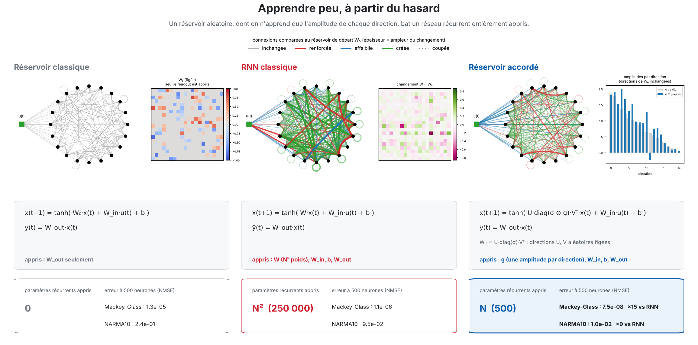

> **Ce qu'il faut retenir**
>
> - Sur des séries synthétiques, presque toutes les façons de rester entre un réservoir et un RNN battent le RNN qui apprend tout. Chaque famille a ses tâches : le sculpté pour la mémoire, l'accordé pour Mackey-Glass et NARMA10, le cisaillé en bande et les relais pour Lorenz et Hénon ; le cisaillé en bande bat même l'accordé sur les cinq tâches à 500 neurones, mais ce gain vient d'une petite correction creuse de la récurrence, pas du cisaillement (partie 5.5).
> - Face aux modèles existants, avec le même budget de recherche pour tous, l'accordé (1 500 paramètres) fait mieux que le GRU sur Mackey-Glass et que le LRU sur NARMA10, et le cisaillé en bande (6 000 paramètres) 3 fois et 2 fois mieux. Le LRU bien réglé gagne sur la mémoire, sauf contre une variante linéaire à porte d'entrée, et le GRU domine les systèmes chaotiques faits de produits.
> - Sur des données non synthétiques, le résultat est surtout négatif : pas de gain en classification, aucun modèle entraîné ne bat le réservoir classique sur trois séries réelles, mieux que le GRU sur un système physique (Silverbox, avec le cisaillé en bande, 127 fois moins de paramètres) et une nette défaite sur un autre (Wiener-Hammerstein). Les mécanismes en jeu sont, pour l'essentiel, déjà connus.

## 8.1 Toutes les familles côte à côte

À 100 neurones, chaque famille contre le RNN qui apprend tout, sur les cinq tâches synthétiques :

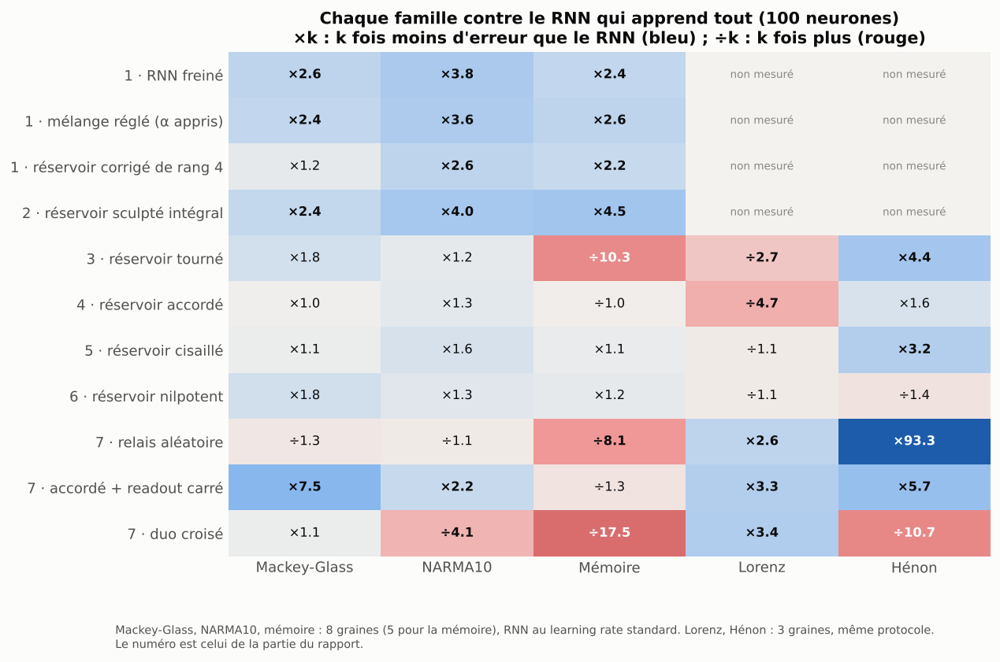

| Famille (partie) | Ce qu'elle apprend dans la récurrence | Là où elle gagne | Là où elle perd |
|---|---|---|---|
| RNN freiné, mélange (1) | tout, lentement | Mackey-Glass, NARMA10, mémoire (2 à 4 fois mieux que le RNN) | rien de net ; dépassé à 500 neurones |
| Réservoir sculpté (2) | une atténuation par connexion | **la mémoire, à toutes les tailles** ; NARMA10 à petite taille | coûte N² paramètres |
| Réservoir tourné (3) | une rotation | Hénon (4,4 fois), Mackey-Glass | la mémoire (10 fois pire), MNIST |
| Réservoir accordé (4) | une amplitude par direction (et surtout les biais et les entrées) | **Mackey-Glass et NARMA10 à 500 neurones** avec 1 500 paramètres | Lorenz (4,7 fois pire que le RNN à 100 neurones) |
| Réservoir cisaillé (5) | un cisaillement triangulaire, plein ou en bande ; en fait, quelques milliers de coefficients récurrents épars | **en bande, les cinq tâches à 500 neurones**, avec un seul k ; Mackey-Glass et NARMA10 face au GRU et au LRU réglés ; Silverbox | plein : sur-apprend ; Lorenz et Hénon face au GRU ; Wiener-Hammerstein |
| Réservoir nilpotent (6) | modes propres + partie nilpotente | Lorenz | Hénon ; plein : s'effondre à 500 neurones et sur tous les systèmes réels |
| Relais, readout carré (7) | une transition plus profonde, des produits | Hénon (93 fois le RNN), Lorenz | la mémoire ; rien ne se transfère au réel |

Les synthèses par tâche rassemblent toutes les expériences, chaque panneau gardant son propre protocole (taille, durée,
nombre de graines) : on compare les modèles à l'intérieur d'un panneau, pas d'un panneau à l'autre.

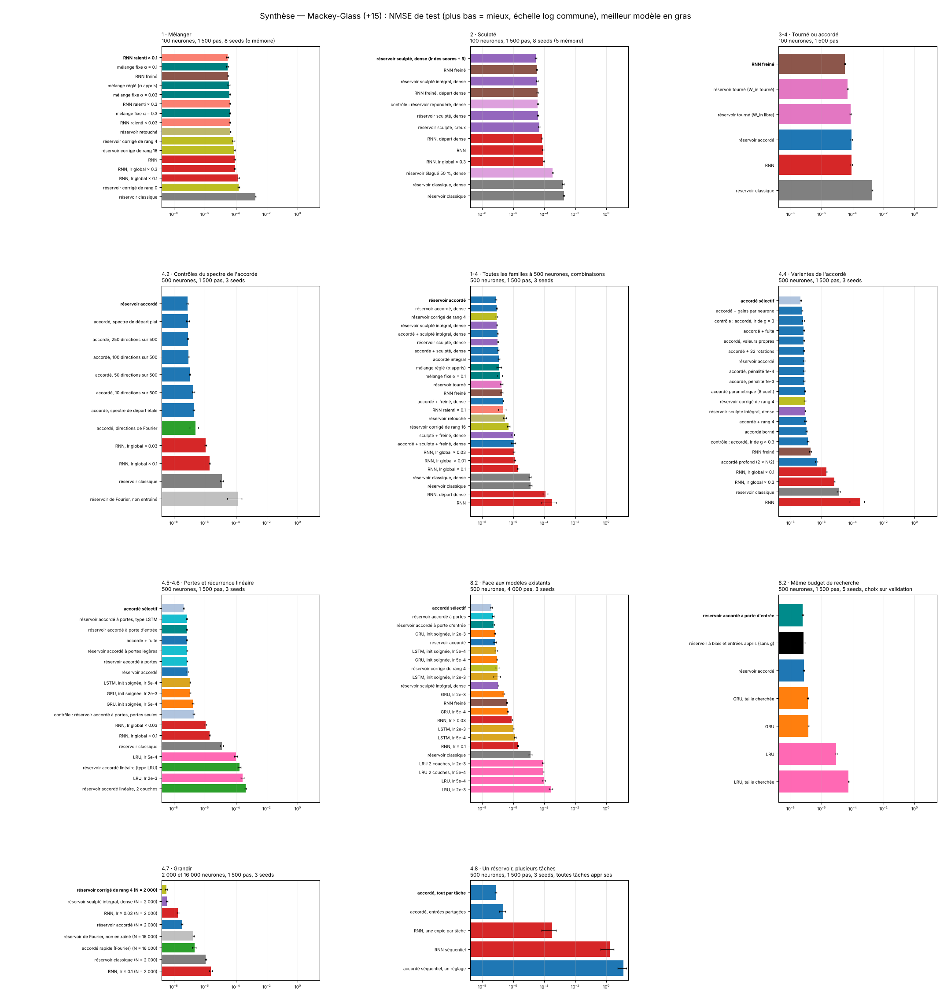

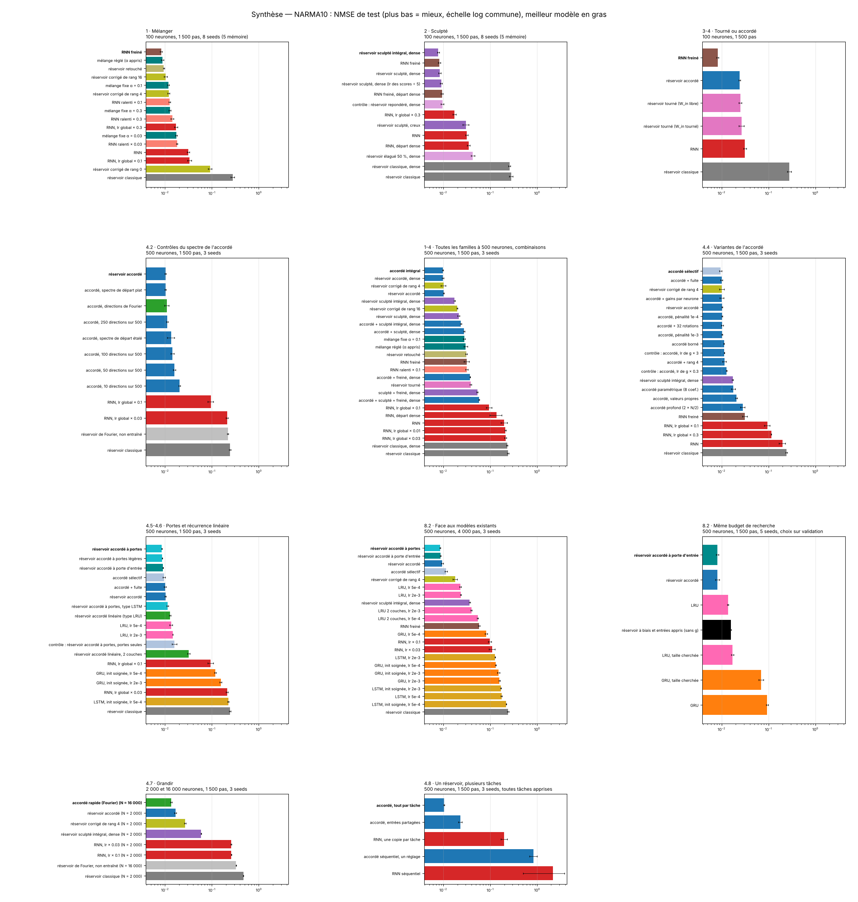

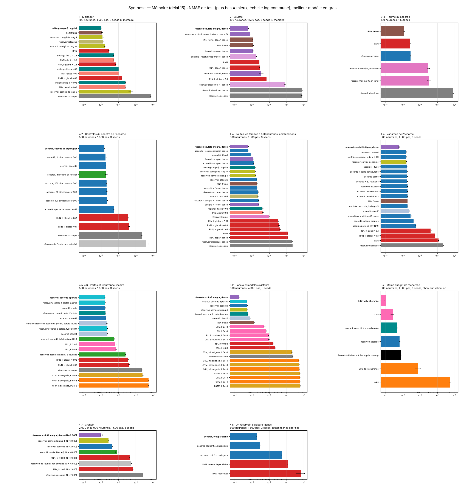

## 8.2 Face aux modèles existants

**Premier protocole : quatre réglages pour chaque modèle existant, choisis sur le test** (500 neurones, 4 000 pas, 3 graines).
Ce choix avantage les modèles existants, qui ont quatre réglages (deux learning rates, deux initialisations, ou une et deux
couches pour le LRU) contre un seul pour les nôtres.

| N = 500, 4 000 pas | Paramètres récurrents | Mackey-Glass | NARMA10 | Mémoire |
|---|---|---|---|---|
| RNN (meilleur réglage) | 251 000 | 7.8e-7 | 0.098 | 0.017 |
| GRU (meilleur réglage) | 754 500 | **6.4e-8** | 0.083 | 0.515 |
| LSTM (meilleur réglage) | 1 006 000 | 7.9e-8 | 0.127 | 0.210 |
| LRU (meilleur réglage) | 251 750 | 8.4e-5 | 0.023 | 0.0050 |
| Partie 1 : RNN freiné | 251 000 | 3.8e-7 | 0.058 | 0.0014 |
| Partie 1 : réservoir corrigé de rang 4 | 5 000 | 9.4e-8 | 0.018 | 0.00054 |
| Partie 2 : réservoir sculpté intégral | 251 000 | 1.0e-7 | 0.036 | **0.00018** |
| Partie 4 : réservoir accordé | **1 500** | 6.7e-8 | **0.0095** | 0.00053 |
| Partie 4 : accordé sélectif | 2 000 | 4.0e-8 | 0.0115 | 0.00078 |
| Partie 4 : accordé à portes | 4 500 | 5.1e-8 | 0.0085 | 0.00051 |

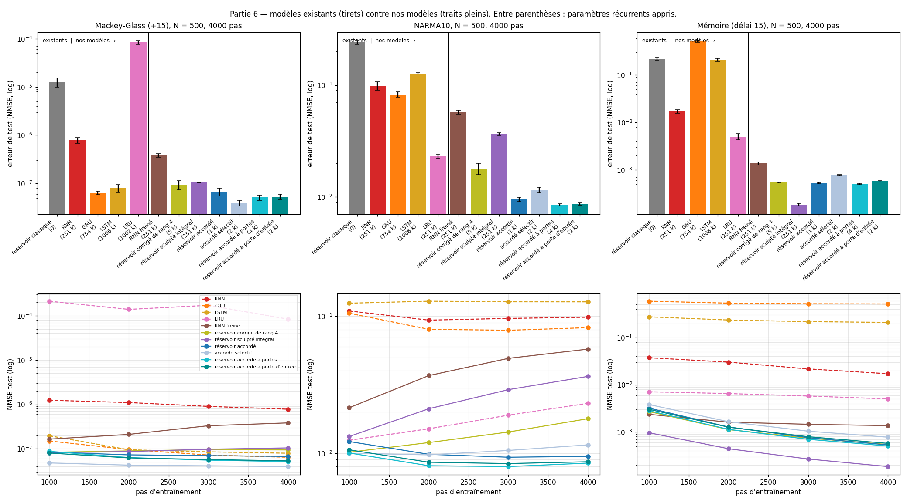

Dans ce protocole, l'accordé égale le GRU sur Mackey-Glass, et tous nos modèles semblent loin devant sur NARMA10 et la
mémoire. Deux contrôles relativisent ce tableau : avec un arrêt optimal (choisi sur le test pour chaque modèle), l'avantage
de l'accordé sur NARMA10 tombe de 2,4 à 1,3 fois, une partie venant de ce qu'il ne sur-apprend pas ; et la recherche
équitable ci-dessous retourne le résultat sur la mémoire.

**Second protocole : le même budget de recherche pour tous.** Chaque modèle reçoit sa configuration par défaut plus 12 essais
tirés au hasard (learning rate et initialisation pour le GRU ; learning rate, couches et rayons des valeurs propres pour le
LRU ; learning rate, learning rates des amplitudes et des entrées, rayon spectral, échelle d'entrée et densité pour l'accordé),
jugés sur une **validation** prise à la fin de la partie entraînement. La meilleure configuration est ré-entraînée sur **5
graines** et mesurée une seule fois sur le test. Deux modèles existants cherchent en plus leur **nombre d'unités** (20 à 500).
500 neurones, 1 500 pas. Écart apparié au meilleur modèle existant (négatif = mieux) :

| Tâche | GRU | GRU, taille cherchée | LRU | LRU, taille cherchée | **Accordé (1 500 par.)** | Accordé à porte d'entrée (2 500) | Biais et entrées appris, sans g (1 000) |
|---|---|---|---|---|---|---|---|
| Mackey-Glass | 1.4e-7 | 1.25e-7 (500 unités, réf.) | 8.6e-6 | 5.4e-5 (100 unités) | **7.0e-8 (−0,25 ± 0,06)** | **6.0e-8 (−0,32 ± 0,06)** | **6.4e-8 (−0,29 ± 0,09)** |
| NARMA10 | 0.093 | 0.068 (40 unités) | 0.0137 (réf.) | 0.017 (40 unités) | **0.0080 (−0,23 ± 0,03)** | **0.0081 (−0,23 ± 0,03)** | 0.0156 (+0,06 ± 0,01) |
| Mémoire | 0.54 | 0.0061 (20 unités) | 2.3e-4 | **1.0e-4 (200 unités, réf.)** | 6.5e-4 (**+0,80 ± 0,05**) | 4.8e-4 (+0,67 ± 0,04) | 7.5e-4 (+0,87 ± 0,06) |

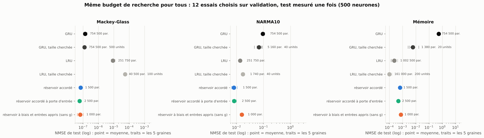

- **Mackey-Glass** : l'accordé fait 1,8 fois mieux que le meilleur GRU (la recherche garde 500 unités), sans aucun réglage
  propre (sa configuration par défaut est la meilleure sur validation).
- **NARMA10** : l'accordé fait 1,7 fois mieux que le LRU, et 8 fois mieux que le meilleur GRU de taille cherchée (40 unités).
  Un GRU de 60 unités, jamais tiré par la recherche, atteignait 0,0063 dans la partie 4.9 : le GRU a une zone de taille étroite
  et instable où il réussit cette tâche.
- **Mémoire** : **le LRU bien réglé gagne** (1,0e-4 à 200 unités, 6 fois mieux que l'accordé, 4,7 fois mieux que la porte
  d'entrée). Les comparaisons précédentes, où le LRU restait à 0,005, le désavantageaient. Le GRU reste mauvais, sauf un
  essai chanceux à 20 unités.
- **Ce que change la taille cherchée** : sur NARMA10, le GRU ne gagne que 1,4 fois sur celui de 500 unités ; sur la mémoire, il
  progresse de 90 fois grâce à un essai à 20 unités, mais reste 9 fois derrière l'accordé ; le LRU de taille cherchée gagne
  2,3 fois sur la mémoire.
- **Le réservoir à biais et entrées appris** (récurrence strictement aléatoire, 1 000 paramètres) égale l'accordé sur
  Mackey-Glass et la mémoire, et fait 2 fois moins bien que lui sur NARMA10, où il rejoint le LRU. Sur ces trois tâches,
  l'essentiel de l'avantage sur les modèles existants ne demande donc pas d'apprendre la récurrence.
- **Les modèles cisaillés avec le même budget** (k compris dans la recherche ; détail en partie 5.9) : le cisaillé en bande
  fait 3,0 fois mieux que le GRU sur Mackey-Glass et 2,1 fois mieux que le LRU sur NARMA10 ; il perd 7 fois contre le LRU sur
  la mémoire. Le **cisaillé linéaire à porte d'entrée** fait 8,3 fois mieux que le LRU sur NARMA10 et **23 fois mieux sur la
  mémoire** (16 535 paramètres contre 161 000).
- **Lorenz et Hénon**, ajoutés à la recherche (8 essais pour tous) : le GRU réglé gagne, 16 fois devant le cisaillé en bande
  sur Lorenz ; sur Hénon, le cisaillé est 1,5 fois derrière le GRU (écart non significatif), l'accordé et le réservoir à biais
  et entrées appris 4 fois.
- Le sculpté intégral n'a pas reçu ce budget de recherche.

## 8.3 Au-delà des tâches synthétiques

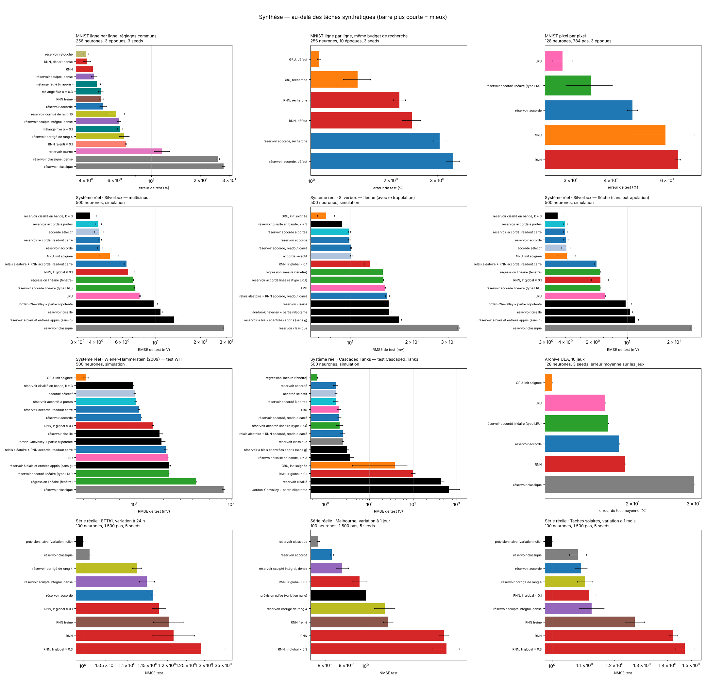

### Classification : pas de gain

- **MNIST ligne par ligne** (28 pas, 256 neurones). Avec les mêmes réglages pour tous, le retouché et le sculpté égalent le
  RNN (4,0 et 4,5 % d'erreur contre 4,4 %), l'accordé est à 5,1 %, le tourné échoue (11,7 %). Avec le même budget de
  recherche (24 essais sur validation), l'accordé reste à 3,1 %, le RNN descend à 2,2 % et le GRU à 1,5 % ; grossir l'accordé
  à 1 024 neurones n'aide pas. Le hasard des directions limite ce que N amplitudes peuvent faire quand il faut **construire
  des représentations**.
- **MNIST pixel par pixel** (784 pas, 128 neurones, 3 époques) : le LRU gagne (28,3 %), l'accordé linéaire est à 6 points
  avec 52 fois moins de paramètres, l'accordé bat le GRU et le RNN (46,7 % contre 59,3 et 64,9 %). Rien n'est proche de l'état
  de l'art : c'est un classement à protocole court.
- **Archive UEA** (dix jeux multivariés, 128 neurones) : le GRU est le meilleur (rang moyen 2,2, premier sur 6 jeux) ;
  l'accordé fait jeu égal avec le RNN et le LRU (rangs 3,4, 3,3 et 3,1) avec 10 fois moins de paramètres, et gagne sur les
  deux jeux les plus courts.

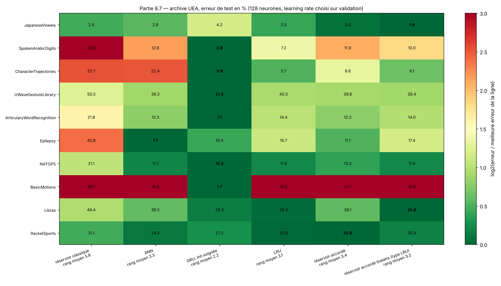

### Séries temporelles réelles : le réservoir classique est le meilleur

Température d'huile d'un transformateur (ETTh1, à 24 h), température minimale à Melbourne (à 1 jour), taches solaires (à
1 mois) ; la cible est la variation, et une NMSE de 1 correspond à la prévision naïve « rien ne change ». 100 neurones, 5
graines.

| | ETTh1 | Melbourne | Taches solaires |
|---|---|---|---|
| Réservoir classique | **1.01** | **0.77** | **1.08** |
| Meilleur RNN | 1.18 | 0.97 | 1.11 |
| RNN freiné | 1.20 | 1.13 | 1.27 |
| Réservoir corrigé de rang 4 | 1.12 | 1.11 | 1.10 |
| Réservoir sculpté intégral | 1.15 | 0.88 | 1.12 |
| Réservoir accordé | 1.16 | 0.83 | 1.09 |

Aucun modèle ne bat la prévision naïve sur ETTh1 et les taches solaires ; sur Melbourne, le meilleur est le réservoir
classique, sans aucun apprentissage récurrent. Les modèles entraînés sur-apprennent ces séries courtes et bruitées ; les
plus contraints s'en sortent le mieux. Le protocole (pas d'arrêt précoce, une seule variable, horizons courts) n'est pas
adapté tel quel.

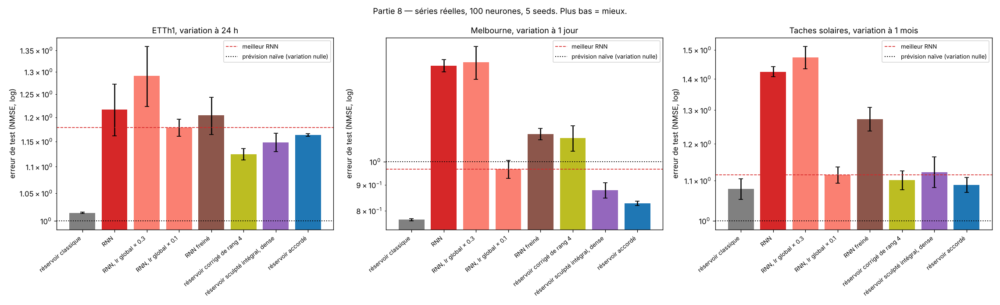

### Carte des tâches : pour quelles données ?

Douze tâches synthétiques de familles différentes (chaos, identification, télécommunications, bruit, peu de données, mémoire
longue), pour voir sur quel genre de données l'accordé garde un avantage. Référence à battre : une **régression linéaire** sur
une fenêtre de valeurs passées. 500 neurones, 3 graines.

| Tâche | Linéaire | Réservoir classique | RNN | GRU | LRU | Accordé | Accordé linéaire | Accordé contre le meilleur existant |
|---|---|---|---|---|---|---|---|---|
| Lorenz (+10) | 0.12 | 5.3e-4 | 4.6e-5 | **2.2e-7** | 0.012 | 4.2e-5 | 4.6e-3 | perd (×190) |
| Hénon (+3) | 0.80 | 0.52 | 0.86 | **8.4e-4** | 0.024 | 0.064 | 0.073 | perd (×77) |
| Lorenz-96, 40 entrées | **0.24** | 0.66 | 0.64 | 0.45 | 0.52 | 0.55 | 0.55 | perd (×1,2) |
| Wiener-Hammerstein (simulé) | 0.0081 | 0.058 | 0.015 | **5.9e-4** | 0.0083 | 0.0013 | 0.0056 | perd (×2,3) |
| Égalisation de canal | 0.012 | 0.013 | 0.010 | 0.0049 | 0.011 | **0.0036** | 0.0087 | gagne (×1,35) |
| Canal sans fil (CSI) | **0.0083** | 0.043 | 0.045 | 0.15 | 0.015 | 0.040 | 0.020 | perd (×2,7) |
| Amplificateur de puissance | 0.47 | 0.20 | 0.26 | 0.26 | 0.68 | **0.0035** | 0.75 | gagne (×74) |
| Mackey-Glass, entrée bruitée 20 % | 0.25 | 0.032 | **0.015** | 0.016 | 0.033 | 0.022 | 0.030 | perd (×1,4) |
| Mackey-Glass, 300 pas | 0.36 | 8.0e-4 | 1.5e-4 | 4.0e-5 | 0.0070 | **2.9e-5** | 0.013 | égalité |
| NARMA10, 300 pas | 0.21 | 0.53 | 0.32 | 0.46 | 0.128 | 0.233 | **0.111** | perd (×1,8) |
| Mémoire, délai 30 | **1.2e-19** | 1.18 | 1.32 | 1.37 | 0.249 | 0.179 | 0.117 | gagne (×1,4) |
| Mémoire, délai 60 | **1.3e-19** | 1.24 | 1.66 | 1.51 | 1.37 | 1.98 | 0.88 | perd (×1,4) |

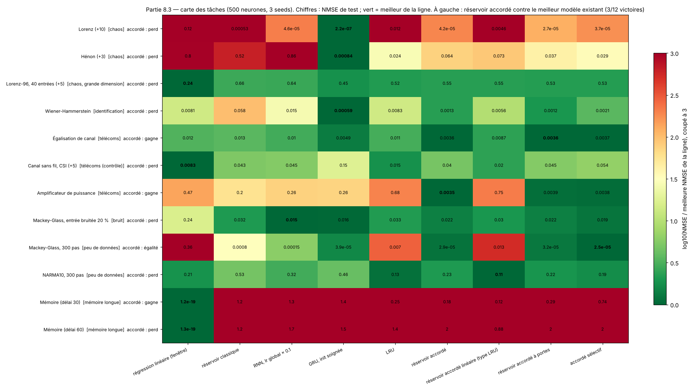

- **L'accordé ne gagne que sur trois tâches sur douze** (égalisation de canal, amplificateur, mémoire à 30 pas) et fait jeu égal
  sur une quatrième (Mackey-Glass avec 300 pas). Sur Lorenz et Hénon, faits de **produits de variables**, qu'une porte
  multiplicative représente directement, le GRU écrase les autres.
- Les mémoires pures sont résolues exactement par la régression linéaire : aucun modèle récurrent n'y a d'intérêt.
- Les portes ajoutées à l'accordé ne comptent que sur Hénon (1,8 fois) et Wiener-Hammerstein (1,2 fois) : elles ne sont pas
  ce qui manque à l'accordé sur les systèmes chaotiques (le GRU reste 120 et 40 fois devant).

**L'amplificateur, de plus près.** L'écart de 74 fois contre le GRU résiste à un entraînement plus long et à deux learning
rates. Mais à 3 000 points, le GRU a une erreur de test 638 fois supérieure à son erreur d'entraînement (3,8 fois pour
l'accordé) : c'est surtout du **sur-apprentissage**. Avec 20 000 points, l'écart tombe à 6 fois ; avec des entrées enrichies
(I, Q, |x|, |x|², comme dans les modèles du domaine), le GRU rejoint presque l'accordé (1,8 fois). Le polynôme à mémoire
généralisé, référence du domaine, est très mauvais avec nos réglages (non spécialistes). L'accordé n'est donc pas
« exceptionnel » sur ce système : il apprend bien avec peu de données.

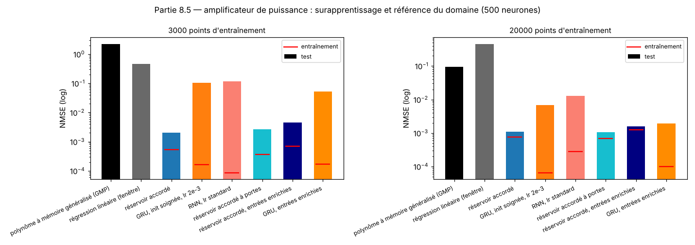

### Systèmes physiques réels : une égalité, une défaite

Trois bancs d'essai d'identification ([nonlinearbenchmark.org](https://www.nonlinearbenchmark.org)), mesurés sur de vrais
systèmes, en **simulation** (le modèle ne voit que l'entrée) : Silverbox (un oscillateur de Duffing électronique, trois tests),
Wiener-Hammerstein (filtre-diode-filtre), Cascaded Tanks (deux réservoirs d'eau, 1 024 points d'entraînement). 500 neurones,
3 graines, 1 500 pas ; RMSE dans l'unité du système.

| RMSE de test | Silverbox, multisinus (mV) | Silverbox, flèche avec extrapolation (mV) | Silverbox, flèche sans extrapolation (mV) | Wiener-Hammerstein (mV) | Cascaded Tanks (V) |
|---|---|---|---|---|---|
| Régression linéaire (fenêtre) | 7.1 | 14.4 | 6.7 | 43.4 | **0.65** |
| Réservoir classique | 29.0 | 33.7 | 26.3 | 83.4 | 2.50 |
| RNN, lr × 0,1 | 6.6 | 12.5 | 6.7 | 15.6 | diverge |
| GRU (754 500 paramètres) | 4.9 | **7.6** | 4.1 | **3.2** | diverge (1 graine sur 3) |
| LRU | 7.8 | 14.8 | 7.1 | 22.3 | 2.00 |
| Réservoir accordé (1 500) | 4.3 | 9.9 | 4.0 | 11.8 | 1.69 |
| Accordé à portes | 4.1 | 9.9 | 4.0 | 10.4 | 1.70 |
| Accordé + readout carré (partie 7) | 4.2 | 10.1 | 4.0 | 11.2 | 2.06 |
| Relais + accordé + readout carré (partie 7) | 6.4 | 15.2 | 6.3 | 21.2 | 2.46 |
| Réservoir nilpotent (partie 6) | 9.7 | 15.4 | 9.8 | 19.1 | 658 |
| Biais et entrées appris, sans g (partie 4, 1 000) | 13.3 | 17.2 | 11.2 | 22.6 | 3.03 |
| Cisaillé en bande, k = 3 (partie 5, 2 494) | 3.6 | 9.1 | 3.6 | 9.8 | 3.54 |
| **Cisaillé en bande, k = 10 (partie 5, 5 945)** | **2.9** | 8.1 | **2.8** | 7.8 | 4.27 |
| Cisaillé plein (partie 5, 125 750) | 10.8 | 15.4 | 10.4 | 18.3 | 440 |
| *Publié : meilleur modèle linéaire* | | *13.5* | | *56.2* | *0.75* |
| *Publié : GRU (Champneys et al., 2024)* | *1.49* | *2.80* | *0.95* | *3.97* | *0.40* |
| *Publié : état de l'art* | | *0.26* | *0.32* | *0.24* | *0.18 à 0.34* |

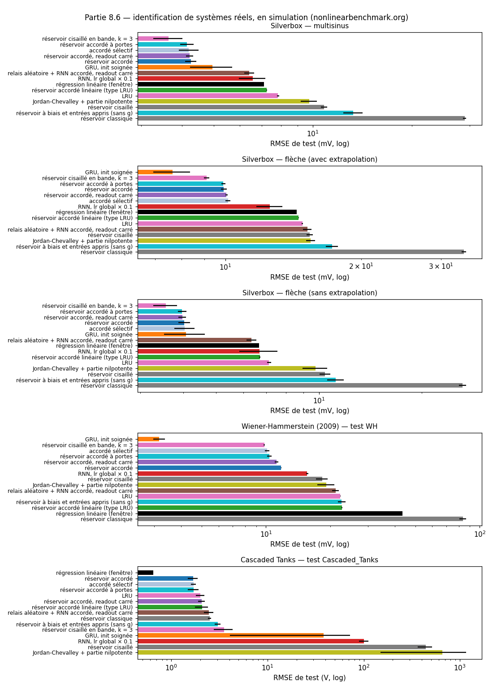

- **Silverbox : l'accordé égale le GRU**, avec 500 fois moins de paramètres (écarts appariés −0,06 ± 0,08 et 0,00 ± 0,07 sur
  deux tests), et le **cisaillé en bande, k = 10, fait mieux que lui** sur deux tests sur trois (2,9 contre 4,9 mV sur le
  multisinus), avec 127 fois moins de paramètres. Le GRU gagne quand il faut extrapoler hors de la plage d'amplitude vue à
  l'entraînement (7,6 contre 8,1 mV).
- **Wiener-Hammerstein : le GRU gagne nettement**, 3,2 à 3,7 fois, et fait même un peu mieux que le GRU publié.
- **Cascaded Tanks : aucun modèle récurrent ne bat la régression linéaire.**
- Notre régression linéaire retrouve le meilleur modèle linéaire publié : le protocole est cohérent. Mais tous nos modèles
  restent 7 à 40 fois derrière l'état de l'art, et le GRU publié, entraîné 10 000 à 20 000 époques avec une taille choisie par
  validation croisée, fait 3 à 4 fois mieux que le nôtre sur Silverbox.
- **Seul le cisaillé en bande transfère un gain synthétique** (1,5 fois l'accordé sur Silverbox et Wiener-Hammerstein, avec
  k = 10). Les autres ne
  se transfèrent pas : readout carré, aucun effet ; relais, 1,5 à 1,8 fois pire ; nilpotent et cisaillé pleins, 1,5 à 2,6 fois
  pire.
- **Les amplitudes g comptent ici pour l'accordé** : sans elles, l'erreur est 1,7 à 3 fois plus grande, alors que sur les
  séries synthétiques bien réglées elles ne servaient que sur NARMA10. Ajoutées au cisaillé, elles n'apportent presque rien.
- **Un quatrième système, EMPS**, qui n'avait servi à aucun réglage (table de positionnement en boucle fermée) : tous les
  modèles échouent, GRU compris (NMSE supérieure à 1) ; aucune conclusion.

## 8.4 Position par rapport à l'existant

**Trois familles proches de ce travail.**

- **Plasticité intrinsèque** ([Wardermann et Steil, ESANN 2007](https://www.esann.org/sites/default/files/proceedings/legacy/es2007-98.pdf) ;
  Schrauwen et al., 2008). Une règle locale et non supervisée adapte le **gain et le biais** de chaque neurone d'un réservoir,
  par descente de gradient sur une divergence de Kullback-Leibler à une distribution de sortie cible ; elle améliore NARMA10.
  La partie 4.2 montre qu'une grande part du gain de l'accordé vient de l'apprentissage des biais et des entrées : adapter un
  biais par neurone est donc connu, avec un autre critère. Une base IP à côté de l'accordé reste à mesurer.
- **Descente de gradient lente sur les poids d'un réservoir** : apprentissage récurrent d'Atiya-Parlos et
  rétropropagation-décorrélation (BPDC, Steil), qui apprennent la sortie vite et les poids internes lentement
  ([Lukoševičius et Jaeger, 2009](https://www.ai.rug.nl/minds/uploads/2261_LukoseviciusJaeger09.pdf)) : le RNN freiné de la
  partie 1 appartient à cette lignée.
- **LottaLoRA** (*A Little Rank Goes a Long Way: Random Scaffolds with LoRA Adapters Are All You Need*,
  [arXiv:2604.08749](https://arxiv.org/abs/2604.08749)). Chaque poids vaut `β·W_seed + (α/r)·B·A`, avec `W_seed` aléatoire figé,
  `B·A` de rang r appris et un scalaire β par couche ; 96 à 100 % de l'entraînement complet avec 0,5 à 40 % des paramètres
  sur neuf bancs d'essai, et un échafaudage qui doit rester **statique**. Une seule expérience récurrente : un réseau CfC
  aléatoire figé avec adaptateurs de rang r, en **classification** (mortalité en réanimation, PhysioNet 2012) ; AUROC 0,832
  au rang 1 contre 0,836 pour le réseau entraîné. Ni réservoir à échos classique, ni prédiction de séries chaotiques, ni
  comparaison à budget égal avec un GRU, ni amplitudes singulières. Le principe « base aléatoire figée + correction de rang r »
  n'est donc pas à revendiquer : le réservoir corrigé de rang r (partie 1) et l'accordé de rang r (partie 4.9) en sont des
  instances.

**Famille par famille.** Le détail est dans le bilan de chaque partie ; en résumé :

| Partie | Voisin le plus proche | Ce qui reste propre à ce travail |
|---|---|---|
| 1 · Mélanger | μP (Yang et al.) ; Atiya-Parlos, BPDC | l'équivalence pratique mélange = ralentissement avec Adam ; le mélange réglé, qui retrouve seul la règle |
| 2 · Sculpté | supermasks, Piggyback | un masque **continu et borné** sur un réservoir, comparé au masque binaire et au gain libre |
| 3 · Tourné | RNN orthogonaux (Lezcano-Casado) | la dissociation « spectre pour la mémoire, orientation pour la prédiction » sur un même réservoir |
| 4 · Accordé | VeRA, SVFit, SVFT ; plasticité intrinsèque ; LottaLoRA | le transfert vers la récurrence d'un réservoir ; les contrôles « qui apprend quoi » ; l'accordé linéaire face au LRU |
| 5 · Cisaillé | nnRNN (Kerg et al.) ; chaînes non normales (Ganguli et al.) ; réglage fin creux ; RNN linéaires à portes (minGRU, LRU) | le facteur N d'Iwasawa d'un réservoir, sans précédent trouvé, mais les contrôles montrent qu'il n'explique pas le gain ; une correction creuse de quelques milliers de coefficients, mesurée face au GRU et au LRU réglés |
| 6 · Nilpotent | nnRNN | rien de nouveau : une variante appliquée à un réservoir |
| 7 · Couplage | DT-RNN, NVAR, state-feedback ESN | une couche aléatoire figée dans la transition apprise ; la comparaison des quatre couplages |

Les briques sont connues séparément ; ce qui pourrait être nouveau est étroit : leur application à un réservoir aléatoire, les
contrôles qui montrent d'où vient le gain, et les comparaisons à protocole égal. La recherche bibliographique n'est pas
exhaustive (plusieurs articles n'ont été lus qu'à travers leur résumé ; voir les [références](references.md)).

## 8.5 Ce qui tient, et les limites

**Ce qui tient** (plusieurs graines, écarts appariés nets, plusieurs tailles) :
- À taille d'état égale, les modèles qui restent près d'un réservoir aléatoire battent largement le RNN qui apprend tout, à
  presque toutes les tailles de 100 à 2 000 neurones, sur les tâches synthétiques.
- Sur les séries synthétiques, le gain de l'accordé vient surtout des biais et des entrées ; bien réglé, un réservoir dont
  seuls les biais et les entrées apprennent l'égale sauf sur NARMA10. Sur les systèmes réels, les amplitudes deviennent
  indispensables.
- Une correction creuse de quelques milliers de coefficients récurrents (cisaillé en bande, ou les mêmes coefficients appris
  au hasard dans `W₀`) bat l'accordé sur les cinq tâches synthétiques à 500 neurones, avec un seul réglage pour toutes, sur des
  séries régénérées, et fait mieux que le GRU sur Silverbox. Avec le même budget de recherche, elle bat le GRU sur
  Mackey-Glass (3 fois) et le LRU sur NARMA10 (2 fois).
- Avec le même budget de recherche, 1 500 paramètres font mieux que le GRU sur Mackey-Glass et que le LRU sur NARMA10.
- Directions aléatoires figées et valeurs propres apprises : le principe égale le LRU complet avec 200 fois moins de paramètres.
- Un réservoir commun et un réglage rangé par tâche battent un RNN par tâche, sans oubli.

**Ce qui ne tient pas, ou pas encore** :
- La mémoire contre un LRU bien réglé ; les systèmes chaotiques à produits contre un grand GRU (à budget égal, la correction
  de rang r sans g le bat de 16 à 17 fois jusqu'à 33 000 paramètres) ; la classification ; les séries réelles bruitées ;
  Wiener-Hammerstein, où le GRU reste 3 fois devant tous nos modèles.
- Les gains de la non-normalité pleine (parties 5 et 6), du readout carré et des relais (partie 7) restent synthétiques.
- La structure K·A·N : le gain du cisaillé ne vient ni de la bande, ni de la base de la décomposition (partie 5.5).

**Limites générales du protocole.**
- Un seul optimiseur (Adam) et des durées fixes (1 500 pas ; 4 000 pour la première comparaison aux modèles existants ;
  3 époques sur MNIST, 10 avec la recherche).
- Des tâches de 3 000 points d'entraînement, qui limitent ce qu'un grand réseau peut en tirer.
- 3 graines dans la plupart des expériences PyTorch (5 dans la recherche équitable, 8 à 100 neurones en numpy).
- L'amplificateur et le canal sont simulés ; les références publiées des systèmes réels sont des modèles spécialisés,
  longuement réglés.
- Pas de théorie démontrée : les explications viennent de contrôles et de propriétés simples (borne de Perron-Frobenius,
  invariance par rotation, amplification transitoire), pas de théorèmes sur la performance.

---

[Sommaire](../README.md#le-rapport) · [← Partie 7](7_couplage.md) · [Partie 9 →](9_structure.md)
