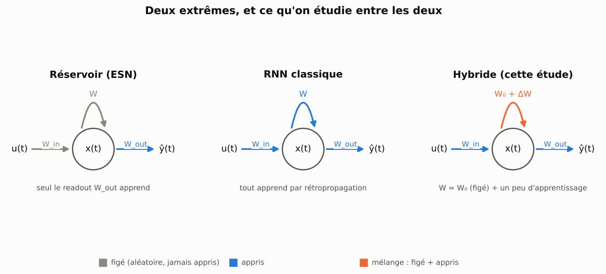
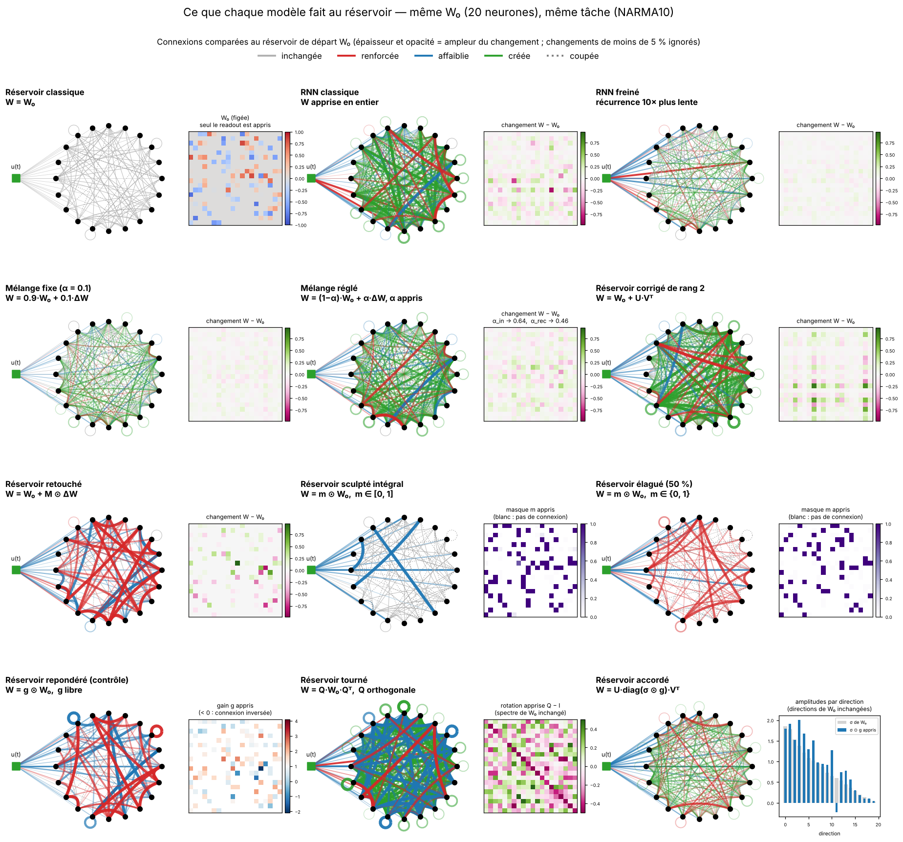

[Contents](../README.en.md#the-report) · [Part 1 →](1_melanger.md) · [Français](../rapport/0_introduction.md)

# Introduction — between a reservoir and an RNN

**The question.** A reservoir (Echo State Network) draws its recurrent matrix at random, freezes it, and learns only its
readout. An RNN learns everything. What happens in between, when the recurrence is allowed to learn **a little**, and in a
chosen way? Each part of this report fixes a rule ("only a speed is learned", "only an attenuation per connection is
learned", "only a gain per direction is learned"…), measures what it is worth, says on which tasks it works, and relates it
to what theory and the literature already say about it.




## The plan

| Part | What the recurrence is allowed to learn | File |
|---|---|---|
| 1 | everything, but slowly: **mixing** reservoir and RNN amounts to **slowing down** the recurrence | [1_melanger.md](1_melanger.md) |
| 2 | an attenuation between 0 and 1 per connection: the **sculpted reservoir** | [2_sculpte.md](2_sculpte.md) |
| 3 | a rotation, without touching the spectrum: the **rotated reservoir** | [3_tourne.md](3_tourne.md) |
| 4 | one gain per singular direction: the **tuned reservoir**, and all its extensions | [4_accorde.md](4_accorde.md) |
| 5 | a triangular shear (Iwasawa decomposition): the **sheared reservoir** | [5_cisaille.md](5_cisaille.md) |
| 6 | the eigenmodes and a nilpotent part (Jordan-Chevalley): the **nilpotent reservoir** | [6_nilpotent.md](6_nilpotent.md) |
| 7 | nothing in the reservoir: a frozen reservoir and a separate RNN, **coupled** | [7_couplage.md](7_couplage.md) |
| 8 | **synthesis**: all families compared, non-synthetic data, existing models, literature | [8_synthese.md](8_synthese.md) |
| 9 | the choice itself: **can the task choose its own structure?** from the gradient, and on tasks where the structure is planted | [9_structure.md](9_structure.md) |

Each part about a reservoir ends with the same three-point assessment: **where it works**, **the limits**, and **the link
with theory**. The leads still open and the stopping rule are gathered in the [appendix](annexe_pistes.md).

## Notation

A recurrent network updates its state as follows:

```
x(t+1) = tanh( W_in·u(t) + W·x(t) + b ),      ŷ(t) = W_out·x(t) + c
```

- A **classic RNN** learns `W_in`, `W`, `b` and `W_out` by backpropagation through time.
- A **classic reservoir** draws `W_in` and `W` at random, freezes them, and learns only `W_out` (by ridge regression).

Throughout the report, **`W₀`** is the random starting matrix (always frozen) and **`ΔW`** what is learned on top of it.
Unless stated otherwise, `W_in` and `b` learn too: this point matters a lot, and part 4 shows that a large share of the gain
comes from them.

| Name | Recurrent matrix | What is learned in the recurrence | Part |
|---|---|---|---|
| **Classic reservoir** | `W = W₀` | nothing | — |
| **Classic RNN** | full `W` (starting from `W₀`) | everything | — |
| **Slowed RNN** × f | same, everything learns f times more slowly | everything | 1 |
| **Braked RNN** | same, only the recurrence learns 10 times more slowly | everything | 1 |
| **Fixed mixture** | `W = (1−α)·W₀ + α·ΔW`, α fixed | `ΔW` | 1 |
| **Tuned mixture** | same, one `α_rec` for `W` and one `α_in` for `W_in`, learned | `ΔW`, `α_in`, `α_rec` | 1 |
| **Patched reservoir** | `W = W₀ + M ⊙ ΔW`, `M` = the existing connections | those connections | 1 |
| **Rank-r corrected reservoir** | `W = W₀ + U·Vᵀ` | `U`, `V` (rank r) | 1 |
| **Sculpted reservoir** | `W = m ⊙ W₀`, `m ∈ [0, 1]` per connection | `m` | 2 |
| **Fully sculpted reservoir** | same, and `W_in = m' ⊙ W_in₀` | the masks only | 2 |
| **Pruned reservoir** (control) | `W = m ⊙ W₀`, `m ∈ {0, 1}` | which connections to keep | 2 |
| **Reweighted reservoir** (control) | `W = g ⊙ W₀`, `g` free | `g` | 2 |
| **Rotated reservoir** | `W = Q·W₀·Qᵀ`, `Q` orthogonal | `Q` | 3 |
| **Tuned reservoir** | `W = U·diag(σ ⊙ g)·Vᵀ` (decomposition of `W₀`) | `g`, one gain per direction | 4 |
| **Reservoir with learned biases and inputs** ("without g" control) | `W = W₀` | nothing; only `W_in` and `b` learn | 4 |
| **Sheared reservoir** | `W = Q·(R + S)` (QR decomposition of `W₀`) | `S`, strictly triangular part | 5 |
| **Banded sheared reservoir** | same, `S` restricted to the first k superdiagonals | k·N coefficients of `S` | 5 |
| **Nilpotent reservoir** | `W = S(g, φ) + Qr·T·Qrᵀ` | eigenmodes and nilpotent part | 6 |
| **Cross duo, random relay, learned relay** | two separate networks | the RNN and its links to the reservoir | 7 |

To see what each model does to the reservoir, here is each one trained on a small network of 20 neurons (same starting
reservoir, same task). On the left, the network after training; on the right, what actually changed.



The classic RNN **creates** connections everywhere; the braked RNN and the fixed mixture make the same changes, much weaker.
The patched reservoir only touches the existing connections. The sculpted reservoir can only weaken or cut them; the
reweighted one can also strengthen or flip them. The rotated reservoir changes the whole wiring but keeps exactly the same
spectrum.


## The protocol

- **Main tasks**: series of 4,000 steps, 3,000 for training and 1,000 for testing.
  *Mackey-Glass*: chaotic series (τ = 17), predict 15 steps ahead.
  *NARMA10*: nonlinear system with order-10 memory, a classic reservoir benchmark.
  *Memory*: recall the input from 15 steps earlier (uniform random input).
  *Lorenz* (predict x at +10 steps) and *Hénon* (+3 iterations): two chaotic systems built from products of variables,
  added for parts 3 to 7.
- **Network**: 100 neurons (500 for the large-size comparisons), sparse reservoir (10 % of connections) with spectral radius
  0.9, input scale 0.5. Part 2: a "dense" reservoir as well (all connections, same spectral radius).
- **Training**: backpropagation through time (numpy at 100 neurons, PyTorch beyond; both versions are checked to be
  identical), Adam (lr 2e-3), 1,500 steps, batches of 32 windows of 60 steps, gradient clipped at 1, zero starting readout.
- **Evaluation**: the final readout is recomputed by ridge regression on the states, then the NMSE
  (`MSE / variance of the target`) is measured on the test set.
- **Paired seeds**: for a given seed, all models start from the same reservoir and see the same windows; comparisons use the
  paired gap `log10(NMSE / NMSE_ref)` (−0.3 ≈ half the error). A gap counts as real if it exceeds max(2 standard errors;
  0.05).
- **Checks**: gradients verified by finite differences, PyTorch version identical to the numpy version, and one test per
  model (the repository contains more than 200).

---

[Contents](../README.en.md#the-report) · [Part 1 →](1_melanger.md)
