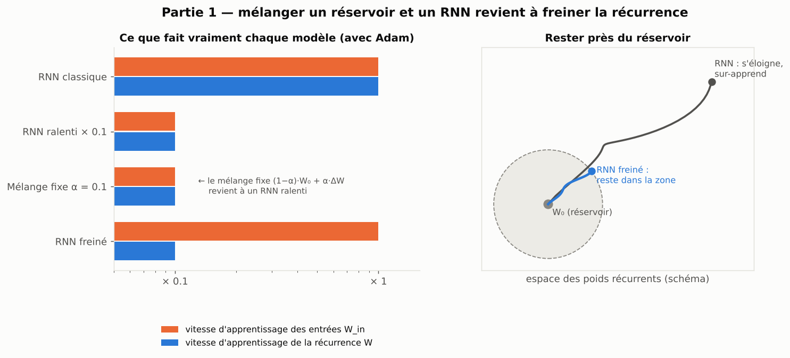
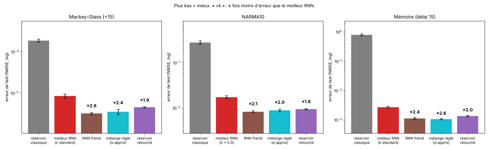
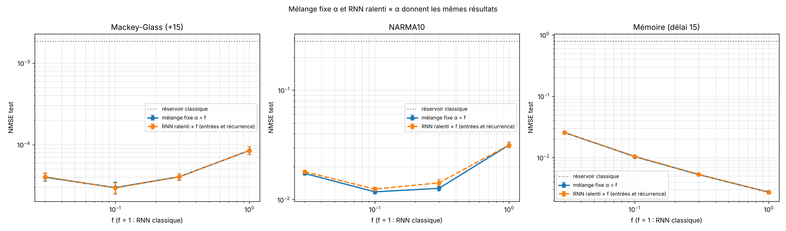
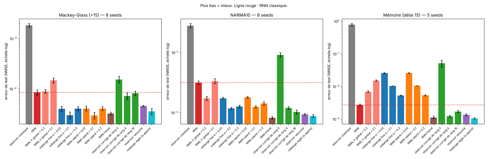
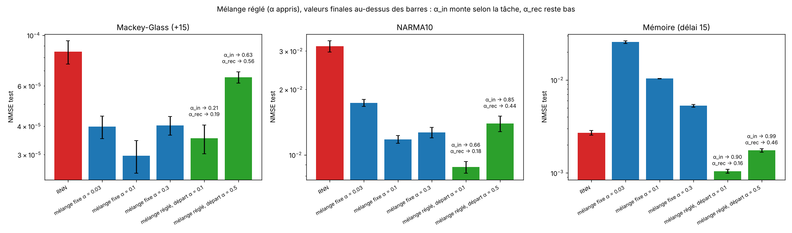
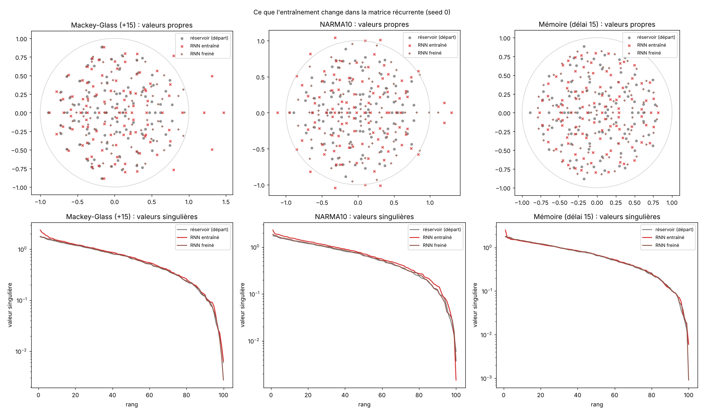
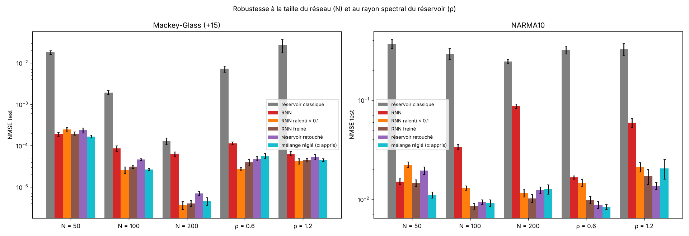

[Contents](../README.en.md#the-report) · [← Introduction](0_introduction.md) · [Part 2 →](2_sculpte.md) · [Français](../rapport/1_melanger.md)

# Part 1 — Mixing a reservoir and an RNN: it is slowing down

> **What to remember**
>
> - The mixture `W = (1−α)·W₀ + α·ΔW` mixes nothing: with Adam, it is exactly equivalent to learning α times more slowly.
> - The rule that follows, the **braked RNN** (inputs at full speed, recurrence 10 times slower), makes 2 to 2.6 times less error than the best RNN at 100 neurons, and the gap grows with size. With one learned α per matrix, the network finds this rule by itself.
> - It is very close to a known prescription from the theory of large networks (μP) and to the APRL/BPDC line of reservoirs: the interest is in reaching it through mixing, not in novelty.

The most direct idea to "mix" a reservoir and an RNN is to write the recurrent matrix as an average: a fixed random part, a
learned part. We test it, understand why it reduces to braking, and derive a simple rule from it.

| Task | Classic reservoir | Best RNN | Braked RNN | Tuned mixture | Patched reservoir |
|---|---|---|---|---|---|
| Mackey-Glass (+15 steps) | 0.0018 | 0.000085 | **0.000032** | 0.000035 | 0.000045 |
| NARMA10 | 0.279 | 0.0173 | **0.0082** | 0.0088 | 0.0094 |
| Memory (delay 15) | 0.785 | 0.0027 | 0.0011 | **0.0010** | 0.0013 |

Test NMSE (lower = better), 100 neurons, mean over 8 seeds (5 for memory). "Best RNN": the best of three learning rates for
each task. All gaps to the best RNN are significant (|t| > 4 on the paired differences).

## 1.1 The fixed mixture is a slowed RNN

With Adam, mixing `(1−α)·W₀ + α·ΔW` gives **the same results** as an RNN whose weights all learn α times more slowly
(within 2 % on Mackey-Glass and memory, within 11 % on NARMA10). The reason fits in one line: the gradient of `ΔW` is
multiplied by α, Adam normalizes the scale of the gradients, so the step on `ΔW` is unchanged, and the effective step on `W`
is multiplied by α. The mixture is therefore not an architecture of its own: it is a brake on learning.

## 1.2 Braking the recurrence beats the RNN, even well tuned

The natural worry: the RNN might just be badly tuned. It therefore gets three learning rates (standard, × 0.3, × 0.1) and is
compared with the best of the three, task by task. Paired gap `log10(NMSE / best RNN)`:

| | Mackey-Glass | NARMA10 | Memory |
|---|---|---|---|
| Braked RNN (recurrence 10 times slower) | −0.41 ± 0.05 | **−0.32 ± 0.02** | −0.39 ± 0.06 |
| Tuned mixture (learned α) | −0.39 ± 0.08 | −0.29 ± 0.02 | **−0.41 ± 0.05** |
| Patched reservoir | −0.25 ± 0.04 | −0.26 ± 0.03 | −0.31 ± 0.04 |
| Rank-4 corrected reservoir | −0.09 ± 0.08 | −0.16 ± 0.04 | −0.35 ± 0.05 |

Lowering the **global** learning rate of the RNN is not enough: on Mackey-Glass it changes nothing or makes things worse; on
memory it makes things worse; on NARMA10 it helps (0.032 → 0.017) but stays twice behind. What matters is braking the
recurrent dynamics **specifically**.

## 1.3 Braking the inputs too is a mistake

If everything is slowed down (inputs **and** recurrence), it works on Mackey-Glass and NARMA10, but fails on memory (4 times
worse than the RNN): to remember, the network must learn to inject the input well.

| | Mackey-Glass | NARMA10 | Memory |
|---|---|---|---|
| RNN | 0.000085 | 0.0316 | 0.0027 |
| Slowed RNN × 0.1 (inputs and recurrence) | 0.000029 | 0.0125 | 0.0105 |
| Braked RNN (recurrence only × 0.1) | 0.000032 | **0.0082** | **0.0011** |

The same effect shows on row-by-row MNIST (256 neurons, 3 epochs, the same settings for all): 4.96 % error for the braked
RNN against 7.01 % for the slowed RNN.

## 1.4 The network finds the rule by itself

With the **tuned mixture** (`α_in` and `α_rec` learned by backpropagation, starting at 0.1), the network:

- raises `α_in` according to what the task needs: **0.21** (Mackey-Glass), **0.66** (NARMA10), **0.90** (memory);
- keeps `α_rec` low on every task: **0.16 to 0.19**.

It therefore chooses to learn its inputs and to keep dynamics close to random. It is the best model on memory and the
second on NARMA10. Limit: the result depends on the starting point; starting from α = 0.5, the α stay higher and the scores
are worse (but still better than the RNN).

## 1.5 What braking changes in the matrix

On one seed per task, the spectrum of the starting reservoir is compared with that of the learned matrices:

| | Spectral radius | Largest singular value | Relative change of `W` |
|---|---|---|---|
| Starting reservoir | 0.90 | 1.75 | 0 |
| RNN — Mackey-Glass / NARMA10 / memory | 1.47 / 1.30 / 0.81 | 2.38 / 2.31 / 2.51 | 0.35 / 0.48 / 0.38 |
| Braked RNN — same tasks | 0.98 / 1.11 / 0.86 | 1.78 / 1.87 / 1.80 | 0.12 / 0.18 / 0.15 |

The classic RNN pushes eigenvalues outside the unit circle on the prediction tasks. On memory, it does the opposite: it
**lowers** the spectral radius but **increases** the largest amplification, a known transient-memory mechanism of non-normal
networks (Ganguli et al., 2008), which parts 5 and 6 test directly. The braked RNN changes the matrix 2.5 to 3 times less and
stays in the reservoir regime.

Memory capacity (part 4.3) says the same thing from the inside: at 100 neurons, the braked RNN keeps a longer memory than the
RNN (26 against 22 when trained on memory) and computes more nonlinearity on NARMA10 (45 against 27).

## 1.6 The advantage grows with size

Gap to the RNN of the same size, over 5 seeds:

| | N = 50 | N = 100 | N = 200 |
|---|---|---|---|
| Mackey-Glass, braked RNN | ≈ 0 (+0.02) | −0.43 | **−1.20** (16 times) |
| NARMA10, braked RNN | ≈ 0 (−0.01) | −0.60 | **−0.93** (8.5 times) |

With a small network, no advantage; with 200 neurons, the gap becomes very large, partly because the classic RNN degrades
(NARMA10: 0.034 at N = 100, 0.087 at N = 200) while the braked variant keeps improving. As for the spectral radius of the
reservoir: with ρ = 0.6, the braked variants clearly beat the RNN (1.7 to 3 times); with ρ = 1.2, the gap is large on NARMA10
(3 to 4 times) but small on Mackey-Glass (1.2 to 1.4 times).

At 500 neurons (3 seeds), the RNN is hard to tune (one seed in three is 10 times worse at the standard learning rate).
Against the best of four learning rates, the braked RNN does 6 times better on Mackey-Glass and 3 times better on NARMA10;
the tuned mixture 10 and 3 times. But at this size, the more constrained models of the following parts move ahead: the rank-4
corrected reservoir does 13 and 9 times better than the RNN, the tuned reservoir 15 and 9 times.

## 1.7 Two other ways of staying close to the reservoir

- **The patched reservoir** (`W = W₀ + M ⊙ ΔW`) only learns the connections that already exist in the sparse reservoir. It
  beats the RNN by 1.8 to 2 times at 100 neurons, and it is the best model on row-by-row MNIST (4.01 % against 4.41 % for the
  RNN), but an RNN starting from a **dense** reservoir does as well (4.05 %): on MNIST, its advantage does not clearly come
  from the constraint.
- **The rank-r corrected reservoir** (`W = W₀ + U·Vᵀ`) only learns a few directions. At 100 neurons, rank 4 wins mostly on
  memory (2.2 times); at 500 neurons, it becomes one of the best models (on par with the tuned reservoir on NARMA10, 0.0101);
  at 2,000 neurons, it is the best on Mackey-Glass (3.2e-9). Rank 16 is worse than rank 4 everywhere: more freedom does not
  help.

## 1.8 Assessment of part 1

**Where it works.** On the three main tasks, at 100 and 200 neurons, braking the recurrence (braked RNN, tuned mixture)
beats the well-tuned RNN by 2 to 16 times, and the advantage grows with size. Keeping the inputs free is indispensable as soon
as the task requires memory.

**The limits.**
- At 500 neurons, braking is overtaken by models that learn far less (rank 4, tuned), and adding it to these models always
  **degrades** them (up to 14 times on Mackey-Glass): an already constrained model does not need to be slowed down on top.
- On row-by-row MNIST, braking does not pay off in 3 epochs (braked RNN 4.96 % against 4.41 % for the RNN). On three real
  series (transformer temperature, Melbourne temperature, sunspots), no trained model does better than the classic reservoir
  (part 8.3).
- The result on learned α depends on the starting point; Lorenz and Hénon were not measured for these models.

**The link with theory.**
- *Adam and mixing.* The equivalence between mixing and slowing down is a direct consequence of Adam's invariance to the
  scale of the gradient (section 1.1).
- *μP.* In the theory of wide networks ([Yang and Hu, 2021](https://arxiv.org/abs/2011.14522);
  [Yang et al., 2022](https://arxiv.org/abs/2203.03466)), the μP parametrization prescribes, with Adam, keeping the learning
  rate of the input weights constant and dividing that of the hidden weights by the width. The braked RNN, and the fact that
  its advantage grows with N, look very much like this prescription: it is the most likely explanation, and the main limit
  to novelty. The published validations of μP concern MLPs, CNNs and Transformers; an explicit test on RNNs derived from a
  reservoir (does the optimal recurrent learning rate scale as 1/N?) remains to be done.
- *Reservoirs with slow internal weights.* The Atiya-Parlos methods and backpropagation-decorrelation (BPDC, Steil) learn the
  output quickly and the internal weights slowly or little
  ([Lukoševičius and Jaeger, 2009](https://www.ai.rug.nl/minds/uploads/2261_LukoseviciusJaeger09.pdf)): the braked RNN belongs
  to this line.
- *Lazy learning and low rank.* A high-rank initial connectivity makes learning "lazier"
  ([Liu et al., ICLR 2024](https://arxiv.org/abs/2310.08513)); here, braking the departure from the reservoir **improves**
  performance. The changes learned by a randomly initialized RNN are naturally low-rank
  ([Schuessler et al., 2020](https://arxiv.org/abs/2006.11036)), which explains why a rank-4 correction loses little.
  "Frozen random base + low-rank correction" is moreover the principle of LottaLoRA (part 8.4), and the patched reservoir
  takes up the idea of [Palangi et al. (2013)](https://arxiv.org/abs/1311.2987), who only learn the nonzero connections of a
  sparse reservoir.

---

[Contents](../README.en.md#the-report) · [← Introduction](0_introduction.md) · [Part 2 →](2_sculpte.md)
