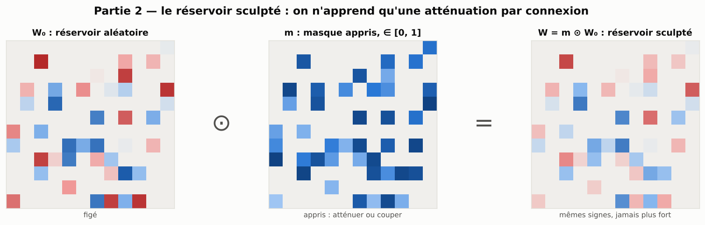
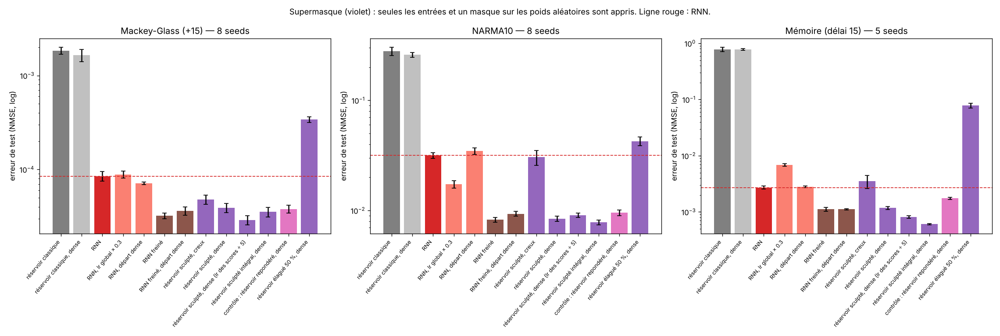
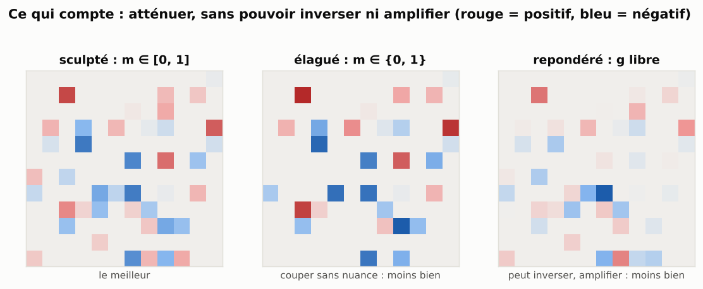

[Contents](../README.en.md#the-report) · [← Part 1](1_melanger.md) · [Part 3 →](3_tourne.md) · [Français](../rapport/2_sculpte.md)

# Part 2 — The sculpted reservoir: learning only an attenuation per connection

> **What to remember**
>
> - Attenuating each connection of a dense reservoir by a coefficient between 0 and 1, without ever changing the value of a weight, beats the RNN: it is the best model of the study on NARMA10 and memory at 100 neurons, and the best on memory at every size tested.
> - The **bound** is what matters: a binary mask (pruned) or a free gain (reweighted) do clearly worse.
> - The mask has as many parameters as a dense RNN: the gain is about what the network is allowed to do, not about its size. The idea is very close to *supermasks*.

Part 1 shows that one should stay close to the reservoir. Here we go further: the random values are not touched at all. For
each connection, only a coefficient `m ∈ [0, 1]` that attenuates it is learned (`W = m ⊙ W₀`, with `m = sigmoid(s)`,
starting at `m ≈ 0.95`). A connection can be weakened or cut, never flipped or amplified. In the **fully sculpted
reservoir**, the same is done for the input weights: only these masks, the bias and the readout learn. "Dense reservoir"
variant: all connections exist at the start (same spectral radius 0.9), which gives much more material to sculpt.

## 2.1 Attenuating random weights is enough to beat an RNN

100 neurons, 8 seeds (5 for memory):

| | Mackey-Glass | NARMA10 | Memory |
|---|---|---|---|
| Classic reservoir (sparse / dense) | 0.0018 / 0.0016 | 0.279 / 0.260 | 0.785 / 0.782 |
| Best RNN | 0.000085 | 0.0173 | 0.0027 |
| RNN, dense start | 0.000071 | 0.0346 | 0.0028 |
| Part 1: braked RNN | **0.000032** | 0.0082 | 0.0011 |
| Sculpted reservoir, sparse start (free inputs) | 0.000048 | 0.0304 | 0.0035 |
| Sculpted reservoir, dense (free inputs) | 0.000039 | 0.0084 | 0.0012 |
| **Fully sculpted reservoir** (masks on W and W_in, dense) | 0.000035 | **0.0078** | **0.00060** |
| Control: reweighted reservoir (can flip or amplify) | 0.000038 | 0.0095 | 0.0017 |
| Pruned reservoir (50 % of connections kept) | 0.00034 | 0.043 | 0.078 |

The fully sculpted reservoir beats the best RNN on all three tasks (paired gap −0.38 ± 0.08, −0.34 ± 0.05, −0.65 ± 0.02:
**2.4, 2.2 and 4.5 times less error**). It ties with the braked RNN on Mackey-Glass and NARMA10, and does 1.8 times better
on memory, while no weight value is modified.

The dense reservoir is indispensable: on the sparse reservoir (10 % of connections), the sculpted one at best ties with the
RNN. A dense classic reservoir, for its part, is no better than a sparse one: density only serves to give more connections to
modulate.

## 2.2 It is not pruning, it is a fine attenuation

- **Pruned reservoir** (binary mask: keep or cut, like the supermasks of image networks): clearly worse than the RNN on all
  three tasks.
- **Binarizing afterwards** the learned continuous mask (keep if `m > 0.5`) destroys performance: 0.029 instead of 0.0006 on
  memory, 0.033 instead of 0.0078 on NARMA10. Yet about 80 % of the connections have `m > 0.5`: the network keeps almost
  everything, but finely adjusts the strength of each connection.

## 2.3 What matters: not being able to flip or amplify

The **reweighted reservoir** is identical to the sculpted one, except that the coefficient is no longer bounded: each
connection can change sign or be amplified. It does **2.9 times worse on memory** (−0.46 ± 0.02), a little worse on NARMA10
(−0.09 ± 0.02) and the same on Mackey-Glass. The constraint itself helps. Caveat: a single learning rate was tested for this
control, and dividing that of the masks by 5 changes the scores a little (memory 0.00081, NARMA10 0.0090).

## 2.4 At larger sizes

- **500 neurons, 1,500 steps** (3 seeds): the fully sculpted reservoir does 13 times better than the best RNN on Mackey-Glass
  and 5 times on NARMA10; on memory, it does **3 times better than the tuned reservoir** (0.0006 against 0.0019), and no
  variant of the tuned reservoir matches it.
- **500 neurons, 4,000 steps, against existing models** (settings chosen on the test set): on memory, 0.00018, the best
  score of this whole comparison (27 times ahead of the LRU in this protocol). It was not included in the fair search of
  part 8.2, where a well-tuned LRU reaches 1.0e-4: the sculpted reservoir would have a serious opponent there.
- **From 100 to 2,000 neurons** (3 seeds): first on memory **at every size** (5e-4 to 1e-3, 3 to 4.5 times ahead of the
  tuned reservoir); first on NARMA10 at 100 and 200 neurons, then it degrades (0.017 at 500, 0.059 at 2,000: the readout
  overfits the 3,000 points); on Mackey-Glass, first at 100 and 1,000 neurons.

| Memory | N = 100 | 200 | 500 | 1,000 | 2,000 |
|---|---|---|---|---|---|
| Best RNN | 0.016 | 0.015 | 0.036 | 0.044 | 0.044 |
| Tuned reservoir | 0.0029 | 0.0018 | 0.0019 | 0.0020 | 0.0044 |
| **Fully sculpted reservoir** | **0.00065** | **0.00055** | **0.00060** | **0.00050** | **0.0010** |

- **What it computes** (memory capacity, 100 neurons): trained on NARMA10, it is the model that gains the most nonlinear
  capacity (48 out of 100, against 27 for the RNN); the three best models on NARMA10 are the three that have the most.
- **Combined with the tuned reservoir**, it brings nothing more than alone: tuned + fully sculpted does exactly like the fully
  sculpted one on memory (×3.1 against ×3.1 at 500 neurons) and worse elsewhere.

## 2.5 On non-synthetic data

- **Row-by-row MNIST** (256 neurons, the same settings for all): the sculpted reservoir with free inputs matches the RNN
  (4.48 % against 4.41 %) without changing the value of any recurrent weight; the fully sculpted one, which does not even
  learn the inputs, goes from 27.6 % (classic reservoir) to 6.4 % and is still improving at the last epoch.
- **Real series** (100 neurons): on the daily temperature in Melbourne, it does better than the RNN (0.88 against 0.97, an
  NMSE of 1 being the naive forecast), but worse than the classic reservoir (0.77), which does not overfit.

## 2.6 Assessment of part 2

**Where it works.** Memory tasks, at every size (it is the best model of the study on memory), and NARMA10 at small size.
It matches the RNN on row-by-row MNIST.

**The limits.**
- The mask has N² parameters: it is not a frugal model. It requires a dense reservoir.
- It degrades as the network grows on NARMA10, like the other models that learn N² coefficients.
- Not measured on Lorenz, Hénon and real physical systems; absent from the fair search (part 8.2). The learning rate of the
  masks and that of the reweighted control were not finely optimized.

**The link with theory.**
- *A stability bound.* For any matrix `A`, the spectral radius satisfies `ρ(A) ≤ ρ(|A|)`, and `ρ` is increasing in each
  entry of a nonnegative matrix (Perron-Frobenius). With `m ∈ [0, 1]`, we therefore have
  `ρ(m ⊙ W₀) ≤ ρ(|m ⊙ W₀|) ≤ ρ(|W₀|)`: whatever it learns, the sculpted reservoir cannot exceed the spectral radius of
  `|W₀|`. The reweighted one has no bound at all. This property is consistent with the fact that the bound mostly helps
  memory (where unstable or saturated dynamics are costly), without being a proof of it.
- *Masks on random weights.* A well-performing subnetwork already hides in a random network
  ([Ramanujan et al., 2020](https://arxiv.org/abs/1911.13299); Zhou et al., 2019), including in ResNets with shared weights
  ([Hidden-Fold Networks](https://arxiv.org/abs/2111.12330)); thresholded real-valued masks adapt a pretrained network
  ([Piggyback, Mallya et al., 2018](https://arxiv.org/abs/1801.06519)); training only the normalization
  ([Frankle et al., 2021](https://arxiv.org/abs/2003.00152)) or only the biases
  ([Williams et al., ICLR 2025](https://arxiv.org/abs/2407.00957)) of a frozen network remains very expressive.
- *On the reservoir side.* There is heuristic pruning followed by retraining the readout
  ([Dynamical Mode Pruning, 2026](https://www.alphaxiv.org/abs/2608.04593)) and gates that globally modulate the input and the
  spectral radius of a frozen reservoir ([Self-Modulated RC, 2023](https://arxiv.org/abs/2301.09235)); modulating the gain of
  the neurons of a frozen recurrent network is studied in neuroscience
  ([Stroud et al., 2018](https://cbl.eng.cam.ac.uk/hennequin/publications/stroud-natneuro-2018/)). No work was found that learns
  a bounded attenuation connection by connection on a reservoir for time series, or that directly compares a bounded
  continuous mask, a binary mask and a free gain; but the form is identified.

---

[Contents](../README.en.md#the-report) · [← Part 1](1_melanger.md) · [Part 3 →](3_tourne.md)
