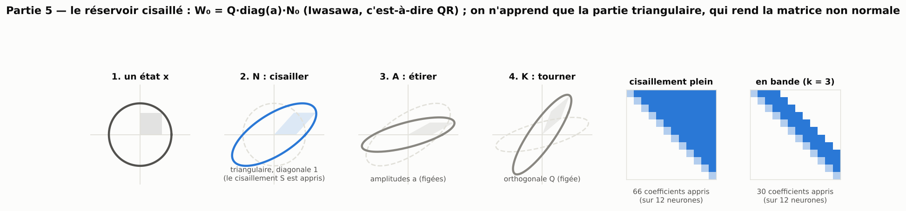
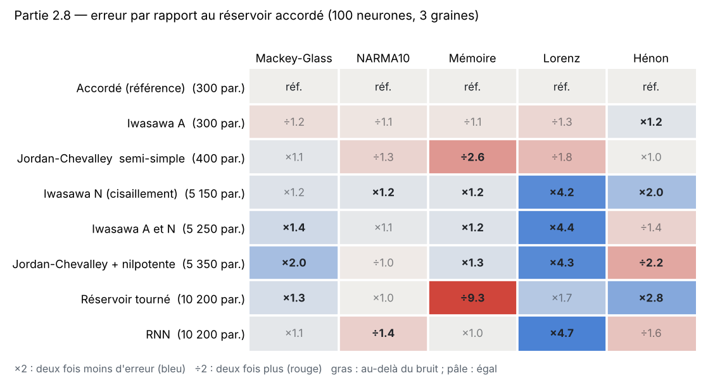
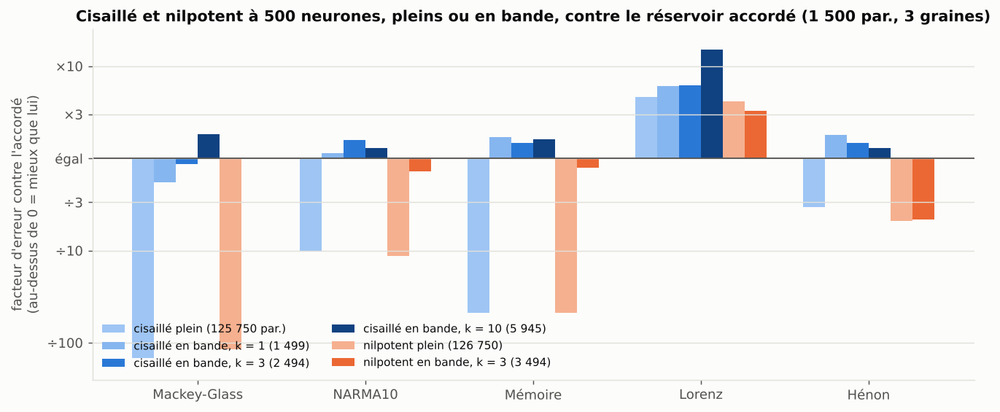
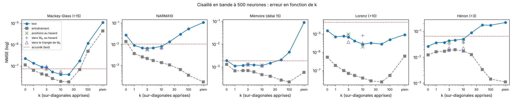
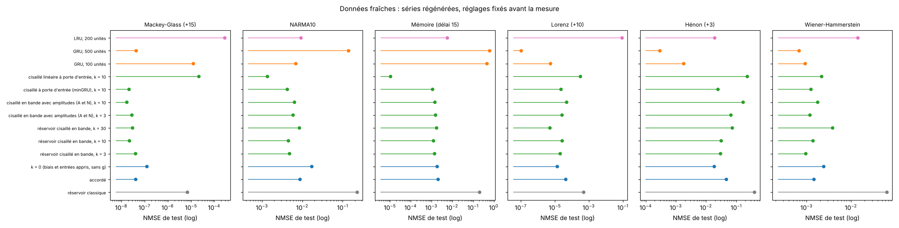
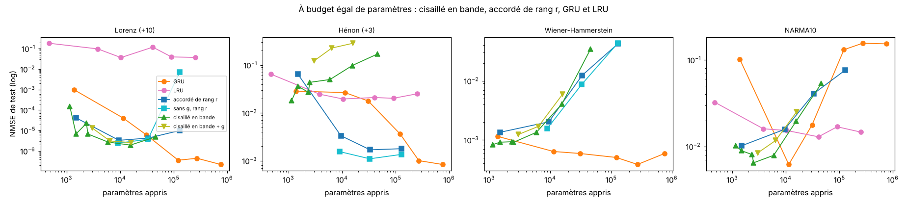
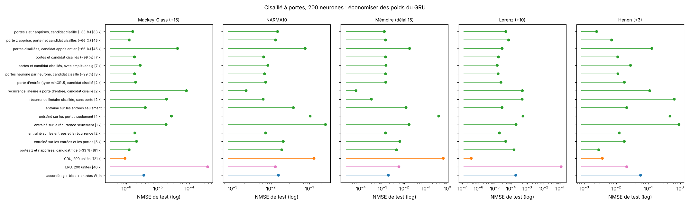

[Contents](../README.en.md#the-report) · [← Part 4](4_accorde.md) · [Part 6 →](6_nilpotent.md) · [Français](../rapport/5_cisaille.md)

# Part 5 — The sheared reservoir: learning the N factor of the Iwasawa decomposition

> **What to remember**
>
> - The reservoir is written `W₀ = K·A·N₀` (Iwasawa decomposition) and only the N factor, the shear, is learned: the rotation K and the gains A stay those of the reservoir. It is a piece that the tuned reservoir cannot learn.
> - Full (N(N−1)/2 parameters), the shear helps at 100 neurons but collapses at 500. **Banded** (k superdiagonals, k·N parameters), it beats the tuned reservoir on all five tasks at 500 neurons. The gain does not come from a k tuned task by task: a single k = 10 for all tasks does almost as well as the best k of each task, and the ranking holds on regenerated series.
> - **But the shear is not what matters.** The same number of coefficients, placed at random in the triangle, or learned directly in `W₀` without going through the decomposition, does as well. The gain comes from a small sparse correction of the recurrence, not from the K·A·N structure.
> - Against existing models, with the same search budget: 3.3 times better than the GRU on Mackey-Glass, 2 times better than the LRU on NARMA10; a clear defeat on Lorenz. A linear variant with an input gate does 8 times better than the LRU on NARMA10 and 23 times better on memory.

The tuned reservoir learns the gains of the singular value decomposition, the rotated one its orientations. A matrix can be
written in other ways, and each writing separates other degrees of freedom. Three classic decompositions of matrix groups
organize parts 4 to 6:

| Part | Decomposition | Factors | What is learned |
|---|---|---|---|
| 4 · Tuned | Cartan, `K·A·K` (singular values) | `U`, `diag(σ)`, `Vᵀ` | the gains A |
| **5 · Sheared** | **Iwasawa, `K·A·N`** | orthogonal `Q`, positive `diag(a)`, unipotent `N₀` | **the N factor** (and A in the "with gains" variant) |
| 6 · Nilpotent | Jordan-Chevalley | semisimple part, nilpotent part | the nilpotent part |

For an invertible matrix, the Iwasawa decomposition is unique: `W₀ = K·A·N₀`, where K is orthogonal, A diagonal with strictly
positive entries, and `N₀` upper triangular with unit diagonal. N is a product of **shears** (transvections: adding to one
coordinate a multiple of another). It is computed by Gram-Schmidt, that is, by the QR decomposition: `K = Q`, `A = diag(a)`
with `a` the diagonal of `R` (made positive), and `N₀ = diag(a)⁻¹·R`.

| Model | Form | What is learned | Parameters at 100 neurons |
|---|---|---|---|
| Iwasawa, gains (A) | `W = Q·diag(g)·R` | the gains `g` | 300 |
| **Sheared reservoir** (N) | `W = Q·(R + S)` | `S`, strictly triangular | 5,150 |
| Sheared + gains (A and N) | `W = Q·diag(g)·(R + S)` | both | 5,250 |

Since `S` is strictly triangular, it does not touch the diagonal of `R`, and `W = Q·(R + S) = K·A·N'` with
`N' = N₀ + diag(a)⁻¹·S`: only the N factor changes. The set of reachable matrices is exactly the orbit of `W₀` under the group
N. Two remarks on this choice:

- **The parametrization is additive on `R`**, not on N. The same step on `S_ij` moves `N'_ij` by `S_ij / a_i`: the rows where
  `a_i` is small are those that `S` modifies the most, relative to their starting content. On our reservoirs (500 neurons, 10 %
  of connections), the `a_i` decrease with the row index, from 0.85 on average over the first 50 rows to 0.18 over the last 50
  (minimum 0.04).
- **The singular case.** If `W₀` is not invertible, some `a_i` are zero and the Iwasawa decomposition no longer applies in the
  strict sense. `W = Q·(R + S)` remains defined (the code never divides by `a`): it is then an extension through QR. Our
  reservoirs are invertible (smallest `a_i`: 0.004 to 0.009 over five seeds, at 100 and 500 neurons); a very sparse reservoir
  (3 % of connections at 100 neurons) has 10 to 14 zero diagonal entries out of 100.

At the start, all these models reproduce exactly `W₀` (error of order 10⁻⁷, checked by a test). As everywhere, `W_in` and the
biases learn too.

## 5.1 Results at 100 neurons

Five tasks, 3 seeds. Error factor relative to the tuned reservoir (×2 = half the error, ÷2 = twice as much); in bold, beyond
the noise threshold.

| Model | Parameters | Mackey-Glass | NARMA10 | Memory | Lorenz | Hénon |
|---|---|---|---|---|---|---|
| Tuned reservoir, NMSE | 300 | 9.0e-5 | 0.023 | 0.0029 | 6.3e-4 | 0.042 |
| Iwasawa: gains (A) | 300 | ÷1.2 | ÷1.1 | ÷1.1 | ÷1.3 | **×1.2** |
| **Sheared reservoir (N)** | 5,150 | ×1.2 | **×1.2** | **×1.2** | **×4.2** | **×2.0** |
| Sheared + gains (A and N) | 5,250 | **×1.4** | ×1.1 | **×1.2** | **×4.4** | ÷1.4 |
| *Part 3: rotated reservoir* | 10,200 | **×1.3** | ×1.0 | **÷9.3** | ×1.7 | **×2.8** |
| *RNN* | 10,200 | ×1.1 | **÷1.4** | ×1.0 | **×4.7** | ÷1.6 |

- **The shear helps, especially on Lorenz**: 4.2 times better than the tuned reservoir, almost as much as the RNN (4.7 times)
  with half the parameters. What the RNN gains over the tuned reservoir on Lorenz therefore seems to be, for the most part,
  non-normality: it is recovered by keeping the rotation and the gains frozen and learning only the triangular part.
- **It is the most regular model of the study**: equal or better on all five tasks, never worse, with a clear gain on four
  (NARMA10, memory, Lorenz, Hénon).
- **At equal budget (300 parameters), nothing beats the tuned reservoir**: the Iwasawa gains amount to the same thing.
  Singular values remain the best choice when only one number per direction is learned.
- Adding the gains to the shear does not help, and even loses the gain on Hénon.
- On memory, the shear helps a little relative to the gains alone (×1.2 against ÷1.1), which points towards a transient
  amplification created by non-normality.

## 5.2 The price, and the banded version

These gains cost N(N−1)/2 parameters: 5,000 at 100 neurons, 17 times the tuned reservoir and half the RNN; at 500 neurons,
about 125,000. This is no longer "learning little". Hence the **banded shear**: only the first k superdiagonals learn (about k·N
parameters; 30 instead of 66 in the icon above, for 12 neurons). At 500 neurons, with `W_in` and the biases, this makes 1,499
parameters for k = 1 (as many as the tuned reservoir), 2,494 for k = 3 and 5,945 for k = 10. Like the full sheared reservoir,
the banded version does not learn gains g.

## 5.3 At 500 neurons: the full shear collapses, the band wins

Five tasks, 3 seeds, 1,500 steps. Error factor relative to the tuned reservoir (×2 = half the error; in bold, beyond the noise
threshold):

| Model (parameters) | Mackey-Glass | NARMA10 | Memory | Lorenz | Hénon |
|---|---|---|---|---|---|
| Tuned reservoir (1,500), NMSE | 7.5e-8 | 0.0102 | 0.00186 | 4.3e-5 | 0.065 |
| Full shear (125,750) | **÷146** | **÷10** | **÷48** | **×4.6** | **÷3.4** |
| Banded shear, k = 1 (1,499) | **÷1.8** | ×1.1 | **×1.7** | **×6.1** | **×1.8** |
| Banded shear, k = 3 (2,494) | ÷1.2 | **×1.6** | **×1.5** | **×6.2** | **×1.5** |
| **Banded shear, k = 10 (5,945)** | **×1.8** | **×1.3** | **×1.6** | **×15** | **×1.3** |

- **The full shear does not scale.** At 500 neurons, its 125,000 parameters make 10 to 146 times more error than the tuned
  reservoir, except on Lorenz, where it keeps its gain (4.6 times). The k curve (section 5.4) shows the gap between training
  error and test error that accompanies this collapse.
- **The band keeps the gain and removes the collapse.** With k = 10, the sheared reservoir beats the tuned one on all five
  tasks, with a very clear gain on Lorenz (15 times: 3.3e-6, as much as the rank-8 tuned reservoir and its 9,500 parameters,
  and 13 times better than the 60-unit GRU, 11,340 parameters). With k = 1 or 3, it beats the tuned reservoir on four tasks
  and loses a little on Mackey-Glass.
- **It wins without learning gains**: the only change made to the recurrence is a triangular coupling between neighbouring
  directions of the basis `Q`. Section 5.5 shows that the form of this coupling does not matter.

## 5.4 The k curve: a single k for all tasks

The gain of the band might hold only for a k well chosen for each task. To check, k goes from 0 (only the biases and `W_in`
learn) to the full shear, on the five tasks, at 500 neurons, 3 seeds, with the training error and the test error. Test error
factor relative to the tuned reservoir (×2 = half the error; in bold, beyond the noise threshold):

| k (parameters) | Mackey-Glass | NARMA10 | Memory | Lorenz | Hénon |
|---|---|---|---|---|---|
| Tuned reservoir (1,500), NMSE | 7.4e-8 | 0.0102 | 0.00186 | 4.2e-5 | 0.064 |
| k = 0, biases and inputs only (1,000) | **÷3.0** | **÷2.6** | ×1.0 | **×2.8** | **×2.5** |
| k = 1 (1,499) | **÷1.8** | ×1.1 | **×1.7** | **×6.0** | **×1.8** |
| k = 3 (2,494) | ÷1.1 | **×1.6** | **×1.4** | **×6.2** | **×1.5** |
| k = 10 (5,945) | **×1.8** | **×1.3** | **×1.6** | **×15** | **×1.3** |
| k = 20 (10,790) | **×1.9** | **÷1.3** | **×1.3** | **×13** | **÷1.4** |
| k = 50 (24,725) | **÷2.4** | **÷2.9** | ÷1.1 | **×15** | **÷2.7** |
| k = 100 (45,950) | **÷16** | **÷5.2** | **÷2.4** | **×8.5** | **÷2.6** |
| full (125,750) | **÷148** | **÷10** | **÷48** | **×4.6** | **÷3.4** |
| k = 10 with gains (6,445) | **×2.2** | **÷1.1** | **×1.3** | **×13** | **÷3.5** |

- **The curve has a plateau, from k = 2 to k = 10**, on every task. A single k = 10 for the five tasks beats the tuned
  reservoir everywhere and makes on average 2.4 times less error (−0.38 in log10). Choosing the best k of each task, on the
  test set, gains only 0.05 more: **the gain does not come from a k tuned task by task.**
- **Beyond k = 20, the model overfits.** The training error keeps falling as k grows, the test error rises: on NARMA10, the
  test/training ratio goes from 2.4 (k = 1) to 5.8 (k = 10), 46 (k = 50) and 618 (full); same shape on memory and Hénon: the
  collapse of the full shear (section 5.3) comes with overfitting. Mackey-Glass is the exception: the training error rises
  there too beyond k = 20.
- **Lorenz** is the only task where almost every k helps a lot (6 to 15 times), full included.
- **Hénon** is the only one where the band does not beat the reservoir with learned biases and inputs (k = 0), better than
  every k.
- **The gains** add nothing regular: they help on Mackey-Glass, hurt strongly on Hénon.

## 5.5 Controls: the shear is not what matters

Two questions remain: does the **band** matter, or only the number of coefficients? And does the **decomposition** matter, or
would any correction of the same size do as well? Three controls, with exactly the same number of learned coefficients as the
band k (same reservoirs, same seeds):

- **sparse shear**: the coefficients of `S` are placed at random in the whole triangle of `R`, instead of the first k
  superdiagonals;
- **in `W₀`, at random**: `W = W₀ + M`, with `M` sparse, at positions drawn at random in the whole matrix, in the neuron
  basis, without any decomposition;
- **in the triangle of `W₀`**: same, positions drawn in the upper triangle of `W₀` itself (not in that of `R`).

Error factor relative to the tuned reservoir, k = 10 (5,945 parameters for all):

| Control (k = 10) | Mackey-Glass | NARMA10 | Memory | Lorenz | Hénon |
|---|---|---|---|---|---|
| Banded shear | **×1.8** | **×1.3** | **×1.6** | **×15** | **×1.3** |
| Sparse shear (random positions in the triangle of `R`) | **×1.8** | **×1.5** | **×1.6** | **×21** | **×1.6** |
| Coefficients learned in `W₀`, at random | **×1.5** | **×1.6** | **×1.7** | **×5.2** | **×1.8** |
| Coefficients learned in the triangle of `W₀` | **×1.4** | **×1.5** | **×1.7** | **×13** | **×2.9** |

With k = 3 (2,494 parameters), same table: the four versions are within 0.15 in log10 of each other on Mackey-Glass, NARMA10
and memory, and the controls in `W₀` do better than the band on Hénon.

- **The band does not matter**: random positions in the triangle do as well, and a little better on NARMA10, Lorenz and Hénon.
- **The decomposition does not matter either.** Learning the same number of coefficients directly in `W₀` does as well as the
  sheared reservoir on Mackey-Glass, NARMA10 and memory, and better on Hénon (2.9 times the tuned reservoir for the triangle
  of `W₀`, against 1.3 for the band). Only Lorenz keeps an advantage for the basis `Q` over random positions in `W₀` (15 against
  5.2 times), but the triangle of `W₀` matches it (13 times).
- **What matters is learning a few thousand sparse recurrent coefficients**, on top of the biases and the inputs. It is a
  **sparse correction** of the recurrence, close to the patched reservoir of part 1 (which learns the existing connections),
  with fewer coefficients and at arbitrary positions.

## 5.6 On fresh data

The models and their settings were fixed before the measurement; the six tasks are regenerated with other generation seeds (for
Mackey-Glass, a segment of the trajectory never used). 500 neurons, 3 seeds. Error factor relative to the tuned reservoir:

| Model (parameters) | Mackey-Glass | NARMA10 | Memory | Lorenz | Hénon | Wiener-Hammerstein |
|---|---|---|---|---|---|---|
| Tuned reservoir (1,500), NMSE | 4.2e-8 | 0.0088 | 0.0021 | 4.4e-5 | 0.047 | 0.0015 |
| Biases and inputs only, k = 0 (1,000) | **÷3.0** | **÷1.9** | ×1.1 | ×3.2 | **×2.5** | **÷1.7** |
| Sheared, k = 3 (2,494) | ×1.0 | **×1.8** | **×1.5** | ×2.1 | **×1.5** | **×1.5** |
| Sheared, k = 10 (5,945) | **×1.9** | **×1.9** | **×1.7** | ×1.6 | **×1.5** | ×1.0 |
| Sheared with an input gate, k = 10 (6,945) | **×1.9** | **×2.1** | **×1.9** | ×1.9 | **×1.9** | **×1.2** |
| GRU, 100 units (30,900) | **÷300** | **×1.3** | **÷220** | ×7.9 | **×26** | **×1.6** |
| GRU, 500 units (754,500) | ×1.0 | **÷16** | **÷300** | **×420** | **×160** | **×2.1** |
| LRU, 200 units (40,700) | **÷6,900** | ×1.0 | ÷2.8 | **÷2,000** | **×2.5** | **÷9.8** |

- **Against the tuned reservoir, the ranking holds**: k = 10 wins on four tasks out of six and ties on the other two (Lorenz,
  whose gap is noisy, and Wiener-Hammerstein); k = 3 wins on four and ties on two.
- **Against the GRU, nothing changes**: the 500-unit GRU, without tuning, dominates Lorenz and Hénon (420 and 160 times the
  tuned reservoir) and wins on Wiener-Hammerstein; it is very bad on NARMA10 and memory, as in the previous parts.
- On Hénon, the reservoir with learned biases and inputs stays ahead of every band, as in 5.4.
- **EMPS**, a real system never used before (a positioning table with dry friction and an integrator, measured in closed loop):
  **all models fail** (NMSE above 1, worse than predicting the mean, for all, GRU included). The pure-simulation protocol does
  not suit this system; no conclusion is drawn from it.

## 5.7 At equal budget against the GRU

The banded shear added to the equal-budget curve of part 4.9 (same seeds and same reservoirs; GRU, LRU and rank-r tuned
reservoir taken as they were). N = 500 with k = 1 to 100, and N = 100 or 200 with k = 10 for small budgets.

| Task | Banded shear | GRU of similar size | Largest GRU |
|---|---|---|---|
| Mackey-Glass | 4.0e-8 (k = 10, 5,945 par.) | 6.1e-5 (60 units, 11,340) | 1.1e-7 (500 units, 754,500): **the sheared reservoir does 2.8 times better** |
| NARMA10 | 0.0065 (k = 3, 2,494) | 0.0062 (60 units, 11,340) | 0.154 (500 units) |
| Memory | 0.0011 (k = 1, 1,499) | 0.0034 (60 units) | 0.55 (500 units) |
| Lorenz | 2.0e-6 (k = 30, 15,535) | 6.1e-6 (100 units, 30,900) | **2.2e-7 (500 units)** |
| Hénon | 0.018 (N = 100, k = 10, 1,145) | 0.018 (100 units, 30,900) | **8.4e-4 (500 units)** |
| Wiener-Hammerstein | 8.4e-4 (N = 100, k = 10, 1,145) | 0.0012 (20 units, 1,380); 6.4e-4 (60 units) | **3.9e-4 (300 units)** |

- **At equal budget, the sheared reservoir beats the GRU on Mackey-Glass, NARMA10 and memory**, and on Mackey-Glass it even
  beats the largest GRU, with 127 times fewer parameters. On NARMA10, it matches the 60-unit GRU (the only one that succeeds on
  this task) with 4.5 times fewer parameters.
- **On Lorenz**, it beats the GRUs up to 100 units (3 times better than the one with 30,900 parameters), but beyond 100,000
  parameters the GRU takes the lead again (9 times better at 500 units).
- **On Hénon**, it matches a GRU 27 times larger; but the best of our models there remains the rank-r correction without g
  (part 4.9), 12 to 17 times better than the band.
- **On Wiener-Hammerstein**, the GRU wins from 11,000 parameters on.
- Growing k beyond 30 never helps: the curve of the sheared reservoir rises again, as in 5.4.

## 5.8 On real physical systems

The three systems of part 8.3 (simulation, 500 neurons, 3 seeds); test RMSE.

| Test RMSE | Silverbox, multisine | Silverbox, arrow with extrapolation | Silverbox, arrow without extrapolation | Wiener-Hammerstein |
|---|---|---|---|---|
| Tuned reservoir (1,500 par.) | 4.25 mV | 9.93 mV | 4.03 mV | 11.8 mV |
| GRU (754,500 par.) | 4.95 mV | **7.64 mV** | 4.08 mV | **3.17 mV** |
| Banded shear, k = 1 (1,499 par.) | 4.90 mV | 10.3 mV | 4.39 mV | 12.8 mV |
| Banded shear, k = 3 (2,494 par.) | 3.64 mV | 9.10 mV | 3.56 mV | 9.82 mV |
| **Banded shear, k = 10** (5,945 par.) | **2.93 mV** | 8.13 mV | **2.79 mV** | 7.84 mV |
| Banded shear, k = 10, with gains (6,445 par.) | **2.85 mV** | 8.12 mV | **2.73 mV** | 7.64 mV |
| Sheared with an input gate, k = 10 (6,945 par.) | **2.92 mV** | 8.05 mV | **2.76 mV** | 7.75 mV |
| Banded shear, k = 30 (15,535 par.) | 3.93 mV | 8.71 mV | 3.55 mV | 9.42 mV |
| Banded shear, k = 100 (45,950 par.) | 6.78 mV | 12.9 mV | 8.16 mV | 13.1 mV |
| Full shear (125,750 par.) | 10.8 mV | 15.4 mV | 10.4 mV | 18.3 mV |

- **On Silverbox, k = 10 does better than the GRU on two tests out of three**: 2.9 mV against 4.9 mV on the multisine
  (1.7 times), 2.8 against 4.1 mV without extrapolation, with 127 times fewer parameters. The GRU keeps the advantage when
  extrapolation is needed (7.6 against 8.1 mV).
- **On Wiener-Hammerstein**, k = 10 does 1.5 times better than the tuned reservoir, but the GRU stays 2.5 times ahead.
- On these systems, the same k curve as in 5.4: an optimum around k = 10, then a degradation.
- **The gains bring almost nothing** to the sheared reservoir (2.85 against 2.93 mV), whereas they are indispensable to the
  tuned reservoir on these same systems (part 4.2).
- **On Cascaded Tanks** (1,024 training points), no model is usable: NMSE of 0.6 at best (tuned, k = 1), linear regression
  stays ahead of all (part 8.3).

## 5.9 Against existing models, with the same search budget

The four sheared models were given the search budget of part 8.2: default configuration + 12 trials judged on validation (8 on
Lorenz and Hénon, for all models), **k included in the search** (1, 3, 10, 30 or 100), then 5 seeds measured once on the test
set. Error factor relative to the best tuned existing model (GRU or LRU, searched size included):

| Task | Best existing | Banded shear | Sheared + gains | Sheared with an input gate | Linear sheared with an input gate |
|---|---|---|---|---|---|
| Mackey-Glass | GRU (754,500 par.), 1.25e-7 | **×3.0** (k = 10) | **×3.3** (k = 10) | **×2.0** | ÷19 |
| NARMA10 | LRU (251,750 par.), 0.0137 | **×2.1** (k = 10) | **×1.9** (k = 1) | **×3.6** | **×8.3** |
| Memory | LRU (161,000 par.), 1.0e-4 | **÷7.2** | **÷9.1** | **÷5.8** | **×23** |
| Hénon | GRU (5,160 par.), 0.0015 | ÷1.5 (not significant) | ÷2.5 (not significant) | **÷5.2** | **÷29** |
| Lorenz | GRU (754,500 par.), 2.4e-7 | **÷16** | **÷22** | **÷37** | **÷780** |

- **Mackey-Glass and NARMA10**: with the same search budget, the sheared reservoir beats the tuned GRU and LRU, with 40 to 130
  times fewer parameters. The tuned reservoir, which already did better than them (part 8.2), is overtaken by 1.7 times on
  Mackey-Glass and 1.2 times on NARMA10.
- **Memory** remains with the LRU, except for the linear variant with an input gate, 23 times better than it: a linear
  recurrence, a gate that depends only on the input, a GELU readout, as in gated linear RNNs (minGRU, LRU).
- **Lorenz and Hénon** remain with the GRU.
- k selected by the search (banded shear): 10 on Mackey-Glass and NARMA10, 3 on memory and Lorenz, 30 on Hénon; always within
  the plateau of section 5.4.

## 5.10 The gated sheared reservoir: saving weights of a GRU

A GRU-like cell has three blocks of weights (update gate z, reset gate r, candidate), each with an N×N recurrent matrix. Each
block can be learned in full, sheared in a band (k = 10) on a frozen random draw, or frozen; what is trained can also be
restricted. 200 neurons, five tasks, 3 seeds; reference: the 200-unit GRU (121,800 parameters), with the same seeds.

| Variant (parameters) | Mackey-Glass | NARMA10 | Memory | Lorenz | Hénon |
|---|---|---|---|---|---|
| GRU, 200 units (121,800), NMSE | 9.0e-7 | 0.132 | 0.63 | 3.6e-7 | 0.0036 |
| Gates z and r learned, candidate sheared, −33 % (83,145) | ÷1.7 | **×8.9** | **×530** | **÷130** | **×1.5** |
| Gate z learned, r and candidate sheared, −66 % (45,090) | ÷1.3 | **×10** | **×470** | **÷200** | **÷1.9** |
| Gates sheared, candidate learned in full, −66 % (45,090) | **÷47** | **×1.7** | **×36** | **÷79** | **÷35** |
| Gates and candidate sheared, −99 % (7,035) | ÷2.0 | **×20** | **×470** | **÷47** | **÷3.0** |
| Input gate (minGRU-like), candidate sheared (2,745) | **÷2.1** | **×18** | **×460** | **÷68** | **÷4.9** |
| Linear recurrence with an input gate (2,745) | **÷89** | **×59** | **×11,000** | **÷1,400** | **÷30** |
| Gates learned, candidate frozen, −33 % (81,200) | ÷1.3 | **×6.9** | **×140** | **÷430** | ×1.3 |
| Trained: inputs only (800) | **÷4.4** | **×3.5** | **×52** | **÷78** | **÷5.8** |
| Trained: gates only (4,290) | **÷30** | **×1.3** | **×1.6** | **÷1,500** | **÷130** |
| Trained: recurrence only (1,945) | **÷20** | **÷2.0** | **×38** | **÷560** | **÷250** |
| Trained: inputs and recurrence (2,745) | **÷2.0** | **×18** | **×470** | **÷54** | **÷3.4** |
| *LRU, 200 units (40,700)* | **÷420** | **×10** | **×110** | **÷330,000** | **÷5.8** |
| *Tuned, 200 neurons (600)* | **÷4.0** | **×8.5** | **×350** | **÷540** | **÷16** |

- **Saving 33 % or 66 % of the weights**: the variant that keeps the gates learned and shears the candidate matches the GRU on
  Mackey-Glass and beats it on Hénon (1.5 times), NARMA10 and memory; it loses 130 times on Lorenz. Shearing the r gate too
  (−66 %) keeps Mackey-Glass, loses Hénon.
- **With 99 % fewer weights**, the sheared cells beat the GRU on NARMA10 and memory, tasks where this GRU fails, and lose on
  the other three.
- **What is trained matters**: the inputs alone, the gates alone or the recurrence alone are not enough; the inputs together
  with the recurrence recover the full cell.
- **The linear recurrence with an input gate** is the best model measured on NARMA10 and memory (100 times better than the
  200-unit LRU on memory), and one of the worst on the chaotic tasks.
- No variant beats the GRU on Lorenz: chaos built from products remains its domain.

## 5.11 Assessment of part 5

**Where it works.**
- Banded (k = 3 to 10), wherever the tuned reservoir works, and better: at 500 neurons, on the five synthetic tasks, with a
  single k for all, and on regenerated series.
- With the same search budget, better than the GRU on Mackey-Glass and the LRU on NARMA10.
- On Silverbox, better than the GRU on two tests out of three, with 127 times fewer parameters.
- The linear variant with an input gate clearly wins on NARMA10 and memory.

**The limits.**
- **The shear does not explain the gain** (section 5.5): the same number of coefficients learned at random in the triangle, or
  directly in `W₀`, does as well.
- Chaos built from products (Lorenz, Hénon) remains with the GRU, even at equal budget beyond 100,000 parameters.
- Wiener-Hammerstein remains with the GRU (2.5 times), and two real systems (Cascaded Tanks, EMPS) make every model fail.
- Beyond k = 20, overfitting; 3 seeds in most measurements (5 in the fair search).

**The link with theory.**
- *The K·A·N frame.* Parts 4 to 6 go through three classic decompositions: `K·A·K` (tuned), `K·A·N` (sheared),
  Jordan-Chevalley (nilpotent). Each separates a piece that the others cannot learn alone: the sheared reservoir changes the
  eigenvalues and the singular values, and the singular directions in a constrained way, which neither the tuned nor the
  rotated reservoir does. This frame made it possible to find the model, but the controls show that it does not describe what
  makes it work.
- *Non-normality.* The starting interpretation was transient amplification: a non-normal matrix can amplify a perturbation for
  a few steps before it dies out (Trefethen and Embree, *Spectra and Pseudospectra*, 2005), which lengthens memory
  ([Ganguli, Huh and Sompolinsky, 2008](https://www.pnas.org/doi/10.1073/pnas.0804451105)), and the band in the basis `Q`
  resembles a feedforward chain. The controls do not support it: the band does not matter, and a sparse correction in the
  neuron basis does as well. Any correction of `W₀` changes its non-normality; nothing here shows that this is what matters.
- *Overfitting and number of parameters.* The plateau from k = 2 to 10 then the rise of the test error, with a falling training
  error, is the classic capacity curve: a few thousand recurrent coefficients are enough on series of 3,000 points; more
  overfits.
- *Related work.* The nnRNN ([Kerg et al., 2019](https://arxiv.org/abs/1905.12080)) writes `W = Q·(Λ + T)·Qᵀ` (Schur form, a
  similarity: the eigenvalues remain those of `Λ`) and learns everything, `Q` included; the sheared reservoir is a left product,
  `Q·(R + S)`, whose diagonal `a` is not the spectrum, with `Q` frozen. No work was found that learns the N factor of the
  Iwasawa decomposition of a reservoir, but the controls make it a discarded lead rather than a result. Learning a sparse part
  of the weights of a random network is known elsewhere (sparse fine-tuning, supermasks, part 2); gated linear RNNs (minGRU,
  LRU) are the neighbours of the linear variant.

---

[Contents](../README.en.md#the-report) · [← Part 4](4_accorde.md) · [Part 6 →](6_nilpotent.md)
