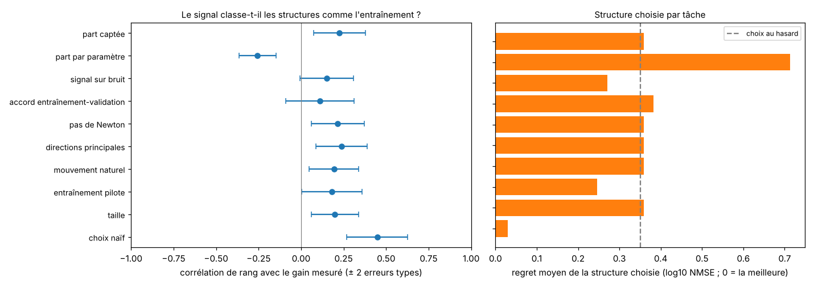
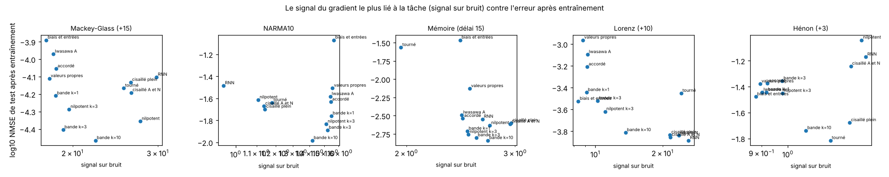
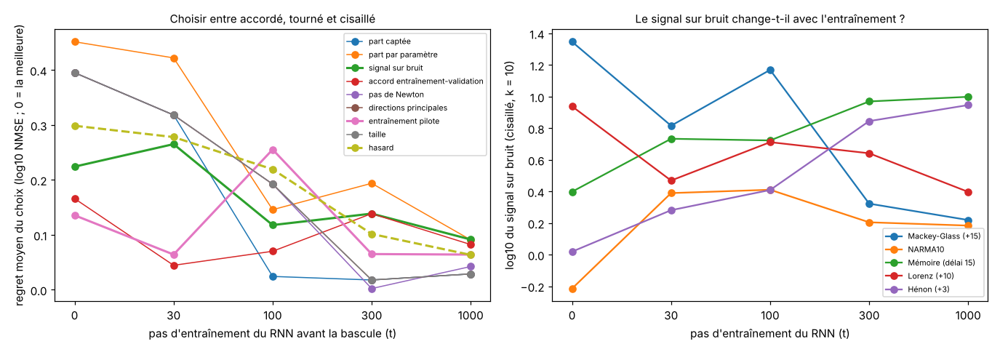
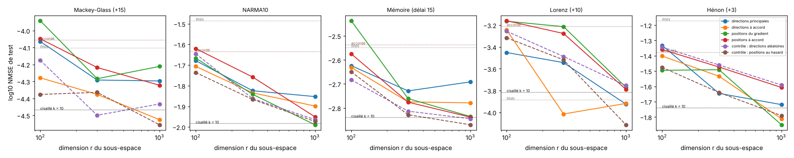
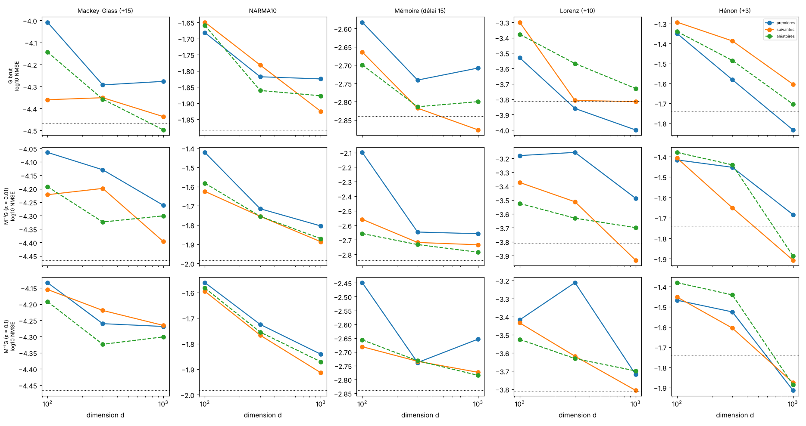
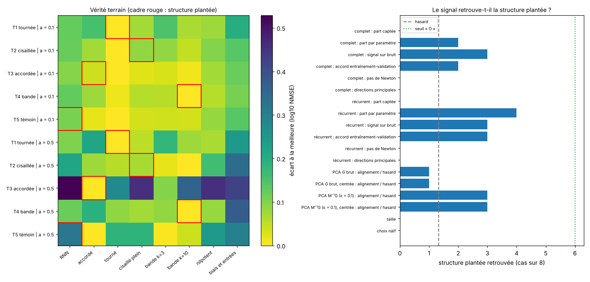
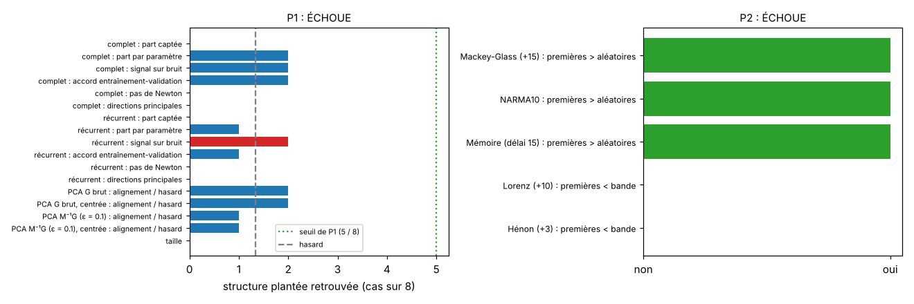

[Contents](../README.en.md#the-report) · [← Part 8](8_synthese.md) · [Appendix →](annexe_pistes.md) · [Français](../rapport/9_structure.md)

# Part 9 — Can the task choose its structure?

> **What to remember**
>
> - Parts 1 to 8 fix by hand what the recurrence learns (rotate, tune, shear), and the best structure changes from one task to another. This part looks for a signal, measured on the data, that says which structure to learn: the gradient of the loss, projected on the tangent space of each structure.
> - **The gradient does not say it.** At the start, its signals rank the structures like their mere size, and the naive choice ("the structure that is best on average on the other tasks") does clearly better. Probing later in training does not help: the task-specific information that appears at 100 steps does not give good choices, and what is at stake in the choice vanishes as the RNN learns.
> - **Nor does it designate a subspace.** Directions taken from the gradient, including the eigendirections of the covariance of the tangent `M⁻¹G` (a Lie decomposition learned on the task), do no better than random directions of the same dimension, and the order of unfreezing by eigenvalues does not matter. This covariance is almost rank one.
> - **Even when the structure is planted in the task, and reachable, neither the gradient nor training recovers it.** On teachers built for each structure, no signal recovers the planted structure, including on fresh seeds. More surprising: at equal budget and with early stopping, the planted structure almost never wins its own task; the bands win, a few hundred coefficients near the diagonal.
> - **In one sentence: ease of learning beats the geometry of the target, even when the exact solution lies in the family.** Performance depends on the number of coefficients learned in the recurrence and on how easy they are to learn, not on their location nor on the geometry of the target. Two promising leads (the signal-to-noise ratio of the gradient, the first gradient directions on Lorenz and Hénon) were checked on fresh seeds: both fell.

## 9.1 The question

Each family of parts 1 to 7 wins on its own tasks: the rotated reservoir on Hénon, the banded shear on Mackey-Glass, NARMA10
and memory, the full RNN on Lorenz (at 100 neurons). Nothing says in advance which one to choose. The idea of this part is to
let training decide: start from a reservoir and unfreeze only the pieces of the recurrence that "want" to learn, or start from
an RNN and freeze the others. This requires a quantity, measured on the data, that says which piece to go to; and this
quantity must reflect a tendency of the task, not the noise of a batch.

**The frame: the decomposition of the Lie algebra.** Parts 4 to 6 each learn one factor of a decomposition of the group of
invertible matrices (K·A·K, K·A·N, Jordan-Chevalley). A gradient does not live in the group but in its Lie algebra, `gl(n)`,
the space of all N×N matrices. The Iwasawa decomposition takes its infinitesimal form there: `gl(n) = so(n) ⊕ a ⊕ n`, every
matrix being written uniquely as a skew-symmetric part (rotation), a diagonal part (amplitudes) and a strictly triangular part
(shear). Each structure learns, to first order, a subspace `T_s` of `gl(n)`: its **tangent space** at `W₀`.

| Structure | Tangent space at `W₀` (recurrent part) | Dimension at 100 neurons |
|---|---|---|
| Tuned | `U·diag(δ)·Vᵀ`: the singular amplitudes | 100 |
| Rotated | `ΩW₀ − W₀Ω`, `Ω` skew-symmetric: the rotation | 4,950 |
| Sheared | `Q·T`, `T` strictly triangular: the N factor | 4,950 |
| Banded shear k | same, `T` restricted to the k superdiagonals | about k·N |
| Nilpotent | semisimple part (modulus and phase of the eigenvalues) and triangle `T` in a random orthogonal basis | 5,050 |
| RNN | all of `gl(n)` | 10,000 |
| Biases and inputs only | nothing in the recurrence | 0 |

All structures also learn `W_in` and the biases (200 more dimensions). The decomposition `so(n) ⊕ a ⊕ n` is direct but **not
orthogonal** (a skew-symmetric matrix and a triangular matrix are not orthogonal in the Frobenius sense). The "energies" of the
three parts of a gradient therefore do not add up; each structure is treated separately, through the orthogonal projection
`P_s` on its tangent space. The orthonormal bases of the `T_s` are obtained from the Jacobian `∂W/∂θ_s` (autograd on the model
itself, exact formula for the rotated reservoir), and checked: orthonormality, stability of the projection, dimension equal to
the number of parameters. The nilpotent reservoir is the exception (5,050 for 5,150 parameters): its semisimple part has two
parameters per eigenvalue, i.e. 200, but only 100 real degrees of freedom. The phase of a real eigenvalue changes nothing to
first order (its derivative, `Re(iλ)`, is zero), and the two eigenvalues of a complex conjugate pair only count through the
sum of their perturbations.

## 9.2 The ground truth

Thirteen structures (the nine of part 5 at 100 neurons, the bands k = 1, 3 and 10, the banded nilpotent and the reservoir with
learned biases and inputs), five tasks, 3 seeds, 1,500 steps; the log10 of the test NMSE is kept.

| log10 test NMSE | Mackey-Glass | NARMA10 | Memory | Lorenz | Hénon |
|---|---|---|---|---|---|
| RNN | −4.10 | −1.49 | −2.55 | **−3.89** | −1.17 |
| Tuned | −4.05 | −1.63 | −2.54 | −3.21 | −1.38 |
| Rotated | −4.17 | −1.64 | −1.57 | −3.45 | **−1.82** |
| Eigenvalues (Jordan-Chevalley, semisimple) | −4.11 | −1.51 | −2.13 | −2.96 | −1.38 |
| Nilpotent | −4.36 | −1.61 | −2.63 | −3.84 | −1.04 |
| Iwasawa, amplitudes A | −3.97 | −1.58 | −2.49 | −3.10 | −1.44 |
| Full shear | −4.13 | −1.70 | −2.60 | −3.83 | −1.68 |
| Sheared A and N | −4.19 | −1.67 | −2.62 | −3.86 | −1.24 |
| Band k = 1 | −4.21 | −1.76 | −2.71 | −3.44 | −1.44 |
| Band k = 3 | −4.40 | −1.89 | −2.80 | −3.52 | −1.36 |
| Band k = 10 | **−4.47** | **−1.98** | **−2.84** | −3.81 | −1.74 |
| Banded nilpotent, k = 3 | −4.29 | −1.83 | −2.76 | −3.62 | −1.45 |
| Biases and inputs only | −3.89 | −1.07 | −1.46 | −3.53 | −1.48 |

The best structure is the band k = 10 on three tasks, the RNN on Lorenz, the rotated reservoir on Hénon. The gap between the
best and the median is 0.24 to 0.37 in log10: the structures differ clearly, but not enormously.

## 9.3 What the gradient says at the start

At the starting reservoir (zero biases, `W_in` and `W₀` drawn), a ridge readout is fitted on the training states; the loss is
the training loss (squared error on windows of 60 steps). The gradient `G_i = ∂L_i/∂(W, W_in, b)` is computed on 128 training
windows (first 75 % of the training part) and 128 validation windows (next 25 %), and projected on each tangent space.

| Signal | Definition | What it tests |
|---|---|---|
| Captured share | `‖P_s(ḡ)‖² / ‖ḡ‖²` | which share of the steepest descent the structure can follow |
| Share per parameter | same, divided by the dimension | the same thing, without the advantage of size |
| Signal-to-noise ratio | `‖P_s(ḡ)‖²` divided by the variance of the mean over windows | a direction stable from one window to the next is learned, noise is overfitted |
| Train-validation agreement | cosine between `P_s(ḡ)` on training and on validation | does what the structure will learn generalize? |
| Newton step | `ḡᵀ(F_s + λI)⁻¹ḡ`, `F_s` empirical Fisher in the structure | the predicted decrease, accounting for curvature |
| Principal directions | share of the first 10 principal directions of the gradients within `T_s` | does the structure contain the directions the loss explores? |
| Natural motion | `‖P_s(ΔW)‖² / ‖ΔW‖²`, `ΔW` = trained RNN − start | where an RNN that learns everything goes (costs one training) |
| Pilot training | validation error after 100 steps of the structure | expensive baseline |
| Size | dimension of the structure | naive baseline |
| Naive choice | mean rank of the structure on the four other tasks | baseline |

**Evaluation.** For each task and each seed, the rank correlation (Spearman) between the signal and the measured gain, over the
thirteen structures; then the structure chosen per task (mean rank over seeds) and its **regret**, the gap in log10 NMSE to the
best. Finally, to isolate the **task-specific** information: signal and gain are double-centred (the mean of each structure and
that of each task are removed) then correlated; a signal that only measures size or the general difficulty of a task is zero
there. The p-value is obtained by permuting the structures within each task (2,000 permutations).

| Signal | Rank correlation | Good choices | Mean regret | Task-specific information (r; p) |
|---|---|---|---|---|
| Captured share | +0.23 ± 0.08 | 1 / 5 | 0.36 | +0.14; 0.37 |
| Share per parameter | −0.26 ± 0.05 | 0 / 5 | 0.71 | +0.14; 0.31 |
| **Signal-to-noise ratio** | +0.15 ± 0.08 | 1 / 5 | 0.27 | **+0.34; 0.02** |
| Train-validation agreement | +0.11 ± 0.10 | 0 / 5 | 0.38 | −0.03; 0.87 |
| Newton step | +0.21 ± 0.08 | 1 / 5 | 0.36 | −0.25; 0.09 |
| Principal directions | +0.24 ± 0.08 | 1 / 5 | 0.36 | −0.15; 0.31 |
| Natural motion | +0.19 ± 0.07 | 1 / 5 | 0.36 | +0.25; 0.06 |
| Pilot training (100 steps) | +0.18 ± 0.09 | 1 / 5 | 0.25 | +0.07; 0.69 |
| Size | +0.20 ± 0.07 | 1 / 5 | 0.36 | — |
| **Naive choice** | **+0.45 ± 0.09** | **3 / 5** | **0.03** | — |
| Random | 0 | | 0.35 | |

- **No gradient signal does better than size.** Captured share, Newton step, principal directions and natural motion have the
  same correlation as the dimension of the structure (0.19 to 0.24) and choose the RNN on all five tasks: a good choice on
  Lorenz, a regret of 0.3 to 0.6 elsewhere. Dividing by the dimension reverses the bias without correcting anything: the share
  per parameter chooses everywhere the reservoir with learned biases and inputs, the worst structure on three tasks. The reason
  is simple: for a gradient with no privileged direction, the captured share is on average dim(T_s)/D, D being the dimension of
  the full space. A signal that does not beat this ratio says nothing about the task.
- **The 100-step pilot training does no better** (0.18): it only finds the rotated reservoir on Hénon. The first 100 steps do
  not say who will be ahead after 1,500.
- **The naive choice wins by far**: the band k = 10 is the best or nearly so everywhere (regret of 0.07 on Lorenz, 0.08 on
  Hénon). At this size, knowing which structure works in general is worth more than anything the gradient says about the task.
- **A lead**, the signal-to-noise ratio: once the effects of structure and task are removed, it remains linked to the gain
  (r = 0.34, p = 0.02). With eight signals tested, the Bonferroni correction requires p < 0.006: it is not established. A
  gradient direction coherent from one example to the next is the one that generalizes (gradient coherence, Chatterjee, 2020);
  it is the lead followed in the rest of the part (9.4, 9.6, 9.7).

**What the gradient sees** (means over tasks and seeds):

| Structure | Dimension | Captured share | Signal-to-noise ratio | Train-valid. agreement | Natural motion |
|---|---|---|---|---|---|
| RNN | 10,200 | 1.00 | 12.2 | 0.19 | 1.00 |
| Nilpotent | 5,250 | 0.59 | 11.3 | 0.17 | 0.59 |
| Full shear | 5,150 | 0.51 | 10.7 | 0.14 | 0.59 |
| Rotated | 5,150 | 0.45 | 10.8 | 0.09 | 0.50 |
| Band k = 10 | 1,145 | 0.26 | 8.2 | 0.08 | 0.22 |
| Band k = 3 | 494 | 0.21 | 6.9 | 0.04 | 0.16 |
| Tuned | 300 | 0.19 | 6.5 | 0.03 | 0.16 |
| Biases and inputs only | 200 | 0.19 | 6.2 | 0.01 | 0.14 |

- **The biases and `W_in` carry 19 % of the starting gradient** on their own. The structures with about a hundred recurrent
  parameters (tuned, Iwasawa A, eigenvalues, band k = 1) add almost nothing to it: at the start, the gradient of the recurrence
  falls almost entirely outside their tangent spaces. Yet these structures clearly beat the reservoir with learned biases and
  inputs on Mackey-Glass, NARMA10 and memory: their gain is built during training, not at the first step.
- **The mean gradient is poorly reproducible**: the agreement between training and validation does not exceed 0.19, and the
  signal-to-noise ratio falls towards 1 on NARMA10 and Hénon (against 8 to 30 on Mackey-Glass and Lorenz), i.e. a mean gradient
  of the same order as its uncertainty.
- **The natural motion follows the captured share**: a trained RNN moves in each structure roughly in proportion to what the
  starting gradient puts there. It does not say better than the captured share which one to choose.

**Related work.** Choosing what to train from gradients taken at the start is an active field, always on individual parameters
or layers, never on structured subspaces of a recurrent matrix:
- the **FISH mask** ([Sung et al., NeurIPS 2021](https://ar5iv.arxiv.org/html/2111.09839)) keeps the k parameters with the
  largest Fisher information (diagonal, empirical, computed once before training) and matches full fine-tuning on GLUE with
  0.5 % of the parameters;
- **surgical fine-tuning** ([Lee et al., 2022](https://ar5iv.labs.arxiv.org/html/2210.11466)) chooses the layers to tune
  according to the type of data shift; its automatic criterion by relative gradient norm beats full fine-tuning but not the
  best manual choice;
- the **zero-cost proxies** of architecture search ([Abdelfattah et al., ICLR 2021](https://alphaxiv.org/abs/2101.08134))
  predict the final ranking of architectures from a single batch, with a rank correlation up to 0.82 on NAS-Bench-201. Here, no
  signal exceeds 0.24, below the naive choice.

These three works were only read through their abstract or excerpts.

## 9.4 Probing later in training

If the gain of a structure is built during training, perhaps the signal is built too. The RNN trains for t steps (t = 0, 30,
100, 300, 1,000); at each t, the question is asked again from the state reached `(W_t, W_in,t, b_t)`: which structure should be
learned from here on? Five structures (RNN, tuned, rotated, banded shear k = 10, biases and inputs only) are re-decomposed on
`W_t`, their biases start from `b_t`, and the six gradient signals are measured at `W_t`, as well as the pilot training (100
steps from `W_t`). The real gain is the log10 test NMSE after 500 steps of each structure from `W_t`. Five tasks, 3 seeds.

**The best structure changes with t, and what is at stake in the choice melts away.**

| t | Mackey-Glass | NARMA10 | Memory | Lorenz | Hénon | Mean gap between the best and the worst of the three families |
|---|---|---|---|---|---|---|
| 0 | sheared | sheared | sheared | sheared | rotated | 0.56 |
| 30 | rotated | sheared | sheared | sheared | rotated | 0.56 |
| 100 | rotated | sheared | sheared | sheared | rotated | 0.52 |
| 300 | rotated | rotated | tuned | rotated | rotated | 0.21 |
| 1,000 | sheared | sheared | rotated | sheared | rotated | 0.11 |

At the start, the sheared reservoir wins everywhere except on Hénon, as in 9.2; among the five structures, the RNN wins Lorenz
up to t = 100. After 300 RNN steps, the ranking gets mixed. After 1,000 steps, the three families are within 0.12 of each other
on four tasks (0.29 on Hénon): once the RNN is well advanced, the choice hardly matters any more.

**Choice among the three families** (good choices out of 5 tasks / mean regret in log10):

| Signal | t = 0 | t = 30 | t = 100 | t = 300 | t = 1,000 |
|---|---|---|---|---|---|
| Captured share | 1 / 0.40 | 2 / 0.32 | 3 / 0.02 | 4 / 0.02 | 2 / 0.03 |
| Share per parameter | 0 / 0.45 | 1 / 0.42 | 1 / 0.15 | 1 / 0.19 | 0 / 0.09 |
| Signal-to-noise ratio | 2 / 0.22 | 1 / 0.27 | 2 / 0.12 | 1 / 0.14 | 1 / 0.09 |
| Train-validation agreement | 3 / 0.17 | 4 / 0.04 | 2 / 0.07 | 1 / 0.14 | 0 / 0.08 |
| Newton step | 1 / 0.40 | 2 / 0.32 | 2 / 0.19 | 4 / 0.00 | 1 / 0.04 |
| Principal directions | 1 / 0.40 | 2 / 0.32 | 2 / 0.19 | 4 / 0.02 | 2 / 0.03 |
| Pilot training (100 steps) | 3 / 0.14 | 4 / 0.06 | 1 / 0.26 | 2 / 0.07 | 2 / 0.06 |
| Size | 1 / 0.40 | 2 / 0.32 | 2 / 0.19 | 4 / 0.02 | 2 / 0.03 |
| Random | 1.7 / 0.30 | 1.7 / 0.28 | 1.7 / 0.22 | 1.7 / 0.10 | 1.7 / 0.06 |

- **No signal durably chooses better than chance.** Regrets fall with t for every signal, random included (from 0.30 to 0.06):
  it is the gap between families that melts away, not the choice that improves.
- **The signals that follow size** mostly choose the rotated reservoir, the largest of the three (5,150 dimensions, against
  1,145 for the band and 300 for the tuned reservoir); their 4 good choices out of 5 at t = 300 come from the rotated reservoir
  winning four tasks there.
- **Train-validation agreement and pilot training do better at the beginning** (3 and 4 good choices out of 5 at t = 0 and
  30), then get lost. The pilot is the only one of the two that costs a training run.

**Task-specific information** (signal and gain double-centred, among the five structures; r, p by permutation):

| Signal | t = 0 | t = 30 | t = 100 | t = 300 | t = 1,000 |
|---|---|---|---|---|---|
| Captured share | −0.19; 0.47 | +0.36; 0.14 | **+0.70; 0.003** | +0.29; 0.25 | +0.38; 0.18 |
| Signal-to-noise ratio | −0.11; 0.67 | +0.46; 0.08 | **+0.78; < 0.001** | −0.26; 0.24 | −0.53; 0.07 |
| Train-validation agreement | +0.03; 0.92 | +0.25; 0.50 | **+0.74; 0.015** | −0.28; 0.27 | −0.15; 0.33 |
| Newton step | +0.03; 0.93 | +0.35; 0.11 | **+0.62; 0.002** | +0.34; 0.14 | −0.38; 0.05 |
| Principal directions | +0.06; 0.82 | +0.28; 0.31 | −0.02; 0.95 | +0.45; 0.06 | +0.51; 0.08 |
| Pilot training | +0.36; 0.18 | **+0.58; 0.02** | +0.56; 0.05 | +0.32; 0.16 | +0.01; 0.97 |

- **At t = 100, four gradient signals carry task-specific information** (r = 0.62 to 0.78), and only at that moment. With 35
  tests, the Bonferroni correction requires p < 0.0014: the signal-to-noise ratio passes (r = 0.78, p < 0.001), as does the
  share per parameter (same r as the captured share, the division by the dimension disappearing in the double centring).
- **But it does not give good choices**: at t = 100, the signal-to-noise ratio finds the best of the three families on only
  2 tasks out of 5. Decomposing the correlation, **64 % comes from the two structures that are not families** (biases and
  inputs only, 41 %; RNN, 23 %). Restricted to the three families, it falls to 0.62 (p = 0.045, not significant after
  correction), and even after removing from each structure its mean on the other tasks before choosing, the signal finds the
  best family only once out of 5. What it sees is when the reservoir with biases and inputs only, or the RNN, will do better
  or worse than usual, not which of the three families wins.
- At the start (t = 0), the signal-to-noise ratio does not recover the lead of 9.3: r = −0.11, against 0.34 with thirteen
  structures and 1,500 steps.

## 9.5 Letting the gradient designate the subspace

If the gradient does not choose among structures fixed in advance, perhaps it directly says which directions of `gl(n)` to
learn. For a dimension r (100, 300, 1,000; 1,000 = as many coefficients as the band k = 10), `W = W₀ + Σ θ_j V_j` is learned in
a subspace taken from the gradient at the start, with the biases and `W_in` as always.

**Free subspaces.**

| Subspace | Definition |
|---|---|
| Principal directions | the first r (uncentred) principal directions of the gradients of 1,280 training windows |
| Agreement directions | among them, the r whose mean component is large and of the same sign on training and on 256 validation windows |
| Gradient positions | the r coefficients of W with the largest mean gradient (the equivalent of the FISH mask) |
| Agreement positions | the r coefficients with the largest product of the mean training and validation gradients |
| Control: random directions | random orthonormal subspace (the "intrinsic dimension" of Li et al., 2018) |
| Control: random positions | r coefficients drawn at random (the "learned in W₀" control of part 5) |

Gap to the random control of the same type and the same dimension (log10 NMSE, negative = better; mean over the five tasks, in
brackets the number of tasks where the method wins; 3 seeds):

| Method | r = 100 | r = 300 | r = 1,000 |
|---|---|---|---|
| Principal directions | −0.01 [2/5] | +0.02 [2/5] | +0.02 [2/5] |
| Agreement directions | −0.03 [3/5] | −0.08 [2/5] | −0.07 [3/5] |
| Gradient positions | +0.17 [1/5] | +0.13 [0/5] | +0.13 [2/5] |
| Agreement positions | +0.16 [0/5] | +0.14 [0/5] | +0.16 [0/5] |

- **Directions taken from the gradient are worth random directions**: the gaps (−0.08 to +0.02) are of the same order as the
  standard deviation between seeds (0.02 to 0.09 on Mackey-Glass, NARMA10 and memory, 0.17 on Hénon, 0.27 on Lorenz).
- **Positions taken from the gradient are worse than random positions** (3 wins out of 15 task × dimension pairs for the
  largest gradient, 0 out of 15 with agreement). They concentrate on a few neurons:

  | Positions | r | Rows of W touched (receiving neurons) | Share of positions in the 10 most touched rows | Columns touched |
  |---|---|---|---|---|
  | Largest gradient | 100 | 17 | 90 % | 36 |
  | Agreement | 100 | 22 | 80 % | 32 |
  | Random | 100 | 64 | 29 % | 64 |
  | Largest gradient | 1,000 | 59 | 45 % | 79 |
  | Agreement | 1,000 | 72 | 37 % | 83 |
  | Random | 1,000 | 100 | 16 % | 100 |

  The starting gradient concentrates on the rows of a few neurons, and so do the positions it chooses; random positions modify
  almost all neurons. It is a correlation, compatible with "better to touch all neurons a little than a few neurons a lot",
  without proving it. The chosen positions do not favour the nonzero coefficients of `W₀` (10 % of them, as at random).
- **The dimension matters, the form does not.** From r = 100 to 1,000, most subspaces gain 0.2 to 0.5 in log10, controls
  included. At r = 1,000, random positions do as well as the band k = 10 (−0.09 on average, 4 tasks out of 5), which extends
  the control of part 5.5.

**A Lie decomposition learned on the task.** All the decompositions of the previous parts (SVD, K·A·N, Schur) are splittings
of `gl(n)` chosen for their mathematical elegance, not for their alignment with the loss. The "right" splitting would be
determined by the geometry of the loss seen from the starting matrix, and this geometry can be probed:

1. from the starting reservoir, the tangent vector `X_k = M⁻¹G_k` is computed for each batch (the multiplicative gradient flow,
   `W = W₀·exp(X)`, hence `ΔW = W₀·X` to first order), with `M = W₀`;
2. the covariance of the tangents `C = E[X_k ⊗ X_k]` is formed;
3. it is diagonalized: its principal eigendirections are the directions the loss wants to explore, and the hierarchy of the
   eigenvalues (the stiffnesses) says in which order to unfreeze the blocks.

`M = W₀` is nearly singular (smallest singular value of order 2·10⁻⁴ at 100 neurons): `M⁻¹` is regularized,
`X = (MᵀM + λI)⁻¹MᵀG` with `λ = (ε·σ_max)²`, for ε = 0.01 and 0.1; the raw gradient (`X = G`) serves as a third variant. The
(uncentred) covariance is estimated on 2,560 training windows. At d = 100, 300 and 1,000 coefficients, the first d
eigendirections, the next d (ranks 1,000 and beyond) and d random directions are compared; then the first 1,000 directions are
unfrozen in ten blocks of 100, one block every ~136 steps, in decreasing order of eigenvalues, in random order, or in
increasing order. Five tasks, 3 seeds.

**The covariance of the tangents is almost rank one:**

| Task | Tangent | Share of the trace in the 1st direction | in the first 5 | λ₂ / λ₁ | λ₅ / λ₁ |
|---|---|---|---|---|---|
| Mackey-Glass | raw `G` | 0.80 | 1.00 | 0.23 | 0.003 |
| Mackey-Glass | `M⁻¹G`, ε = 0.01 | 0.85 | 1.00 | 0.16 | 0.002 |
| NARMA10 | raw `G` | 0.81 | 0.97 | 0.10 | 0.015 |
| NARMA10 | `M⁻¹G`, ε = 0.01 | 0.83 | 0.98 | 0.11 | 0.011 |
| Memory | raw `G` | 0.35 | 0.91 | 0.80 | 0.13 |
| Memory | `M⁻¹G`, ε = 0.01 | 0.43 | 0.95 | 0.67 | 0.07 |
| Lorenz | raw `G` | 0.71 | 0.99 | 0.28 | 0.010 |
| Lorenz | `M⁻¹G`, ε = 0.01 | 0.72 | 0.99 | 0.28 | 0.010 |
| Hénon | raw `G` | 0.44 | 0.93 | 0.50 | 0.15 |
| Hénon | `M⁻¹G`, ε = 0.01 | 0.51 | 0.95 | 0.40 | 0.11 |

Two to five directions carry 90 % of the trace; the hundredth eigenvalue is more than 10,000 times smaller than the first. The
"hierarchy of stiffnesses" therefore reduces to a few directions: the first block of 100 contains the whole structured part,
and the other nine are distinguished only by estimation noise. It is not just the mean gradient: on the planted tasks of 9.6,
the centred covariance keeps the same share of the trace in its first direction as the uncentred one, within 0.01.

Mean gaps (log10 NMSE, negative = the first line is better; mean over the five tasks, [wins]):

| Tangent | Comparison | d = 100 | d = 300 | d = 1,000 |
|---|---|---|---|---|
| raw `G` | first − random | +0.01 [3/5] | −0.04 [2/5] | −0.01 [2/5] |
| | first − next | +0.02 [3/5] | −0.03 [3/5] | +0.00 [2/5] |
| `M⁻¹G`, ε = 0.01 | first − random | +0.23 [1/5] | +0.16 [1/5] | +0.13 [0/5] |
| | first − next | +0.20 [1/5] | +0.15 [0/5] | +0.19 [0/5] |
| `M⁻¹G`, ε = 0.1 | first − random | +0.06 [1/5] | +0.08 [2/5] | +0.03 [2/5] |
| | first − next | +0.06 [1/5] | +0.10 [2/5] | +0.05 [2/5] |

| Tangent | Decreasing unfreezing − random order | Decreasing unfreezing − increasing order | Decreasing unfreezing − same directions without unfreezing |
|---|---|---|---|
| raw `G` | +0.07 [0/5] | −0.03 [1/5] | −0.01 |
| `M⁻¹G`, ε = 0.01 | −0.02 [4/5] | +0.04 [2/5] | −0.02 |
| `M⁻¹G`, ε = 0.1 | −0.07 [4/5] | +0.04 [2/5] | −0.04 |

- **On average, the first eigendirections beat neither the next ones nor random directions.** With the raw gradient, the gaps
  are zero; with the multiplicative tangent, the first directions are worse (+0.03 to +0.23), and strong regularization
  (ε = 0.1) brings it almost back to the raw gradient.
- **The order of unfreezing does not matter**: the gaps (−0.07 to +0.07) are below the standard deviation between seeds (0.04
  to 0.24 depending on the task), and progressive unfreezing does no better than learning the 1,000 directions from the start.
- **But the mean hid two groups of tasks.** With the raw gradient, on the two tasks where the band does not win, the first
  directions beat random directions, the next ones, and even the band k = 10 with the same number of coefficients:

  | Task | Best fixed structure (9.2) | First − random (d = 100, 300, 1,000) | First − next | First (d = 1,000) − band k = 10 |
  |---|---|---|---|---|
  | Mackey-Glass | band k = 10 | +0.14; +0.06; +0.22 | +0.35; +0.06; +0.16 | +0.19 |
  | NARMA10 | band k = 10 | −0.02; +0.04; +0.05 | −0.03; −0.04; +0.10 | +0.16 |
  | Memory | band k = 10 | +0.12; +0.07; +0.09 | +0.08; +0.08; +0.17 | +0.13 |
  | Lorenz | RNN | −0.15; −0.29; −0.27 | −0.23; −0.05; −0.18 | −0.19 |
  | Hénon | rotated | −0.01; −0.10; −0.13 | −0.06; −0.19; −0.23 | −0.10 |

  The same pattern is found with the principal directions of the free subspaces (−0.20, −0.06, −0.17 on Lorenz; +0.01, −0.19,
  −0.13 on Hénon; positive on the three other tasks), but on the same reservoirs: it is not an independent confirmation. It was
  the first result of the part where the gradient seemed to say something that a fixed structure does not. It was noticed
  after the fact; it is checked on fresh seeds in 9.7, and it does not hold there.

## 9.6 Tasks whose structure is known

The previous sections show that the gradient does not say which structure to learn on our tasks. But nothing says that these
tasks have a structure to find. Here, the structure is planted in a teacher, and reachable by construction: if the gradient
does not recover it even there, the conclusion becomes general; if it does, the previous failure comes from the tasks.

**The teachers.** A network of 100 neurons, with the same `W_in` as the student and zero biases, whose matrix departs from the
starting reservoir `W₀` of the student by a distance fixed in advance, `‖W_teach − W₀‖_F = a·‖W₀‖_F`:

| Task | Teacher matrix | Expected structure |
|---|---|---|
| T1 rotated | `e^{cΩ} W₀ e^{−cΩ}`, Ω random skew-symmetric | rotated |
| T2 sheared | `Q(R + cS)`, S random strictly triangular | full shear |
| T3 tuned | `U diag(σ ⊙ e^{cz}) Vᵀ`, z random | tuned |
| T4 band | `Q(R + cS)`, S restricted to the first 10 superdiagonals | band k = 10 |
| T5 control | `W₀ + cP`, P random dense | RNN |

(Q, R: QR of `W₀`; U, σ, V: its SVD, with the conventions of the students.) The input is i.i.d., `u_t ~ N(0; 0.5²)`, over
4,000 steps; the output is a fixed random readout of the teacher's state, standardized, plus measurement noise at 30 dB (NMSE
floor: 10⁻³, i.e. −3 in log10). The student predicts `y_t` from `u_≤t`. Eight structures learn; the signals choose among the
six recurrent structures other than the RNN. The oracle (reservoir frozen at the teacher's matrix, readout only) reaches the
noise floor in every case (−2.95 to −3.05): the construction is correct.

**Two first amplitudes, a = 0.1 and a = 0.5** (1,500 steps, no early stopping, 3 seeds). The criterion, fixed before seeing the
results: a signal is "Y" if it recovers the planted structure in at least 6 of the 8 cases (T1 to T4 × two amplitudes),
"partial" from 3 to 5, "N" otherwise; chance finds 1.3.

| Case | Oracle | Classic reservoir | Best structure | Expected structure | Does the expected one win? |
|---|---|---|---|---|---|
| T1, a = 0.1 | −2.99 | −2.93 | rotated (−2.66) | rotated | yes |
| T2, a = 0.1 | −3.01 | −2.80 | rotated (−2.69) | full shear (−2.61) | no |
| T3, a = 0.1 | −2.95 | −2.76 | rotated (−2.70) | tuned (−2.66) | no |
| T4, a = 0.1 | −2.98 | −2.86 | band k = 10 (−2.74) | band k = 10 | yes |
| T5, a = 0.1 | −3.00 | −2.81 | rotated (−2.72) | RNN (−2.61) | no |
| T1, a = 0.5 | −2.99 | −2.44 | rotated (−2.62) | rotated | yes |
| T2, a = 0.5 | −2.99 | −1.29 | band k = 10 (−1.87) | full shear (−1.80) | no |
| T3, a = 0.5 | −2.99 | −0.45 | tuned (−0.93) | tuned | yes |
| T4, a = 0.5 | −2.97 | −1.73 | band k = 10 (−2.18) | band k = 10 | yes |
| T5, a = 0.5 | −3.00 | −1.26 | tuned (−1.63) | RNN (−1.31) | no |

- **At a = 0.1, training degrades.** The classic reservoir, frozen at `W₀`, is already 0.06 to 0.2 from the floor, and every
  trained structure does *worse* than it (by 0.06 to 0.5). Yet the frozen reservoir lies in the space of each structure, at
  zero parameters: it is not the geometry that is missing, it is training (1,500 Adam steps without early stopping) that adds
  its own noise.
- **At a = 0.5, the planted structure wins three tasks out of four** (T1, T3, T4), but no structure comes close to the oracle:
  the best stays 0.4 to 2.1 above the floor. On T2, the band k = 10, a subspace of the full shear, beats the full shear; on T5,
  with no structure, the tuned reservoir wins and the RNN is last.

| Signal (planted structure recovered out of 8 cases) | Full (W, `W_in`, b) | Recurrent only (W) |
|---|---|---|
| Captured share | 0 / 8 | 0 / 8 |
| Share per parameter | 2 / 8 | 4 / 8 |
| Signal-to-noise ratio | 3 / 8 | 3 / 8 |
| Train-validation agreement | 2 / 8 | 3 / 8 |
| Newton step | 0 / 8 | 0 / 8 |
| Principal directions | 0 / 8 | 0 / 8 |
| PCA of the covariance of the tangents (alignment of the 1st direction / chance), raw `G` | 1 / 8 | |
| PCA, `M⁻¹G` (ε = 0.1) | 3 / 8 | |
| Size | 0 / 8 | |

- **No signal gets "Y".** The signals that follow size choose the nilpotent reservoir, the largest of the six, in almost every
  case. The first eigendirection of the PCA is no more inside the tangent space of the expected structure than chance would
  have it (ratio of 0.6 to 1.1).
- **The partial successes do not hold from one seed to another.** On the first complete seed, the recurrent signal-to-noise
  ratio recovered 4 cases, including the rotated, the sheared and the tuned at a = 0.1; with three seeds, it recovers 3, and
  they are no longer the same. The task-specific information is nowhere significant after correction for sixteen signals.
- **But neither regime is the one where the question has an answer**: at a = 0.1 the task is already solved by the frozen
  reservoir, at a = 0.5 the planted structure is not reached. This is the subject of the next section.

## 9.7 The two leads, checked on fresh seeds

Two questions remained open: the intermediate regime of the planted tasks, where the structure matters and can be learned, and
the first gradient directions on Lorenz and Hénon. Both are taken up again on seeds that had not been used for anything, with a
criterion fixed before running the computation.

**Training.** For all the planted tasks, the same budget for all structures: 3,000 steps, validation error every 100 steps and
return to the best point (early stopping).

**The intermediate regime.** On a separate seed (seed 3), the smallest a in {0.2; 0.3; 0.4} is sought such that, on each of
the tasks T1 to T4, (i) the frozen reservoir is more than 0.5 from the floor, and (ii) the planted structure beats each of the
others by at least 0.1. **No amplitude satisfies both conditions**:

| Condition that fails (number of tasks out of 4) | a = 0.2 | a = 0.3 | a = 0.4 |
|---|---|---|---|
| (i) frozen reservoir too close to the floor | 3 | 2 | 1 |
| (ii) planted structure that does not win by 0.1 | 4 | 4 | 3 |
| Mean lead of the planted structure | −0.02 | +0.01 | +0.04 |

It is almost always (ii) that fails: even when there is something to learn, the planted structure does not beat the others. On
T1, at a = 0.2 and 0.3, early stopping returns to step 0 for every structure: no training improves validation over the frozen
reservoir. The amplitude where the planted structure has the largest lead, a = 0.4, is kept, along with the next one, a = 0.5.

**On the test seeds, the planted structure still does not win** (seeds 4, 5, 6; lead of the planted structure over the best of
the others, in log10; positive = it wins):

| Case | Classic reservoir − oracle | Best structure | Lead of the planted one |
|---|---|---|---|
| T1 rotated, a = 0.4 | +0.22 | band k = 3 | −0.06 |
| T1 rotated, a = 0.5 | +0.56 | rotated | +0.03 |
| T2 sheared, a = 0.4 | +0.82 | band k = 10 | −0.07 |
| T2 sheared, a = 0.5 | +0.99 | band k = 10 | −0.06 |
| T3 tuned, a = 0.4 | +1.03 | band k = 10 | −0.01 |
| T3 tuned, a = 0.5 | +1.48 | band k = 10 | −0.10 |
| T4 band, a = 0.4 | +1.26 | band k = 10 | +0.02 |
| T4 band, a = 0.5 | +1.44 | band k = 3 | −0.00 |
| T5 control, a = 0.4 | +0.71 | band k = 10 | −0.08 |
| T5 control, a = 0.5 | +1.19 | band k = 3 | −0.04 |

In seven of the eight planted cases, there is something to learn (the frozen reservoir is more than 0.5 from the floor), and
yet the planted structure clearly wins none of them. It is the bands, from 294 to 945 coefficients, that win nine cases out of
ten, including against the exact structure: on T3 at a = 0.5, the tuned reservoir, which contains the teacher exactly with
100 parameters, ends 0.10 behind the band k = 10.

**The signal-to-noise ratio.** The expectation was that the signal-to-noise ratio of the gradient, restricted to the
recurrence, would recover the planted structure in at least 5 of the 8 cases (T1 to T4, a = 0.4 and 0.5; chance finds 1.3,
and 5 or more by chance has a probability of about 0.5 %). **That is not what happened: 2 cases out of 8.** It recovers the
rotated and the full shear at a = 0.4, nothing at a = 0.5; elsewhere it mostly chooses the full shear or the band k = 3,
whatever the planted structure. No other signal exceeds 2 cases out of 8. In any case, since the planted structure clearly wins
no case, a signal that recovered it would have gained nothing.

**The first gradient directions.** The expectation was that, with d = 1,000 and the protocol of 9.5, the first eigendirections
of the gradient would beat the band k = 10 on Lorenz and Hénon, and do worse than random directions on the three other tasks.
**That is not what happened on Lorenz and Hénon** (seeds 3, 4, 5):

| Task | First − band k = 10 | First − random | Expected | Obtained? |
|---|---|---|---|---|
| Mackey-Glass | +0.13 | +0.16 | worse than random | yes |
| NARMA10 | +0.11 | +0.03 | worse than random | yes, barely |
| Memory | +0.13 | +0.09 | worse than random | yes |
| Lorenz | +0.22 | −0.16 | better than the band | no |
| Hénon | +0.01 | +0.05 | better than the band | no |

On fresh seeds, the first gradient directions beat the band neither on Lorenz nor on Hénon: the lead of 9.5 came from seeds 0
to 2. (Seed 3 serves both for tuning the amplitude and for this check, but on different tasks, planted on one side and real on
the other.)

**Description, without a test** (seeds 3 to 5):

| Task | Share of the displacement of a trained RNN in the first 1,000 directions (chance: 0.10) | Stable rank of ΔW | Departure from normality of `W₀ + ΔW` (Henrici; `W₀`: 0.73) | Participation ratio of the covariance |
|---|---|---|---|---|
| Mackey-Glass | 0.40 | 4.0 | 0.72 | 1.3 |
| NARMA10 | 0.25 | 6.0 | 0.70 | 1.7 |
| Memory | 0.26 | 3.8 | 0.73 | 4.8 |
| Lorenz | 0.45 | 2.2 | 0.74 | 1.8 |
| Hénon | 0.35 | 2.7 | 0.77 | 3.5 |

What the full RNN learns is of lower rank on Lorenz and Hénon (stable rank of 2.2 and 2.7, against 3.8 to 6.0), and the first
gradient directions capture 25 to 45 % of its displacement, four times more than chance. The departure from normality does not
distinguish the tasks. Since the expected effect is not there, there is nothing to explain.

## 9.8 Assessment of part 9

**What the part establishes.**

| Question | Answer, at 100 neurons |
|---|---|
| Does the gradient at the start rank the structures? | no, no better than their size; the naive choice wins |
| And later in training? | no for the choice; the task-specific information that appears at t = 100 concerns the reservoir with biases and inputs and the RNN, not the families; what is at stake in the choice melts away with t |
| Does the gradient designate a subspace? | no: the directions it designates are worth random directions, the positions it designates are worse than random positions |
| A learned Lie decomposition (PCA of the tangent `M⁻¹G`)? | no: the covariance is almost rank one, the order of unfreezing does not matter, and the lead on Lorenz and Hénon does not hold on fresh seeds |
| Does the gradient recover a structure planted in the task? | no, in none of the four regimes tested |
| Does training recover it? | rarely: at equal budget and with early stopping, the planted structure clearly wins no case of the test seeds; the bands win |

**The main result is not the one that was sought: ease of learning beats the geometry of the target, even when the exact
solution lies in the family.** The question was whether the gradient sees the structure; the clearest answer concerns the
ground truth itself. When a structure is planted in the task and the student that carries it contains the teacher exactly, it
is not the one that learns best in finite time: the bands do, a few hundred coefficients near the diagonal of the basis Q.
What decides the winning structure is therefore not the geometry of the target, but ease of learning: few coefficients, each
with a local and well-conditioned effect. A signal looking for the geometry of the target would, under these conditions, ask a
question that training does not answer. This is consistent with the rest of the report: part 5.5 already showed that random
coefficients do as well as the band, and section 9.5 that no choice of directions beats chance at equal dimension.

**What remains solid from start to finish**: on the tasks where the band wins, performance depends on the number of
coefficients learned in the recurrence (from 100 to 1,000, 0.2 to 0.5 in log10), not on their location.

**A method, as much as a result.** Two leads emerged along the way, and both were followed up to a test that could make them
fall:
- the **signal-to-noise ratio** of the gradient: a lead at the start (r = 0.34), task-specific information at t = 100 (but not
  on the families), 4 cases out of 8 on the first seed of the planted tasks, 3 over three seeds, then 2 out of 8 on fresh
  seeds;
- the **first gradient directions on Lorenz and Hénon**: spotted after the fact, found again on the same reservoirs with
  another estimate, then absent on fresh seeds.

Each time, the lead weakened with every new independent measurement, until it disappeared. Without the fresh seeds, the part
could have concluded to two effects that do not exist.

**The limits.**
- 100 neurons, 3 seeds per experiment: the gaps between methods (less than 0.1 on average) are of the same order as the
  standard deviation between seeds. The negative conclusions concern effects of this size; a much smaller effect would go
  unnoticed.
- The signals are first order, or second order for the Newton step; a signal that integrates training (pilot training) does
  better at the very beginning of training, but costs a training run.
- The multiplicative tangent is regularized; the chosen regularization (ε = 0.01 and 0.1) is only one choice among others.

**The link with existing work.** That gradient descent happens in a small subspace spanned by the top directions of the
Hessian is observed on classification networks ([Gur-Ari et al., 2018](https://alphaxiv.org/abs/1812.04754)), with a subspace
that stabilizes after a few steps; here, at the start, this subspace has only a few directions and is not enough to guide
learning. Conversely, that a random subspace of sufficient dimension is enough to learn a task is the result on intrinsic
dimension ([Li et al., 2018](https://alphaxiv.org/abs/1804.08838)), which part 9 recovers. These two works were only read
through their abstract.

---

[Contents](../README.en.md#the-report) · [← Part 8](8_synthese.md) · [Appendix →](annexe_pistes.md)
